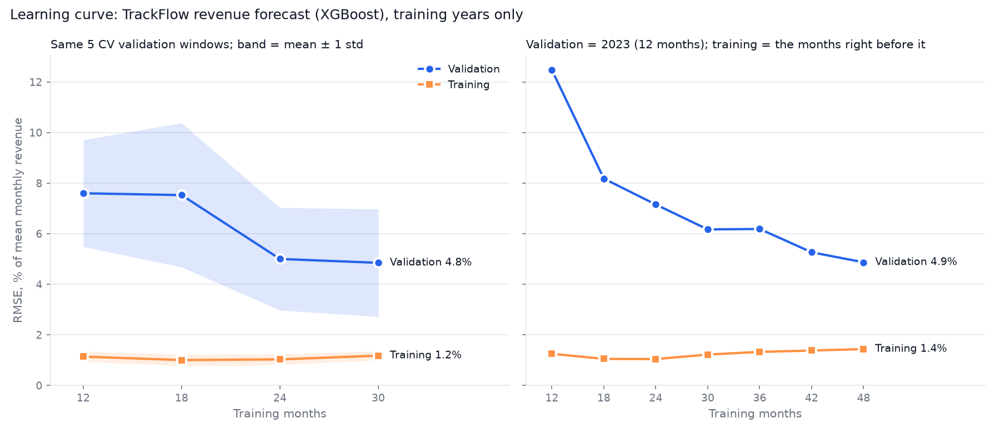

# Sales forecast: technical evaluation

Ticket: formal technical evaluation before promotion to staging. The model under evaluation is the monthly revenue forecast in [`scripts/sales_forecast.py`](../../scripts/sales_forecast.py): XGBoost (XGBRegressor) on revenue_eur / trailing-12-month mean, parameters `max_depth=2`, `n_estimators=200`, `learning_rate=0.03`, 17 causal features (see [`docs/SALES_FORECAST.md`](../../docs/SALES_FORECAST.md)).

Data: `data/raw/trackflow_sales.csv`, `consolidated` rows, target `revenue_eur`. **Only the training years 2016-2023 were used; the 2024-2025 test years were not read**, so they remain a clean final check. Generated by [`scripts/evaluate_sales_forecast.py`](../../scripts/evaluate_sales_forecast.py); every number below is in [`sales_forecast/evaluation.json`](sales_forecast/evaluation.json).

## Verdict: **overfitting**

| Ticket question | Answer |
|---|---|
| 1. Underfitting, overfitting or well fitted? | **Overfitting.** In cross-validation the validation error is 3.4× the training error (4.51% vs 1.34% RMSE of mean monthly revenue). At the largest learning-curve size it is 3.4×, and the validation error was still falling (7.5% in the last step) when the history ran out. It is not underfitting: the model beats a seasonal-naive rule in 4 of 5 folds. |
| 2. How stable when the training portion changes? | Validation RMSE 4.51 ± 0.97% across 5 folds (range 3.04-5.71%, coefficient of variation 22%). The *direction* of the error follows the growth year, the briefing's alternating 9%/3% pattern: 2021-07..2021-12 -0.1% (year growth 8.0%); 2022-01..2022-06 +2.1% (year growth 2.8%); 2022-07..2022-12 +3.2% (year growth 2.8%); 2023-01..2023-06 -3.2% (year growth 10.1%); 2023-07..2023-12 -3.8% (year growth 10.1%). |
| 3. Specific corrective action | **Trees of depth 1 and 9 compact features.** On the same folds the validation RMSE goes 4.51% → 4.25% (-6%), its spread across folds 0.97 → 0.44 pp (-55%), and the gap 3.4× → 1.5×. Proposed, not applied; see section 5. |

## 1. Time-aware cross-validation

**Splitter:** sklearn TimeSeriesSplit(n_splits=5, test_size=6), expanding window, no shuffle, over the 60 usable training months (2019-01 to 2023-12). The first 36 months (2016-2018) are warm-up: the lag and seasonal features need three years of history before the first usable row.

Why 6-month validation windows: 5 × 6 months leaves fold 1 with 30 training months. sklearn's default sizing (60 ÷ 6 = 10 validation months) would leave fold 1 with only 10, too few to say anything about fit.

**Validation mode:** one month ahead from measured history, the same task as the training fit, so the training/validation gap measures over-fitting and nothing else. The error of the real use (a recursive forecast feeding on its own predictions) is reported next to it in every fold.

| Fold | Training months | n | Validation months | Chronology | Leakage checks |
|---|---|---|---|---|---|
| 1 | 2019-01 → 2021-06 | 30 | 2021-07 → 2021-12 | pass | 3/3 pass |
| 2 | 2019-01 → 2021-12 | 36 | 2022-01 → 2022-06 | pass | 3/3 pass |
| 3 | 2019-01 → 2022-06 | 42 | 2022-07 → 2022-12 | pass | 3/3 pass |
| 4 | 2019-01 → 2022-12 | 48 | 2023-01 → 2023-06 | pass | 3/3 pass |
| 5 | 2019-01 → 2023-06 | 54 | 2023-07 → 2023-12 | pass | 3/3 pass |

**No mixing or shuffling.** `assert_chronological` refuses any fold whose training and validation months are not one contiguous, increasing run (training ends the month before validation starts, with no gap and no overlap). It also refuses any validation window that does not start after the previous fold's window ends. The unit test `test_temporal_folds_preserve_chronological_order` checks the same rules independently.

**No leakage across the fold boundary.** A lag or rolling feature computed on the full series can still read a later fold. Three checks run on every fold:

- every month after the fold's last training month is multiplied by 3, and the training rows (features, base and label) must not change;
- the training rows built from the full series must equal the ones built from the series cut at the boundary, which is what the evaluation trains on;
- for each validation month *t*, months *t* and later are multiplied by 3, and its features must not change.

All pass, because every feature is built with `shift(≥1)` before any window. The detrending base is the mean of the 12 *previous* months, there are no centred windows or full-series statistics, and the `StandardScaler` is refitted inside each fold's `Pipeline`.

**Results per fold** (shipped model; RMSE and MAE as % of that set's mean monthly revenue):

| Fold | Validation | Train MAE | Train RMSE | Val MAE | Val RMSE | Val RMSE % | Val bias | Recursive RMSE % | Naive RMSE % |
|---|---|---|---|---|---|---|---|---|---|
| 1 | 2021-07 → 2021-12 | €9,629 | €11,784 | €32,207 | €34,190 | 3.04% | -0.07% | 3.37% | 4.00% |
| 2 | 2022-01 → 2022-06 | €9,802 | €11,869 | €37,371 | €44,128 | 4.27% | +2.14% | 3.84% | 6.31% |
| 3 | 2022-07 → 2022-12 | €10,283 | €12,488 | €60,198 | €65,566 | 5.71% | +3.16% | 5.40% | 4.11% |
| 4 | 2023-01 → 2023-06 | €12,144 | €14,710 | €40,429 | €52,608 | 4.70% | -3.17% | 4.22% | 4.99% |
| 5 | 2023-07 → 2023-12 | €13,816 | €16,724 | €53,829 | €62,029 | 4.83% | -3.78% | 4.64% | 6.20% |
| **mean ± std** | | €11,135 ± €1,801 | €13,515 ± €2,150 | €44,807 ± €11,742 | €51,704 ± €12,881 | 4.51 ± 0.97% | -0.34 ± 3.10% | 4.30 ± 0.77% | 5.12 ± 1.11% |

Bias is signed: total forecast minus total actual, over total actual. Positive means over-forecast. *Naive* is the seasonal-naive rule anyone can check: the same month last year × the growth of the last 12 months, from months before *t* only. Std uses ddof = 1.

## 2. Learning curve



Two views of the same question: what happens to the training and validation error as the model sees more history?

- **Left, CV windows:** the same 5 validation windows at every size. Each fold trains on the *n* months right before its window (`TimeSeriesSplit` with `max_train_size=n`), so only the amount of history changes. The largest size is fold 1's 30 months.
- **Right, last training year:** validation is 2023 (12 months, both February and Nov-Dec). Training is the *n* months right before it, up to 48, close to the 60 the shipped model trains on.

| Training months | Train RMSE (CV windows) | Val RMSE (CV windows) |
|---|---|---|
| 12 | 1.14 ± 0.20% | 7.60 ± 2.11% |
| 18 | 1.00 ± 0.22% | 7.53 ± 2.85% |
| 24 | 1.03 ± 0.21% | 5.00 ± 2.03% |
| 30 | 1.18 ± 0.18% | 4.85 ± 2.13% |

| Training months | From | Train RMSE | Val RMSE | Train RMSE (€) | Val RMSE (€) |
|---|---|---|---|---|---|
| 12 | 2022-01 | 1.25% | 12.47% | €13,647 | €149,848 |
| 18 | 2021-07 | 1.05% | 8.18% | €11,580 | €98,260 |
| 24 | 2021-01 | 1.04% | 7.15% | €11,230 | €85,952 |
| 30 | 2020-07 | 1.22% | 6.17% | €13,082 | €74,119 |
| 36 | 2020-01 | 1.33% | 6.19% | €13,853 | €74,329 |
| 42 | 2019-07 | 1.38% | 5.27% | €14,326 | €63,265 |
| 48 | 2019-01 | 1.44% | 4.87% | €14,710 | €58,499 |

**Reading.** The training error stays low and almost flat (1.25% → 1.44%). The validation error starts high and keeps falling (12.47% → 4.87%, still 7.5% lower in the last step from 42 to 48 months). The curves have not met: at 48 months validation is still 3.4× training. A large gap that more data keeps narrowing is the signature of high variance (over-fitting), not of high bias. With high bias, both errors would be high and close together.

## 3. Metrics: MAE and RMSE, training and validation

| | Training | Validation |
|---|---|---|
| MAE (EUR) | €11,135 ± €1,801 | €44,807 ± €11,742 |
| RMSE (EUR) | €13,515 ± €2,150 | €51,704 ± €12,881 |
| MAE (% of mean monthly revenue) | 1.10 ± 0.16% | 3.90 ± 0.88% |
| RMSE (% of mean monthly revenue) | 1.34 ± 0.19% | 4.51 ± 0.97% |

### Which one reflects the business cost: RMSE

The briefing ([`contexts/trackflow-sales-briefing.md`](../../contexts/trackflow-sales-briefing.md)) says TrackFlow bills mainly on **shipment volume**, and that the peaks and valleys are the ones Ana (Warehouse) and Carlos (Carriers) plan for by hand every year. A revenue error is therefore a **workload** error: the forecast is what warehouse staff in Los Angeles and Zaragoza are scheduled against and what carrier capacity is booked against. The two directions of error do not cost the same:

- **Under-forecasting is the expensive error.** Too few operatives and carrier slots, worst of all in Nov-Dec, when revenue runs 25-35% above the average (Black Friday and the holidays). Once planned capacity is exceeded, each extra parcel costs more: overtime, last-minute carrier capacity at peak rates, late deliveries and SLA incidents. Those land on the brands in their most important selling weeks, and client contracts are renewed yearly on whether the operation runs well.
- **Over-forecasting is the cheaper error.** Idle staff hours and unused carrier commitments. The cost is roughly proportional to the miss, bounded, and recoverable the following month.

Because the cost of a miss grows faster than the miss itself, the metric should too. **RMSE squares each error**, so one large miss (a peak month badly under-planned) weighs more than several small ones of the same total. That matches how the cost behaves. **MAE** weighs every euro of error equally, as if a €100k shortfall in December cost the same as ten €10k misses in spring. RMSE is the decision metric for this model. MAE is kept as the plain-language figure ("off by about €45k a month") for Thomas and Ana.

The RMSE/MAE ratio in validation is 1.15. It would be 1.00 if every month missed by the same amount, and √6 ≈ 2.45 if one month of a 6-month window carried all the error. The errors are spread evenly, with no single blow-out month. A rising ratio would warn that misses are concentrating, which is the peak-month risk.

Neither metric sees *direction*, so the report adds the signed bias. In cross-validation, **5 of the 6 Nov-Dec validation months were under-forecast**: the shipped model leans towards the expensive side exactly in the peak. Any future change should be checked on this count as well as on RMSE.

## 4. Diagnosis: **overfitting**

The rule (`classify_fit` in `scripts/sales_forecast_evaluation.py`):

- **overfitting** if validation RMSE ≥ 2.0× training RMSE both in cross-validation and at the largest learning-curve size;
- **underfitting** if the gap is below 1.5× and the model does not beat the seasonal-naive rule, so both errors are high and it has not learned even what a simple rule knows;
- **well fitted** otherwise.

| Check | Measured | Threshold | Result |
|---|---|---|---|
| CV gap: validation ÷ training RMSE | 3.37× | ≥ 2.0× | over-fit signal |
| Learning-curve gap at 48 months | 3.38× | ≥ 2.0× | over-fit signal |
| Last learning-curve step (42 → 48 months) | validation 7.5% lower | ≥ 5% = still improving | still improving: more history would help |
| Beats seasonal-naive rule | 4.51% vs 5.12% RMSE (4/5 folds) | lower is better | yes: not underfitting |

**Root cause.** The shipped model has more capacity than its training data can support. It has 17 features and depth-2 trees, so it can learn pairwise feature interactions, boosted 200 times. It trains on 30 to 60 monthly rows. That capacity lets it fit month-level noise. Its training error (1.34%) is less than half of what the depth-1 variant reaches (2.72%), and that variant validates at least as well. The fit below that level was noise, not signal. The learning curve shows the model would need more history to use its capacity, and there is none: 2016 is the first month on record, and the 36-month warm-up already uses 3 of the 8 training years. The fix is therefore to shrink capacity to what about 60 rows support. "Add more data" is not possible, and "increase complexity" would widen the gap.

## 5. Corrective action

Every candidate below is a way to shrink capacity, scored on the same 5 folds as the shipped model, on the training years only. Selection rule: lowest mean validation RMSE across the 5 folds; candidates within 0.1 pp are tied and the lowest std wins.

| Candidate | Train RMSE | Val RMSE (mean ± std) | Gap | Recursive val RMSE | Val MAE | Beats naive | Nov-Dec under-forecast |
|---|---|---|---|---|---|---|---|
| As shipped: the tuned parameters, all 17 features | 1.34% | 4.51 ± 0.97% | 3.37× | 4.30 ± 0.77% | €44,807 | 4/5 | 5/6 |
| Trees of depth 1 (no feature interactions), all 17 features | 2.72% | 4.35 ± 0.58% | 1.60× | 4.44 ± 0.77% | €44,007 | 4/5 | 5/6 |
| Shipped depth, 9 compact features | 1.61% | 4.35 ± 0.65% | 2.71× | 4.27 ± 0.61% | €43,642 | 4/5 | 4/6 |
| Trees of depth 1 and 9 compact features **(selected)** | 2.91% | 4.25 ± 0.44% | 1.46× | 4.28 ± 0.50% | €43,953 | 4/5 | 5/6 |

**Recommended: Trees of depth 1 and 9 compact features.**

- **Parameters:** `max_depth=1`, `n_estimators=200`, `learning_rate=0.03`.
- **Features (9):** `lag_1_ratio`, `lag_2_ratio`, `lag_3_ratio`, `lag_12_ratio`, `rolling_mean_3_ratio`, `trailing_growth_yoy`, `seasonal_ratio_last_year`, `seasonal_ratio_2y_mean`, `month_cos`.
- **Effect in cross-validation:** validation RMSE 4.51% → 4.25% (-6%). Fold-to-fold spread 0.97 → 0.44 pp (-55%), which answers question 2 directly. Gap 3.37× → 1.46×. Recursive validation RMSE 4.30 ± 0.77% → 4.28 ± 0.50%.
- **Why it targets the root cause:** depth 1 removes feature interactions, so each tree is a single split on one signal. The forecast becomes an additive sum of seasonal, lag and growth effects, which is how the briefing describes the series (growth × seasonality × noise). The compact set keeps each signal once and drops the columns that only restate the calendar month or measure month-to-month volatility, the noise being memorised. Training error rises 1.34% → 2.91% while validation error falls, so the fit it gives up was noise, not signal.

Columns dropped from the compact set:

| Column | Why it can go |
|---|---|
| `is_peak_season` | zero gain; the seasonal ratios already mark Nov-Dec |
| `is_february` | zero gain; the seasonal ratios already mark February |
| `month_of_year` | a second encoding of the calendar month (month_cos is kept) |
| `month_sin` | a third encoding of the calendar month |
| `rolling_mean_6_ratio` | overlaps rolling_mean_3_ratio and the 12-month base |
| `rolling_std_3_ratio` | month-to-month volatility: the noise the model memorises |
| `rolling_std_6_ratio` | month-to-month volatility: the noise the model memorises |
| `rolling_std_12_ratio` | month-to-month volatility: the noise the model memorises |

**What this does not fix.** Two limits remain in every candidate. Neither is over-fitting:

- **The growth year.** The validation bias flips sign with the growth year. It is an over-forecast in low-growth years and an under-forecast in high-growth years (question 2's bias list). From 3 to 5 usable training years the model cannot tell whether the coming year is a 9% or a 3% year. A growth-regime feature or external drivers (clients won or lost) are the way to address it.
- **The peak is flattened.** 5 of 6 Nov-Dec validation months are under-forecast by the shipped model, and 5 of 6 by the recommended one. In 2022-07..2022-12 the half-year as a whole was over-forecast (+3.2%), yet Nov-Dec were still under-forecast (-2.6%). Boosted trees with shrinkage pull the most extreme ratio, the peak, towards the average. Under-forecasting the peak is the expensive error (section 3), so this is the next limit to work on. One option is an asymmetric loss, for example XGBoost's `reg:quantileerror` above the median, which buys peak protection at a known cost in RMSE. That is a business trade-off for Thomas, not part of this fix.

**How to apply it, after approval.** In `scripts/sales_forecast.py`, train with the parameters above on the compact feature list. Re-run `scripts/train_sales_forecast.py` **once** and compare its 2024-2025 metrics with the current [`sales_forecast/metrics.json`](sales_forecast/metrics.json). The test years were not used to choose this action, so that single run is an honest confirmation. Running it repeatedly to tune would turn the test years into a second validation set.

## 6. Caveats

- The shipped parameters were chosen by recursive backtests from origins inside these same training years. The shipped model's cross-validation scores are therefore slightly optimistic.
- The recommended candidate was chosen on the same five folds it is scored on, so its gain is an upper bound. The single test-year run above is the unbiased check.
- The validation windows alternate between H1 (the February dip) and H2 (the Nov-Dec peak), and between low- and high-growth years. The fold-to-fold spread therefore mixes season and growth-year effects with the data-portion effect.
- 60 usable months is a small sample. Differences of a few tenths of a percentage point between candidates are within noise. The ranking is driven by the gap and the spread, which move by much more.

## 7. Reproduce

```bash
# macOS without Homebrew's libomp only:
export DYLD_LIBRARY_PATH="$PWD/.venv/lib/python3.14/site-packages/sklearn/.dylibs"
.venv/bin/python scripts/evaluate_sales_forecast.py
.venv/bin/python -m pytest tests/pipelines/test_sales_forecast_evaluation.py
```

The run is deterministic: a second run rewrites identical files.
