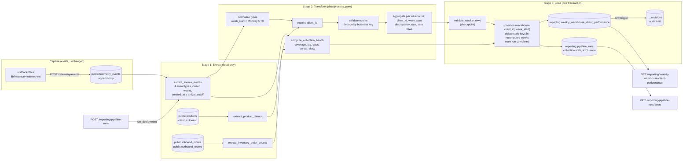

# Weekly Warehouse & Client Performance Pipeline — Design

- Status: **implemented** (Part 2, 2026-10-22). Section 10 maps the code to the phase checklist and lists where it departs from this design
- Date: 2026-10-21 (robustness review 2026-10-22, section 9; implementation 2026-10-22, section 10)
- Branch: `telemetry-tech-report` (design), `pipeline-design` (implementation)
- Scope: sections 1-9 are the approved design. Section 10 records the implementation.
- Source of requirements: [`BRIEFING.md`](../../BRIEFING.md) (business performance pipeline), the tech lead's brief (`lead-instr.png`) and the phase checklist (`stages-todo.png`).
- Builds on: [`docs/telemetry/telemetry-plan.md`](../../docs/telemetry/telemetry-plan.md), [`docs/telemetry/event-schemas.json`](../../docs/telemetry/event-schemas.json), `services/telemetry/` and `services/inventory/`.

## 0. Summary

| Item | Decision |
|---|---|
| Deliverable | The **Weekly Warehouse & Client Performance Report**: one row per warehouse, per client, per ISO week |
| Audience | Daniel Espinoza (CEO) and Ana Whitfield (Head of Warehouse Operations). They need numbers, not raw events |
| Cadence | Weekly, scheduled Monday 06:00 `America/Monterrey` so it is ready before the 07:00 Monday report leadership already expects |
| KPIs | Inbound Volume, Outbound Throughput, Stockout Frequency, Discrepancy Rate |
| Source (read-only) | `public.telemetry_events`, 4 mandatory event types, plus `public.products` to look up the client |
| Destination | `reporting.weekly_warehouse_client_performance`, plus the run log `reporting.pipeline_runs` |
| Idempotency | Every run recomputes whole weeks from a fixed snapshot of the source (`created_at <= arrival_cutoff`) and upserts on `unique (warehouse, client_id, week_start)` in a single transaction. Every change to a published figure is kept in a revisions table |
| Observability | Each run measures its input against the inventory tables (capture coverage), plus arrival lag, gaps, bursts and clock skew, so "no activity", "lost capture" and "never ran" look different |
| Orchestration | Prefect 3: 1 main flow, 9 tasks (8 + the non-critical `write_eval_snapshot`), backfill flow. Entry point `data/pipelines/pipeline.py` |
| API | New `services/reporting/` module with 3 endpoints, separate from `services/telemetry/` and `GET /telemetry/report` |
| Blocking prerequisite | No client is recorded anywhere today. The four events need an additive `client_id` field (section 2.4) |
| Robustness | Section 9 answers the ten robustness checks (idempotency, observability, recoverability, concurrency) and points to the mechanism behind each |

Two parts of the existing system stay as they are. `services/telemetry/analysis.py` and `GET /telemetry/report` keep serving engineering unchanged. `telemetry_events` stays the source and is never this pipeline's destination.

---

## 1. Current state (Phase 1)

Checklist:

- [x] Document what we already have: the events captured, where they are stored, and what the technical report answers for engineering (1.1–1.4)
- [x] Identify the business question the technical report leaves unanswered (1.5)

### 1.1 Telemetry events captured so far

The telemetry plan catalogues 44 events, 12 of them mandatory. Since 2026-10-15 the backoffice captures events through `uis/backoffice/services/telemetry-service.ts`. It emits 28 event types plus `telemetry_dropped`. Events are queued behind `track()` and posted in batches every 10 s or at 20 events, with at most 100 per request and up to 3 retries with exponential backoff. On page hide the queue is sent with `navigator.sendBeacon`.

The pipeline needs exactly the four mandatory inventory events that `BRIEFING.md` section 3 names:

| `event_type` | Emitted today by | Payload fields the pipeline uses | KPI |
|---|---|---|---|
| `inbound_order_created` | Backoffice, `lib/inventory-telemetry.ts::trackOrderCreated`, after the API confirms the order | `product_id`, `sku`, `warehouse`, `quantity`, `order_id` (optional, absent from the frontend) | Inbound Volume |
| `outbound_order_created` | Same | `product_id`, `sku`, `warehouse`, `quantity`, `order_id` (optional) | Outbound Throughput, and the denominator of Discrepancy Rate |
| `stock_threshold_triggered` | Same, only when an outbound order moves a product into a lower band | `product_id`, `warehouse`, `threshold_band` (`low` \| `out_of_stock`), `triggering_order_id` (optional) | Stockout Frequency |
| `inventory_discrepancy_detected` | **Nothing yet.** Its capture point (a reconciliation workflow or WMS connector) does not exist | `reconciliation_id`, `product_id`, `warehouse`, `variance_units`, `count_method`, `source_system` | Numerator of Discrepancy Rate |

All four carry `warehouse` with the enum `Monterrey` | `Zaragoza`, the same values as `services/inventory/models.py::Warehouse`. **None of them carries a client.**

The plan's minimum-stock rule uses the documented display bands: 0 is out of stock, 1–9 is low, 10+ is healthy. "Below the configured minimum" therefore means a crossing into `low` (fewer than 10 units) or `out_of_stock`. No per-product minimum exists in the schema.

### 1.2 Where they are stored

- `POST /telemetry/events` (`services/telemetry/router.py`) validates each event against the `TelemetryEvent` envelope. It stores the valid ones in Supabase PostgreSQL with one `upsert(on_conflict="id", ignore_duplicates=True)`.
- Table `public.telemetry_events` has these columns:
  - `id` uuid PK, equal to `eventId`
  - `timestamp` timestamptz, the event time set by the emitter
  - `event_type` text
  - `payload` jsonb, holding `properties` exactly as sent
  - `tags` jsonb, holding `sessionId`, `userId`, `requestId`, `schemaVersion` and any of `warehouse`, `branch`, `source_system`, `client_app`, `section`
  - `created_at` timestamptz, the server arrival time
- Indexes: `timestamp` DESC, `event_type`, and a GIN index on `tags`. RLS is on with no policies.
- **Append-only.** `services/telemetry/database.py` installs triggers that reject UPDATE, DELETE and TRUNCATE.
- **Per-event `properties` are not validated** against `event-schemas.json` at ingest (progress 2026-10-19, item 2). The pipeline cannot assume, for example, that `quantity` is a positive integer.

### 1.3 What the technical report already answers (for engineering)

`GET /telemetry/report?start_date=&end_date=` (`services/telemetry/report.py` → `analysis.py`) computes the report on request from `telemetry_events`. It defaults to the last 7 days, groups by UTC day and caches the result for 60 s.

| Metric | Engineering question it answers |
|---|---|
| `events_per_day` | Is telemetry flowing, and how busy is the system? |
| `event_type_share` | Which event types dominate each day? |
| `error_rate_by_type` | How often do API calls fail, and why (per `error_class`)? |
| `latency_by_route` | How fast does each route answer (p50/p95/mean/max) and where does it fail? |

This is the engineering team's radar. It stays exactly as it is.

### 1.4 Snapshot of the source (read-only query, 2026-10-21)

| `event_type` | Rows | Days | `warehouse` values | Rows with `client_id` |
|---|---|---|---|---|
| `inbound_order_created` | 2 | 2026-10-19 → 2026-10-20 | `Monterrey` | 0 |
| `outbound_order_created` | 2 | 2026-10-19 → 2026-10-20 | `Monterrey` | 0 |
| `stock_threshold_triggered` | 0 | — | — | — |
| `inventory_discrepancy_detected` | 0 | — | — | — |

`telemetry_events` holds 224 rows in total, all in one ISO week (`week_start` 2026-10-19), which is still open. The `reporting` schema does not exist. **If this pipeline ran today it would load zero rows.** No week has closed yet, and no event can be attributed to a client.

### 1.5 The gap: the business question nothing answers yet

> **How did each warehouse perform for each client last week: how much it received, how much it shipped, how often that client's stock ran low, and how accurate its inventory was?**

Today directors answer this by hand every Sunday evening, at 3–4 hours each, and the data is a day or two old by Monday 10:00 (`contexts/context.md`, Executive Direction). The technical report cannot answer it, for six reasons:

1. It has **no client dimension.** No event records which brand owns the goods.
2. It has **no warehouse breakdown.** It groups by day, event type, error class and route.
3. It **counts events, not business quantities.** Inbound Volume is a sum of `quantity`, not a count of events.
4. It works in **UTC days on demand**, with nothing persisted. There is no ISO-week history to compare week over week.
5. It does not **dedupe by business key or reconcile late events.** It does not need to, for engineering.
6. Its audience is engineers. Its payload (latency percentiles, error classes) is not what a CEO acts on.

That gap needs its own pipeline, with its own schedule, persisted output and an API for the business side.

---

## 2. Pipeline design (Phase 2)

Checklist:

- [x] Purpose in one concrete sentence: deliverable, KPIs, mandatory metrics (2.1, 2.2)
- [x] Extraction format: what arrives, in what shape, how often (2.5)
- [x] Data flow with separate extraction, transformation and load stages (2.6, 2.7)
- [x] Strategy for a source that updates existing records, without duplicates (2.8)
- [x] Destination table under `reporting` with the exact BRIEFING name, plus the new `services/reporting/` endpoints (2.9, 2.10)

### 2.1 Purpose

> Every Monday by 07:00 Monterrey time, produce the rollup behind the **Weekly Warehouse & Client Performance Report** that Daniel Espinoza (CEO) and Ana Whitfield (Head of Warehouse Operations) read instead of the directors' hand-built Sunday report. The rollup gives **Inbound Volume, Outbound Throughput, Stockout Frequency and Discrepancy Rate** per warehouse, per client, per ISO week. It is computed from the mandatory telemetry events `inbound_order_created`, `outbound_order_created`, `stock_threshold_triggered` and `inventory_discrepancy_detected`.

### 2.2 Traceability: KPI → event → stored field

| KPI (BRIEFING §2) | Who acts on it | Source event(s) | Stored field | Rule |
|---|---|---|---|---|
| Inbound Volume | Ana: receiving capacity | `inbound_order_created` | `inbound_units_count` | `sum(payload.quantity)` |
| Outbound Throughput | Ana: picking capacity | `outbound_order_created` | `outbound_orders_count` | `count(*)` of orders, not units |
| Stockout Frequency | Miguel Torres (Commercial): client expectations | `stock_threshold_triggered` | `stockout_events_count` | `count(*)`, both `low` and `out_of_stock` crossings |
| Discrepancy Rate | Ana: which warehouse/client to audit | `inventory_discrepancy_detected` ÷ `outbound_order_created` | `discrepancy_events_count`, `discrepancy_rate` | `discrepancy_events_count / outbound_orders_count`, or 0 when there are no orders |

On Stockout Frequency: a product that drops from 12 to 5 and then to 0 in one week counts 2. A product that drops from 12 straight to 0 counts 1. This follows the emitter, which fires once per band entered.

### 2.3 Vocabulary reconciliation (BRIEFING vs. monorepo)

The tech lead requires the design to use the monorepo's domain vocabulary. Where `BRIEFING.md` differs, this design follows the code:

| BRIEFING says | Monorepo says (source) | This design uses |
|---|---|---|
| `warehouse` = `los_angeles` / `zaragoza` | `Monterrey` / `Zaragoza` (`services/inventory/models.py::Warehouse`, the `warehouse` enum in `event-schemas.json`). Los Angeles was mapped to Monterrey with developer approval for the inventory seed (2026-10-04) | **`Monterrey`, `Zaragoza`**, stored verbatim |
| "Thomas (CEO)" | Daniel Espinoza, founder and CEO (`contexts/context.md`) | **Daniel Espinoza** |
| "Miguel" | Miguel Torres, Commercial and Client Relations | **Miguel Torres** |
| `client_id` | No such concept exists in code, schemas or events | **`client_id`**, introduced additively (2.4) |
| "configured minimum" | Display bands 0 / 1–9 / 10+, `threshold_band` ∈ {`low`, `out_of_stock`} | Crossing into `low` or `out_of_stock` |
| `quantity`, `week_start` (Monday, UTC) | `payload.quantity`; `analysis.py` already groups in UTC | Same |

### 2.4 Prerequisite: the client dimension (additive telemetry extension)

The grain is per `client_id`, and nothing records a client today. The tech lead's brief allows an additive payload field on an existing mandatory event: it extends telemetry and does not rewrite the technical report. The design needs two small changes:

1. **Client ownership on the product (inventory domain).** Add `products.client_id text not null`. In a 3PL warehouse every SKU belongs to one brand client, so the product is the natural owner. The format is a lowercase slug (`^[a-z0-9]+(-[a-z0-9]+)*$`, at most 64 characters), assigned by Commercial and Client Relations, because there is no CRM. The three seeded products need an owner (open question Q1).
2. **Additive event field (telemetry).** Add an optional `client_id` property, same pattern, to the four event types in `event-schemas.json` and `telemetry-plan.md`. Their `schemaVersion` moves from `1.0.0` to `1.1.0`, the plan's rule for "adding an optional property". `lib/inventory-telemetry.ts` copies `product.client_id` into the payload. Optional means every existing event stays valid. The ingest code, `to_row`, `tags` and the technical report do not change.

The pipeline resolves the client of each event in this order:

1. Use `payload.client_id` when present.
2. Otherwise, look up `products.client_id` by `payload.product_id`. This covers the `1.0.0` history and any emitter that has not been updated.
3. Otherwise, **exclude the event** and count it as `missing_client_id` in the run log.

An "unassigned" bucket would mix goods from different clients in one row, which BRIEFING §7 forbids. Exclusions are visible in `GET /reporting/pipeline-runs/latest`. Nothing is dropped silently.

### 2.5 Extraction format and freshness

| | `public.telemetry_events` (primary) | `public.products` (lookup) |
|---|---|---|
| How data arrives | JSON batches over HTTP from the backoffice, stored as rows with jsonb `payload` and `tags` | Rows written by `POST /inventory/products` |
| How often it changes | Continuously: a batch every ≤10 s per active tab, plus a beacon on page hide. Append-only: rows are inserted, never changed | Rarely: on product creation, or a future client reassignment |
| How the pipeline reads it | SQLAlchemy `SELECT` over the `DATABASE_URL` connection, never PostgREST. As `analysis.py` notes, PostgREST's 1000-row default would silently truncate a busy week | `SELECT id, client_id, warehouse FROM products` |
| Filter | `event_type IN (4 types) AND timestamp >= :window_start AND timestamp < :window_end AND created_at <= :arrival_cutoff`, served by the existing `event_type` and `timestamp` indexes | None. The table is small, and every row is needed for the client lookup and the zero rows (2.7) |
| Shape after extraction | Pandas DataFrame, one row per event: `id, timestamp, created_at, event_type, warehouse, client_id, product_id, quantity, order_id, triggering_order_id, threshold_band, reconciliation_id, schema_version`. Fields come out of jsonb as text and are typed and validated in the transform step | DataFrame `product_id, client_id, warehouse` |

Sketch of the extraction query:

```sql
select id, timestamp, created_at, event_type,
       payload->>'warehouse'           as warehouse,
       payload->>'client_id'           as client_id,
       payload->>'product_id'          as product_id,
       payload->>'quantity'            as quantity,
       payload->>'order_id'            as order_id,
       payload->>'triggering_order_id' as triggering_order_id,
       payload->>'threshold_band'      as threshold_band,
       payload->>'reconciliation_id'   as reconciliation_id,
       tags->>'schemaVersion'          as schema_version
from public.telemetry_events
where event_type in ('inbound_order_created', 'outbound_order_created',
                     'stock_threshold_triggered', 'inventory_discrepancy_detected')
  and timestamp >= :window_start
  and timestamp <  :window_end
  and created_at <= :arrival_cutoff;
```

The window covers whole closed ISO weeks: `[Monday 00:00 UTC of the oldest week, Monday 00:00 UTC after the newest week)`. The pipeline never computes the week in progress. A half-finished week would read as a bad week to a non-technical reader.

**Snapshot cutoff.** `arrival_cutoff` is the run's start time, recorded in the run log. The read is bounded by arrival time as well as event time, so a run is reproducible: the same window and cutoff always read the same rows, however many events arrive later. Events that arrive after the cutoff belong to the next run, which detects them (9.3).

The coverage check (9.6) also reads, read-only, the daily order counts per warehouse from `public.inbound_orders` and `public.outbound_orders`. These are the system of record for orders.

Volume: "hundreds of orders every day" across two warehouses comes to roughly 10–20k in-scope events per week. A two-week window fits comfortably in memory, which is why the transform uses Pandas like `analysis.py`. If volume grows by an order of magnitude, the aggregation step can move into SQL without changing the load contract.

### 2.6 Data flow



The three stages are separate units of work with explicit hand-offs (DataFrame in, DataFrame out). Extract only reads. Transform has no I/O at all. Load is the only stage that writes, and it writes only to `reporting.*`.

### 2.7 Transformation rules

These live in `data/process/` as pure Pandas functions, so the main flow, the backfill flow and the tests share them. They follow the `analysis.py` conventions: UTC first, explicit window, no side effects.

1. **Normalize.** Parse `timestamp` as a UTC datetime. Event time is trusted only up to arrival: `effective_time = min(timestamp, created_at)`. A client clock running ahead therefore cannot push an event into a week that had not started when the event arrived. Two events in the source are already stamped 273 s after they arrived. Set `week_start = effective_time.floor('D') - weekday` as a date, which is the Monday in UTC. Cast `quantity` to an integer.
2. **Resolve the client** in the order given in 2.4.
3. **Validate each event.** Exclude and count, by reason:
   - `unknown_warehouse`: not `Monterrey` or `Zaragoza`
   - `invalid_quantity`: inbound `quantity` missing, not an integer, or below 1
   - `missing_client_id`
   - `unknown_threshold_band`

   Ingest does not validate properties, so this step is the pipeline's own defence.
4. **Deduplicate by business key** (see 2.8):

   | Event | Key | Keep |
   |---|---|---|
   | inbound / outbound | `order_id` when present, else `id` (the `eventId`) | first |
   | `stock_threshold_triggered` | `(triggering_order_id, threshold_band)` when present, else `id` | first |
   | `inventory_discrepancy_detected` | `(reconciliation_id, product_id)` | latest `timestamp` (the corrected count) |

   Each event removed here is counted as `duplicate_business_key`, like the exclusions in step 3, and listed by `eventId` in the run's exclusions (3.7).

5. **Aggregate** per `(warehouse, client_id, week_start)`: the sum of inbound quantity, and counts of outbound, threshold and discrepancy events. Outer-combine the four aggregates and fill gaps with 0.
6. **Rate.** `discrepancy_rate = round(discrepancy_events_count / outbound_orders_count, 4)`, or `0` when `outbound_orders_count = 0`. Rounding in the transform makes re-runs produce identical values, which the load relies on to detect unchanged rows. Converting to a percentage is the dashboard's job.
7. **Zero rows.** Every `(warehouse, client_id)` pair that owns at least one product when the run executes gets a row for each computed week, with zeros when nothing happened. Zero is written, not implied. A missing row then means only one thing: that client has no products in that warehouse.
8. **Output** exactly the destination columns, sorted by `week_start, warehouse, client_id`.

**Collection health** (3.7, 9.4–9.6) is computed from the same extracted events and the inventory order counts. It goes to the run log, not the report.

### 2.8 A source whose records change after they were reported

`telemetry_events` cannot be updated in place: its triggers reject UPDATE and DELETE. Three things still have the effect of an update, and each has a concrete answer:

| What happens | Example | Strategy |
|---|---|---|
| **Re-delivered events** | Retry after a 5xx, or an in-flight batch re-sent by beacon (observed 2026-10-19) | Absorbed at ingest: `id = eventId`, so duplicates are ignored. The business-key dedupe in 2.7 step 4 is a second guard for when backend and frontend emitters coexist |
| **Corrections** | A re-count publishes a second `inventory_discrepancy_detected` for the same `(reconciliation_id, product_id)` | The latest event per business key wins. The superseded one is not counted |
| **Late arrivals** | An event whose `timestamp` falls in week W reaches the table after week W was reported: a WMS import or an offline device | **Recompute whole weeks, never increment.** Each scheduled run rebuilds the last `lookback_weeks` closed weeks (default 2) from scratch and upserts. Late events for older weeks are detected and counted (9.3), and the backfill flow rebuilds those weeks. Every changed figure keeps its previous value in the revisions table (3.6) |

The underlying rule: the pipeline never does `stored_count += new_events`. Every `(warehouse, client_id, week_start)` cell is rebuilt from the whole source for its week and written with an upsert on the unique key. Re-reading the same events always yields the same cell, so duplicates are impossible by construction.

The same rule covers mutable sources added later, such as reassigning `products.client_id` or a WMS table with `updated_at`. Find the weeks the changed rows touch, then recompute those weeks through the same upsert path. Recomputing can also make a key disappear, for example when a product moves to another client. That is why the load also deletes keys in the recomputed weeks that the new result no longer contains (3.1).

### 2.9 Destination table

The table name and columns are **exactly** as in `BRIEFING.md` §5. The schema is new. Nothing is ever written to `telemetry_events`.

```sql
create schema if not exists reporting;

create table reporting.weekly_warehouse_client_performance (
  id uuid primary key default gen_random_uuid(),
  warehouse text not null,
  client_id text not null,
  week_start date not null,
  inbound_units_count integer not null default 0,
  outbound_orders_count integer not null default 0,
  stockout_events_count integer not null default 0,
  discrepancy_events_count integer not null default 0,
  discrepancy_rate numeric not null default 0,
  computed_at timestamptz not null default now(),
  unique (warehouse, client_id, week_start)
);
```

Additions that leave the name and columns unchanged:

```sql
-- Integrity: the vocabulary and the grain cannot drift.
alter table reporting.weekly_warehouse_client_performance
  add constraint wwcp_warehouse_ck  check (warehouse in ('Monterrey', 'Zaragoza')),
  add constraint wwcp_week_start_ck check (extract(isodow from week_start) = 1),
  add constraint wwcp_counts_ck     check (inbound_units_count >= 0 and outbound_orders_count >= 0
                                          and stockout_events_count >= 0
                                          and discrepancy_events_count >= 0
                                          and discrepancy_rate >= 0);

-- "All combinations for one week" is the endpoint's query; week_start is the
-- last column of the unique index, so it needs its own.
create index if not exists wwcp_week_start_idx
  on reporting.weekly_warehouse_client_performance (week_start);

-- Same posture as every other table: RLS on, no policies.
alter table reporting.weekly_warehouse_client_performance enable row level security;
```

`computed_at` changes only when a row's figures change (3.1). It answers "when did these numbers last move?" The run log answers "how fresh is the report?"

### 2.10 New endpoints (detail in section 5)

| Purpose | Endpoint |
|---|---|
| KPI query | `GET /reporting/weekly-warehouse-client-performance?week_start=YYYY-MM-DD` |
| Status | `GET /reporting/pipeline-runs/latest` |
| Manual trigger | `POST /reporting/pipeline-runs` |

They live in a new `services/reporting/` module. It does not import from `services/telemetry/`, and `GET /telemetry/report` is untouched.

---

## 3. Resilience and idempotency (Phase 3)

Checklist:

- [x] Idempotency strategy, including a failure during load followed by a re-run (3.1, 3.2, 3.3)
- [x] Execution log: minimum fields and why each one is needed to audit production (3.4)

### 3.1 Idempotency strategy

A run is a pure function of `(window, arrival_cutoff, code_version)` and writes with operations that are safe to repeat:

1. **Deterministic input.** The read is bounded by event time (whole closed weeks) and by arrival time (`created_at <= arrival_cutoff`), and the source is append-only. A re-run with the original cutoff therefore reproduces the original result exactly. A new run with a later cutoff adds only late arrivals, which is exactly what should be picked up. "The same outcome as a clean run" means a clean run over the same snapshot.
2. **Deterministic transform.** It has no clock, no randomness and no I/O. Rates are rounded at a fixed precision.
3. **Upsert on the natural key.** It updates only when a value changed:

   ```sql
   insert into reporting.weekly_warehouse_client_performance as t
     (warehouse, client_id, week_start, inbound_units_count, outbound_orders_count,
      stockout_events_count, discrepancy_events_count, discrepancy_rate)
   values (...)
   on conflict (warehouse, client_id, week_start) do update set
     inbound_units_count      = excluded.inbound_units_count,
     outbound_orders_count    = excluded.outbound_orders_count,
     stockout_events_count    = excluded.stockout_events_count,
     discrepancy_events_count = excluded.discrepancy_events_count,
     discrepancy_rate         = excluded.discrepancy_rate,
     computed_at              = now()
   where (t.inbound_units_count, t.outbound_orders_count, t.stockout_events_count,
          t.discrepancy_events_count, t.discrepancy_rate)
         is distinct from
         (excluded.inbound_units_count, excluded.outbound_orders_count, excluded.stockout_events_count,
          excluded.discrepancy_events_count, excluded.discrepancy_rate)
   returning (xmax = 0) as inserted;   -- true = inserted, false = updated; skipped rows return nothing
   ```

4. **Remove stale keys.** In the same transaction, delete rows whose `week_start` is in the recomputed set but whose key the new result does not contain. Each recomputed week then matches the source exactly.
5. **Proof built in.** Re-running over unchanged data must log `rows_inserted = 0, rows_updated = 0, rows_deleted = 0`. That is both the idempotency test (section 7) and a production signal.
6. **Nothing is overwritten without a record.** A row trigger writes each insert, update and delete, with the old and new figures and the run id, to the revisions table (3.6).
7. **Pooler-safe.** The load uses only transaction-scoped features: `pg_advisory_xact_lock` and `set_config(..., true)`. Those are what the Supabase transaction pooler (port 6543) supports. Session-level locks or settings would fail or leak there.

### 3.2 What happens if the load fails and the run is repeated

The entire load is one PostgreSQL transaction (`engine.begin()`): the upsert, the stale-key delete, and the update that marks the run `completed`. So:

| Failure point | State after the failure | Re-run result |
|---|---|---|
| Before or during the upsert (connection lost, constraint violation) | Rolled back: the table is exactly as before, and the run is still `running`, then marked `failed` by the flow hook | Recomputes the same weeks and loads them completely. Nothing is duplicated, because nothing was written |
| After the upsert, before commit | Rolled back as a whole. No reader ever saw a half-loaded week | Same as above |
| The connection drops during `COMMIT` itself | Committed or not, and the client cannot tell | Read the run row. `completed` means the data committed, because both are in one transaction. Otherwise re-run. The outcome is the same either way |
| After commit, but the process dies before Prefect records success | Data and the run's `completed` status were committed together, so the database is consistent. Prefect may show the flow as `Crashed` | Upserts identical rows: `0 inserted / 0 updated`. Proves the earlier load was complete |
| Extract or transform fails | Nothing written | Re-run as normal |
| The database stays down longer than the retries | Nothing written, and the run log cannot be written either | See 9.7 |

Readers of the API therefore see either last week's complete numbers or this week's complete numbers, never a mix.

The run is marked `completed` inside the data transaction, so in `reporting.pipeline_runs`, `completed` means "the data is committed", and nothing weaker.

### 3.3 Concurrency

A scheduled Monday run and a manual `POST` can overlap. Four layers keep that safe:

1. **API.** `POST /reporting/pipeline-runs` answers `409 Conflict` while a run is `running`, so the common case never reaches Prefect.
2. **Prefect.** The deployment has a concurrency limit of 1 with `collision_strategy: ENQUEUE`. A second flow run waits instead of being dropped, so the Monday run is never lost because someone pressed the button at 05:59. The queued run then recomputes the same weeks, which is harmless (0 changes).
3. **Database, run log.** A partial unique index allows one `running` row per pipeline (3.4). `open_run` is **idempotent per `flow_run_id`**: a retried task, or a retried flow, finds its own row and resumes it instead of colliding with itself. A *different* flow run that loses the race writes a `skipped` row with `blocked_by_run_id` and ends `Cancelled`, without a failure alert.
4. **Database, load.** At the start of the load transaction, `pg_advisory_xact_lock` on a fixed key for this pipeline serializes loads, even when the layers above are bypassed (a manual script). Serializing alone is not enough: a run that read an older snapshot could still load after a newer one and overwrite fresher figures. So after taking the lock, the load checks that no `completed` run covering any of the same weeks has a later `arrival_cutoff`. If one does, the load rolls back and the run is recorded `skipped` with `error_class = 'StaleSnapshot'`.

**Recovery from a crashed run.** A crashed run leaves its row at `running`. Before inserting, `open_run` asks Prefect for the state of the flow run that owns any `running` row. If that flow run is terminal (`Failed`, `Crashed`, `Cancelled`), the row is marked `failed` with `error_class = 'Abandoned'`. If Prefect cannot answer, a row older than the longest possible run counts as abandoned. That limit is about 3 h: 4 attempts × 30 min plus 3 × 15 min retry delays. Age alone is not a safe test, because a flow waiting between retries is still alive.

### 3.4 Execution log

Table `reporting.pipeline_runs` is shared by every future pipeline (BRIEFING §6), keyed by `pipeline_name`.

```sql
create table reporting.pipeline_runs (
  id                          uuid primary key default gen_random_uuid(),
  pipeline_name               text not null,                 -- 'weekly_warehouse_client_performance'
  flow_run_id                 uuid unique,                   -- Prefect flow run; a retried flow resumes its own row
  trigger                     text not null check (trigger in ('schedule', 'manual', 'backfill')),
  triggered_by                uuid,                          -- TinyDB user UUID for manual runs; null otherwise
  status                      text not null check (status in ('running', 'completed', 'failed', 'skipped')),
  blocked_by_run_id           uuid references reporting.pipeline_runs (id),  -- set when skipped
  started_at                  timestamptz not null default now(),
  finished_at                 timestamptz,
  weeks_from                  date not null,
  weeks_to                    date not null,
  arrival_cutoff              timestamptz not null,          -- snapshot: only events with created_at <= this were read
  source_watermark            timestamptz,                   -- max(created_at) of the events read
  events_read                 integer,
  events_excluded             jsonb not null default '{}'::jsonb,  -- {"missing_client_id": 0, "duplicate_business_key": 0, ...}
  rows_inserted               integer,
  rows_updated                integer,
  rows_unchanged              integer,
  rows_deleted                integer,
  weeks_revised               date[] not null default '{}',  -- already-published weeks whose figures changed
  late_events_outside_window  integer,                       -- arrived since the previous run, for weeks older than the window
  telemetry_dropped           integer,                       -- sum of dropped_count reported by emitters in the window
  min_capture_coverage        numeric,                       -- lowest telemetry / inventory-table ratio (9.6)
  quality_status              text check (quality_status in ('ok', 'degraded')),
  error_stage                 text check (error_stage in ('extract', 'transform', 'validate', 'load')),
  error_class                 text,                          -- also 'ConcurrentRun' / 'StaleSnapshot' when skipped
  error_message               text,
  code_version                text,                          -- git commit of the deployed flow
  check (status = 'running' or finished_at is not null),
  check (status not in ('failed', 'skipped') or error_class is not null)
);

create unique index if not exists pipeline_runs_one_running_idx
  on reporting.pipeline_runs (pipeline_name) where status = 'running';
create index if not exists pipeline_runs_latest_idx
  on reporting.pipeline_runs (pipeline_name, started_at desc);
alter table reporting.pipeline_runs enable row level security;
```

Why each field is needed to audit the pipeline in production:

| Field | Question it lets you answer |
|---|---|
| `started_at`, `finished_at` | Did Monday's run happen, and how long did it take? A slowly growing duration warns before the 07:00 deadline is missed |
| `status` | Can the report be trusted right now? `completed` is written in the same transaction as the data, so it never claims data that is not there |
| `weeks_from`, `weeks_to` | Which weeks this run is responsible for. "Most recent computed week" (section 5) is derived from it, and a week with no activity can be told apart from a week that was never computed |
| `events_read`, `source_watermark` | How much input there was, and the latest arrival included. A week with half the usual events, or a watermark stuck in the past, points to a capture or ingest problem rather than a quiet week |
| `arrival_cutoff` | Which snapshot of the source produced the figures. Together with `code_version` it makes any past run reproducible. It is also the boundary that late-event detection measures from |
| `events_excluded` | How many events were left out and why. A rising `missing_client_id` means an emitter lost the field, and a rising `duplicate_business_key` means something is reporting actions twice. The ids are in `pipeline_run_exclusions` (3.7) |
| `weeks_revised`, `late_events_outside_window` | Whether a number leadership already read has changed, and whether late data is waiting outside the window for a backfill (9.3) |
| `telemetry_dropped`, `min_capture_coverage`, `quality_status` | Whether the input was complete: known client-side loss, and the telemetry count measured against the inventory tables (9.6) |
| `blocked_by_run_id` | Why a run did nothing: it lost a race to that run (3.3) |
| `rows_inserted`, `rows_updated`, `rows_unchanged`, `rows_deleted` | What the load did. `updated > 0` on an already-reported week means late data changed a number someone already read. All zero on a re-run proves idempotency |
| `error_stage`, `error_class`, `error_message` | Where and what failed, without reading Prefect logs. Like `report.py`, only the exception class and a fixed message per stage are stored, because a driver message can quote the connection URL. The traceback stays in Prefect's logs |
| `trigger`, `triggered_by`, `flow_run_id` | Who or what started the run, and the link to its full Prefect log. `triggered_by` is the pseudonymous user UUID, never a name or email |
| `code_version` | Which code produced a number, so a past figure can be reproduced or explained after a fix |

A run that fails still keeps its minimum record: the failure hook writes `finished_at`, `status = 'failed'`, the error fields and `events_read` (how many events it had read, null when extraction itself failed). When the run log cannot take that record - the database is unreachable, or the run failed before `open_run` wrote its row - the hook appends the same fields to `data/eval/weekly_warehouse_client_performance/run_log_fallback.jsonl` with the reason, so no run ends without a record. A run that skipped itself already has its row and writes no fallback line.

### 3.5 Data quality checks (the `validate_weekly_rows` task)

The load refuses to start, and the run fails at `error_stage = 'validate'`, if:

- any `(warehouse, client_id, week_start)` appears twice in the output
- any `week_start` is not a Monday, or is not a closed week
- any count is negative, or `discrepancy_rate` disagrees with its two counts
- `warehouse` is outside `Monterrey` / `Zaragoza`

The constraints in 2.9 repeat these checks in the database. The task fails early and with a readable reason. The constraints are the last line of defence.

One check warns instead of failing. If capture coverage for any warehouse-week is outside 0.95–1.05 (9.6), the run still completes, with `quality_status = 'degraded'`. Withholding the numbers would be worse than publishing them with a visible warning.

### 3.6 Audit trail of published figures

```sql
create table reporting.weekly_warehouse_client_performance_revisions (
  id          bigint generated always as identity primary key,
  run_id      uuid not null references reporting.pipeline_runs (id),
  operation   text not null check (operation in ('insert', 'update', 'delete')),
  warehouse   text not null,
  client_id   text not null,
  week_start  date not null,
  old_values  jsonb,                       -- the five figures before; null on insert
  new_values  jsonb,                       -- the five figures after; null on delete
  changed_at  timestamptz not null default now()
);
create index if not exists wwcp_revisions_key_idx
  on reporting.weekly_warehouse_client_performance_revisions (week_start, warehouse, client_id);
alter table reporting.weekly_warehouse_client_performance_revisions enable row level security;
```

- An `AFTER INSERT OR UPDATE OR DELETE` row trigger on the report table writes this table. The load runs `select set_config('reporting.run_id', :run_id, true)` at the start of its transaction. The trigger raises if that setting is missing, so no write can change a figure without a record, including a manual SQL fix.
- The revisions table gets the same append-only guard as `telemetry_events`.
- The upsert skips unchanged rows (3.1), so the trigger fires only for real changes. The history holds what changed, not one copy per run.
- A question like "why did Monterrey's outbound count for the week of 2026-10-12 go from 980 to 985?" is answered by one query: the revision, its run, that run's `late_events_outside_window` and cutoff, and the events behind it (9.5).

### 3.7 Collection health and exclusions

```sql
create table reporting.pipeline_run_collection_stats (
  run_id                  uuid not null references reporting.pipeline_runs (id),
  warehouse               text not null,
  day                     date not null,          -- UTC
  event_type              text not null,
  telemetry_events        integer not null,       -- as extracted, before dedupe
  counted_events          integer not null,       -- after exclusions and dedupe
  inventory_orders        integer,                -- inbound_orders / outbound_orders that day; null for the other two types
  lag_p95_seconds         numeric,                -- created_at - timestamp
  max_gap_minutes         numeric,                -- longest silence between consecutive events that day
  peak_events_per_minute  integer,
  future_dated            integer,                -- timestamp later than created_at
  primary key (run_id, warehouse, day, event_type)
);

create table reporting.pipeline_run_exclusions (
  run_id    uuid not null references reporting.pipeline_runs (id),
  event_id  uuid not null,                        -- telemetry_events.id
  reason    text not null,                        -- same keys as pipeline_runs.events_excluded
  primary key (run_id, event_id)
);
```

Both tables are written in the load transaction and have RLS on with no policies. Section 9 explains what each column detects.

---

## 4. Mapping to Prefect (Phase 4)

Checklist:

- [x] At least one main flow and at least three tasks (extract, transform, load), plus the states that matter (4.1–4.3)
- [x] Configuration and credentials managed as Prefect blocks (4.5)

### 4.1 Flows

| Flow | Parameters | Role |
|---|---|---|
| `weekly_warehouse_client_performance` (main) | `week_start: date \| None = None`, `lookback_weeks: int = 2`, `trigger: str = "schedule"`, `triggered_by: UUID \| None = None` | Without `week_start`, rebuilds the last `lookback_weeks` closed weeks. With `week_start`, rebuilds that one closed week |
| `backfill_weekly_warehouse_client_performance` (optional in Part 1) | `from_week: date`, `to_week: date` | Calls the main flow once per week as a **subflow**, oldest first. This repairs history after a fix or a large late import. Part 3 goes further and splits extract, transform and load into their own subflows |

### 4.2 Tasks (main flow)

| Task | Stage | Calls | Retries | Notes |
|---|---|---|---|---|
| `open_run` | — | `data/pipelines/run_log.py::open_run` | 2 | Idempotent per `flow_run_id`. Sweeps abandoned runs, then inserts or resumes the `running` row and fixes `arrival_cutoff`. Records `skipped` if another run holds the slot (3.3) |
| `extract_source_events` | Extract | SQL in 2.5 | 3, exponential backoff (10 s / 30 s / 90 s) | Read-only. The Supabase pooler has been unreachable before (2026-10-17). `persist_result=False`, so event rows are never written to Prefect result storage |
| `extract_product_clients` | Extract | `SELECT id, client_id, warehouse FROM products` | 3 | Read-only lookup for 2.4 step 2 and the zero rows |
| `extract_inventory_order_counts` | Extract | Daily counts per warehouse from `inbound_orders` / `outbound_orders` joined to `products` | 3 | Read-only. The independent count for capture coverage (9.6) |
| `transform_weekly_rollup` | Transform | `data/process/weekly_rollup.py` | 0 | Deterministic: retrying the same input gives the same failure. Its exclusion list (event ids and reasons) is persisted with the checkpoint key below |
| `compute_collection_health` | Transform | `data/process/collection_health.py` | 0 | Coverage, lag, gaps, bursts, clock skew, late events outside the window, dropped counts (3.7). Persisted with the same cache key as `validate_weekly_rows`, because the load writes it too. Aggregates only |
| `validate_weekly_rows` | Transform → Load gate | `data/process/weekly_rollup.py::validate` | 0 | Checks in 3.5. Always runs: a gate is never served from a cache |
| `load_weekly_rows` | Load | `data/pipelines/weekly_warehouse_client_performance/load.py` | 2 | One transaction: `set_config` run id, advisory lock, stale-snapshot check, upsert, stale-key delete, health and exclusion rows, mark `completed`. Safe to retry because of 3.1 |
| `write_eval_snapshot` | After load, **non-critical** | `pipeline.py` | 0 | Writes the run's validation summary to `data/eval/weekly_warehouse_client_performance/` (totals per week and warehouse, exclusions, load counts, collection health; no per-client figures). Invoked with `return_state=True`: a failure is logged and the run still completes |

As implemented, the checkpoint of 9.7 is the **transform cache** rather than a persisted `validate_weekly_rows`: `transform_weekly_rollup` and `compute_collection_health` persist their results to `data/raw/prefect-results/` under a content key (section 10.3), so a flow retry re-reads the same snapshot and reuses the stored rollup. `compute_collection_health` is invoked with `return_state=True`: if it fails, the figures are still published and the run is marked `degraded` (3.5).

Task timeouts are 300 s each, and the flow timeout is 1800 s. The flow has 3 retries, 15 minutes apart, so it can ride out a short database outage on Monday morning before 07:00 (9.7). A flow retry keeps its `flow_run_id`, so it resumes its own run row (3.3). Database tasks retry only transient errors (lost or refused connection, timeout); a `ProgrammingError` or an integrity violation fails at once. Prefect 3 has no retry condition for flows, so a deterministic failure (validation) also goes through the 3 flow retries and alerts after the last one, about 06:50 for the 06:00 run.

### 4.3 States that matter

| Prefect state | Meaning here | Effect on `reporting.pipeline_runs` | Action |
|---|---|---|---|
| `Scheduled` / `Pending` | Monday run queued | none yet | — |
| `Late` | Scheduled time passed and no worker picked it up | none | **Alert:** the 07:00 report will be stale |
| `Running` | Flow executing | `status = 'running'` (from `open_run`) | Shown by `GET /reporting/pipeline-runs/latest` |
| `AwaitingRetry` / `Retrying` | Transient extract or load failure, at task or flow level | stays `running`. The retry resumes the same row | None, unless retries run out |
| `Completed` | Data committed | `status = 'completed'` (inside the load transaction) | — |
| `Failed` | A task ran out of retries, or validation failed | `on_failure` hook sets `status = 'failed'` with `error_stage`, `error_class` | **Alert** |
| `Crashed` | The worker or infrastructure died | `on_crashed` hook sets `failed`, `error_class = 'Crashed'`. If the hook could not run, the next `open_run` sweep marks it `Abandoned` | **Alert** |
| `Cancelled` | Cancelled by an operator | `on_cancellation` hook sets `failed`, `error_class = 'Cancelled'` | — |
| `Cancelled` (by the flow itself) | It lost a race to another run, or its snapshot is older than a completed run's | `status = 'skipped'`, `error_class = 'ConcurrentRun'` or `'StaleSnapshot'`, `blocked_by_run_id` | None. Expected behaviour, not a failure |

Alerts are Prefect Automations on `Late`, `Failed` and `Crashed` that notify the tech team. Today the team "finds out through a WhatsApp message" (`contexts/context.md`).

### 4.4 Schedule and deployment

**Intended schedule:** every Monday at 06:00 `America/Monterrey` (cron `0 6 * * 1`), rebuilding the last 2 closed ISO weeks. It is one hour before the 07:00 Monday report leadership expects.

As implemented, the deployment is served from the entry point instead of a `prefect.yaml` work pool, so the schedule lives in one place (`pipeline.py`: `SCHEDULE_CRON`, `SCHEDULE_TIMEZONE`, `DEFAULT_LOOKBACK_WEEKS`):

| Setting | Value |
|---|---|
| Deployment | `weekly-warehouse-client-performance/weekly` (Prefect names the flow after its function, with `-`) |
| Schedule | `Cron("0 6 * * 1", timezone="America/Monterrey")` |
| Parameters | `{lookback_weeks: 2, trigger: "schedule"}` |
| Concurrency | `global_limit` 1 with `collision_strategy: ENQUEUE`: a second run waits, it is never dropped |

**Run commands** (from the repository root, with the virtual environment active, or prefixed with `uv run`):

```bash
python data/pipelines/pipeline.py                            # once: the last 2 closed weeks (trigger "manual")
python data/pipelines/pipeline.py --week-start 2026-10-12    # once: one closed week
python data/pipelines/pipeline.py --backfill 2026-09-28 2026-10-12
python data/pipelines/pipeline.py --flow-retries 0           # interactive run without 15-minute flow retries

# Scheduled operation: a Prefect server, then the served deployment pointed at it
prefect server start
PREFECT_API_URL=http://127.0.0.1:4200/api python data/pipelines/pipeline.py --serve
```

The API's `POST /reporting/pipeline-runs` needs the same `PREFECT_API_URL`; without it the endpoint answers 503. The command line validates its arguments before starting a flow (exit code 2), so a bad week never waits out the flow retries.

The ISO week closes at Monday 00:00 UTC, which is Sunday 18:00 in Monterrey and Monday 01:00/02:00 in Zaragoza. The run starts 12 hours after the week closes in UTC. That is ample time for frontend batches, which arrive within seconds.

### 4.5 Blocks and configuration

| Name | Prefect type | Holds | Why a block |
|---|---|---|---|
| `trackflow-reporting-database-url` | `Secret` | SQLAlchemy URL of the Supabase transaction pooler (port 6543, SSL), for a **dedicated `reporting_pipeline` role** | A credential. It must not live in code, flow parameters or logs |
| `trackflow-pipeline-alerts` | Notification block (Slack or email webhook) | Where Automations send `Late` / `Failed` / `Crashed` alerts | Shared by every future pipeline |
| `reporting_lookback_weeks` | Prefect Variable | `2` | Non-secret setting, tunable without a redeploy |

The pipeline does **not** need `SUPABASE_SECRET_KEY`. It never uses PostgREST.

The dedicated role makes "read `telemetry_events` read-only" a guarantee enforced by the database, not a convention:

```sql
grant usage on schema public to reporting_pipeline;
grant select on public.telemetry_events, public.products,
                public.inbound_orders, public.outbound_orders to reporting_pipeline;
grant usage, create on schema reporting to reporting_pipeline;
grant select, insert, update, delete on all tables in schema reporting to reporting_pipeline;
-- no INSERT/UPDATE/DELETE on public.*; the append-only triggers remain a second guard
```

---

## 5. Application integration (Phase 5, design only)

Checklist:

- [x] The three endpoints in `services/reporting/`: status query, manual trigger, KPI query, kept separate from `services/telemetry/` and `GET /telemetry/report` (5.2)
- [x] For each endpoint, the function or flow in `data/pipelines/` it calls. No ETL logic in `services/` (5.2, 5.3)

### 5.1 Module boundaries

```
data/
  raw/
    prefect-results/              # intermediate files: persisted transform results (git-ignored)
  process/
    weekly_rollup.py              # pure Pandas: weeks, normalize, resolve_client, dedupe, aggregate, validate
    collection_health.py          # pure Pandas: coverage, lag, gaps, bursts, skew
  eval/
    weekly_warehouse_client_performance/   # one validation snapshot per run (git-ignored)
  pipelines/
    PIPELINE_DESIGN.md            # this document
    pipeline.py                   # entry point: Prefect flows, tasks, hooks, cache keys, CLI, serve
    reporting_db.py               # the flow's engine: REPORTING_DATABASE_URL, Secret block, DATABASE_URL
    run_log.py                    # reporting.pipeline_runs: open_run, complete_run, skip_run, fail_run, readers
    weekly_warehouse_client_performance/
      schema.py                   # DDL from 2.9, 3.4, 3.6, 3.7 (idempotent, matched by name)
      extract.py                  # read-only SQL from 2.5
      load.py                     # transaction from 3.1
      queries.py                  # get_weekly_performance(engine, week_start)
      trigger.py                  # trigger_run(week_start, triggered_by) -> run_deployment(...)
services/
  reporting/
    models.py                     # Pydantic response contracts only
    router.py                     # HTTP only: parse, call data.pipelines, map errors to status codes
```

`flow.py` became `pipeline.py`: the developer's brief names `data/pipelines/pipeline.py` as the entry point.

- The dependency direction is `services/reporting` → `data/pipelines` → `data/process`. Nothing in `data/` imports `services/`. Functions take an SQLAlchemy engine as an argument: the API passes its shared engine (`services/inventory/database.py::get_engine`), and the flow passes one built from the Secret block.
- `services/reporting/` imports nothing from `services/telemetry/`, and `services/main.py` mounts its router next to the others.
- To be importable, `data/`, `data/pipelines/` and `data/process/` need `__init__.py` files, and `data` must be added to `[tool.hatch.build.targets.wheel].packages` in `pyproject.toml`. `prefect>=3` becomes a dependency.

### 5.2 Endpoints

| Method and path | Purpose | Auth | Calls in `data/pipelines/` | Success | Errors |
|---|---|---|---|---|---|
| `GET /reporting/weekly-warehouse-client-performance` | **KPI query**: what the Part 3 dashboard reads | Bearer (Q6) | `weekly_warehouse_client_performance.queries.get_weekly_performance(engine, week_start)`, and `run_log.latest_completed_week(engine, pipeline_name)` when `week_start` is omitted | 200, BRIEFING §6 shape | 422 if `week_start` is not a Monday or is in the future; 404 if the week was never computed; 503 if the database is unreachable |
| `GET /reporting/pipeline-runs/latest` | **Status query** | Bearer | `run_log.get_latest_run(engine, pipeline_name="weekly_warehouse_client_performance")` | 200, run row (see 5.3) | 404 if the pipeline has never run; 503 |
| `POST /reporting/pipeline-runs` | **Manual trigger** | Bearer; caller's UUID is recorded as `triggered_by` | `weekly_warehouse_client_performance.trigger.trigger_run(week_start, triggered_by)`, which calls Prefect `run_deployment("weekly-warehouse-client-performance/weekly", parameters=..., timeout=0)` and returns without waiting | 202, `{flow_run_id, pipeline_name, week_start, status: "scheduled"}` | 409 if a run is `running`; 422 for an invalid `week_start`; 503 if Prefect is unreachable |

### 5.3 Response contracts

`GET /reporting/weekly-warehouse-client-performance?week_start=2026-10-19`, shaped exactly as in `BRIEFING.md` §6 with the monorepo's warehouse values:

```json
{
  "week_start": "2026-10-19",
  "entries": [
    {
      "warehouse": "Monterrey",
      "client_id": "<client slug>",
      "inbound_units_count": 4200,
      "outbound_orders_count": 980,
      "stockout_events_count": 3,
      "discrepancy_events_count": 2,
      "discrepancy_rate": 0.002
    }
  ]
}
```

- Without `week_start`, the endpoint returns the **most recent computed week**: the latest `weeks_to` of a `completed` run. It does not use `max(week_start)` from the table, because that would skip a week with no activity.
- Every `(warehouse, client_id)` pair that owns products has a row for each computed week, with zeros when nothing happened (2.7). A week that was never computed returns `404`. Leadership can tell "nothing happened" from "not calculated".
- Entries are ordered by `warehouse`, then `client_id`.

`GET /reporting/pipeline-runs/latest`:

```json
{
  "pipeline_name": "weekly_warehouse_client_performance",
  "status": "completed",
  "trigger": "schedule",
  "started_at": "2026-10-26T12:00:03Z",
  "finished_at": "2026-10-26T12:00:41Z",
  "weeks_from": "2026-10-12",
  "weeks_to": "2026-10-19",
  "arrival_cutoff": "2026-10-26T12:00:03Z",
  "last_closed_week": "2026-10-19",
  "stale": false,
  "events_read": 15234,
  "events_excluded": { "missing_client_id": 0, "invalid_quantity": 0, "unknown_warehouse": 0, "duplicate_business_key": 0 },
  "rows_inserted": 6, "rows_updated": 1, "rows_unchanged": 5, "rows_deleted": 0,
  "weeks_revised": ["2026-10-12"],
  "late_events_outside_window": 0,
  "telemetry_dropped": 0,
  "min_capture_coverage": 1.0,
  "quality_status": "ok",
  "error_stage": null, "error_class": null
}
```

`last_closed_week` and `stale` are derived when the endpoint is read. `stale` is true when the latest completed run's `weeks_to` is older than the last closed week, which means the scheduled run is late or failed. A dashboard can show that without knowing Prefect exists.

`flow_run_id`, `triggered_by` and `error_message` stay internal. The endpoint exposes nothing that identifies a person, the same way the incident routes are designed.

---

## 6. Implementation order (next milestone)

1. Answer the open questions in section 8, especially Q1 and Q2.
2. **Telemetry extension (2.4).** Add `products.client_id`. Add the optional `client_id` to the four schemas (`1.1.0`) and to `telemetry-plan.md`. Copy it in `lib/inventory-telemetry.ts`, and pass the inventory call's request id to `track()` so the event links to its `api.timing` log line (9.5). The technical report is untouched. If Q11 is accepted, backend emission replaces the frontend emission of the three order events here.
3. `data/process/weekly_rollup.py` and `data/process/collection_health.py` with unit tests.
4. `schema.py`, `run_log.py`, `extract.py`, `load.py` with opt-in PostgreSQL tests. **Re-inspect the live Supabase schema the same day before running any DDL.** It is also edited by hand.
5. `flow.py`, `prefect.yaml`, the blocks, the `reporting_pipeline` role and the Automations.
6. `services/reporting/` and its API tests, mounted in `services/main.py`.
7. Docs: `memory-bank/techContext.md`, `memory-bank/progress.md`, and a section in `data/pipelines/README.md`.

Status 2026-10-22: steps 3, 4, 6 and 7 are done. Step 2 is done for the product owner only (`products.client_id`); the event field is deferred. Step 5 is done except the `reporting_pipeline` role, the blocks and the Automations. Section 10 has the detail.

## 7. Test plan

| Level | What it proves | How |
|---|---|---|
| Transform unit tests (`data/process`) | Week boundaries (Sunday 23:59:59 UTC vs. Monday 00:00 UTC), client resolution order, each exclusion reason, each dedupe rule (including "latest discrepancy wins"), `discrepancy_rate` with 0 orders, no row mixing two clients | Fixture DataFrames, no database. Same no-loop Pandas style as `tests/test_telemetry_analysis.py` |
| Load idempotency (opt-in PostgreSQL) | Two consecutive runs → second run logs `0 inserted / 0 updated / 0 deleted`. A late event → exactly one row updated. A client reassignment → the stale key is deleted | Isolated `reporting_test_*` schemas, enabled by an explicit test database variable like `INVENTORY_TEST_DATABASE_URL` |
| Failure injection (opt-in PostgreSQL) | An exception after the upsert leaves the table byte-identical and the run `failed`. The re-run loads everything | Patch the load to raise before commit |
| Snapshot reproducibility (opt-in PostgreSQL) | Re-running with the original `arrival_cutoff` after inserting newer events gives the original rows. A later cutoff picks the new events up | Insert events with explicit `created_at` |
| Concurrency (opt-in PostgreSQL) | A retried `open_run` resumes its own row. A second flow run records `skipped`. A load whose `arrival_cutoff` is older than a completed overlapping run's is refused | Two connections, explicit cutoffs |
| Audit trail (opt-in PostgreSQL) | Each insert, update and delete on the report table writes one revision with the run id. A write without `reporting.run_id` set fails | Direct SQL against the test schema |
| Collection health | Coverage, lag p95, max gap, peak per minute, the future-dated clamp, late events outside the window. Includes the real 2026-09-28 case: inventory orders and no events gives coverage 0 | Fixture DataFrames |
| Read-only guarantee | The pipeline role cannot write to `telemetry_events` | Attempt an INSERT as `reporting_pipeline` and expect a permission error |
| API tests (`services/reporting`) | Status codes and shapes in 5.2. `services/reporting` never imports `services/telemetry` | `TestClient` with the `data/pipelines` functions mocked, plus an import check |
| Flow test | Task wiring and state hooks | `prefect_test_harness` with extract and load mocked |

## 8. Risks and open questions

| # | Question / risk | Proposed answer |
|---|---|---|
| Q1 | **Client ownership.** Where does `client_id` come from, who assigns it, what format does it take, and who owns the three seeded products? | `products.client_id` slug assigned by Commercial and Client Relations (Miguel Torres). If two clients can hold the same SKU in one warehouse, the unique key becomes `(client_id, sku, warehouse)` |
| Q2 | **Warehouse vocabulary.** BRIEFING says `los_angeles` / `zaragoza`; the monorepo says `Monterrey` / `Zaragoza` | Use `Monterrey` / `Zaragoza`, as the tech lead requires the monorepo vocabulary. Confirm the BRIEFING example is a template value |
| Q3 | **Discrepancy Rate can exceed 1.** A cycle count can find more discrepancies than the week has outbound orders. It is a ratio, not a true share | Keep the BRIEFING formula, which is the contract, and document it for readers. Revisit if leadership reads it as a percentage of orders |
| Q4 | **No `inventory_discrepancy_detected` emitter exists.** Until a reconciliation capture point ships, Discrepancy Rate is 0 everywhere, which reads as perfect accuracy | The dashboard labels Discrepancy Rate "not yet measured" until the first such event exists. Building the reconciliation endpoint is its own milestone |
| Q5 | **Frontend-emitted events undercount.** Orders created through the API directly (scripts, Swagger, seed) or lost before a tab flushes emit nothing, so Throughput can be lower than the real `outbound_orders`. This shows in the data: the week of 2026-09-28 has 4 orders in the inventory tables (the seed script) and no events | Every run measures it as capture coverage (9.6). Q11 fixes it at the source. During the switch, keep **one emitter per event type** so no order is counted twice |
| Q6 | **Endpoint authorization.** Per-client volumes are commercially sensitive | Bearer token on all three, like `/suppliers` and `/inventory`. No role model exists yet |
| Q7 | **Prefect hosting.** Prefect Cloud or a self-hosted server and worker in `docker-compose.yml`? | Self-hosted server plus process worker in Compose for development. Decide production hosting separately |
| Q8 | **Test traffic shares the table.** E2E and curl rows (for example `tags.sessionId = 0e2e0000-…-c0de`) sit next to real events | Add an environment tag at capture, or purge test rows before go-live (that needs the append-only trigger disabled deliberately) |
| Q9 | **UTC week boundary.** Monterrey activity on Sunday from 18:00 counts in the next week | Accepted per BRIEFING §4 (UTC). Note it in the dashboard |
| Q10 | **CEO name.** BRIEFING says "Thomas"; the monorepo says Daniel Espinoza | This design uses Daniel Espinoza |
| Q11 | **Who emits business events.** `POST /telemetry/events` is public by design, so browser-reported order events can be lost (9.8) or forged with curl, and either would move the CEO's numbers | Emit `inbound_order_created`, `outbound_order_created` and `stock_threshold_triggered` from `record_order`, inside the order's own PostgreSQL transaction, with `order_id` and `eventId = uuid5(order_id, event_type)`. Stop emitting them from the frontend. This changes the convention that telemetry rows are written only through the Supabase client |
| Q12 | **Retention limits recomputation.** The proposed 90-day telemetry purge deletes the events a backfill or a lineage query needs | Backfill and lineage reach back 90 days. Older weeks are final, and their record is the report row plus its revisions |
| Q13 | **Coverage thresholds.** 0.95–1.05 is a starting value | Revisit after four weeks of baseline |

---

## 9. Robustness checks

Checklist (`checks-for-pipeline.png`):

- [x] Idempotency: duplicates at the source (9.1)
- [x] Idempotency: re-run after failure (9.2)
- [x] Idempotency: late events (9.3)
- [x] Observability: silence vs. true absence (9.4)
- [x] Observability: collection traceability (9.5)
- [x] Observability: growth vs. data loss (9.6)
- [x] Recoverability: database outage (9.7)
- [x] Recoverability: frontend buffer (9.8)
- [x] Recoverability: transmission retry (9.9)
- [x] Cross-cutting: concurrent runs (9.10)

Evidence from the live source (read-only queries, 2026-10-22):

| Signal | Value | What it shows |
|---|---|---|
| Inventory orders vs. telemetry events, week of 2026-09-28 | 4 orders in `inbound_orders` / `outbound_orders` (seed script), 0 events | A capture gap. Orders created outside the backoffice emit nothing, so "0 in telemetry" was not "0 activity" |
| Same, week of 2026-10-19, Monterrey | inbound 2 / 2, outbound 2 / 2 | Full coverage for orders created in the backoffice |
| Each of those 4 events matched to a domain order by product, quantity and ±2 min | 4 / 4 | Today the trace back to the order works only by fuzzy matching. There is no `order_id`, and the event's `requestId` is not the order call's `X-Request-Id` |
| Arrival lag `created_at − timestamp`, all 224 events | p50 4.5 s, p95 10.4 s, max 10.7 s | Matches the 10 s flush. A 2-week lookback is generous |
| Future-dated events | 2 (`section_viewed`, `incident_created`), stamped 273 s after they arrived | Client clocks drift, so event time is clamped to arrival (2.7) |
| `telemetry_dropped` | 0 | No known client-side loss so far |

### 9.1 Duplicates at the source

> How do you prevent counting the same action twice in `telemetry_events` and in the business aggregates? Which envelope field is the dedup key, and at which layer?

**The dedup key is the envelope's `eventId`.** It is enforced at the first two layers below, and the later layers protect against what `eventId` cannot catch:

| Layer | Mechanism | Protects against |
|---|---|---|
| Frontend | `eventId` is generated once in `track()`. Retries and the beacon resend the same batch | A retry creating a new identity |
| Ingest (`telemetry_events`) | `id = eventId` primary key, `upsert(on_conflict="id", ignore_duplicates=True)`. A repeated `eventId` inside one batch is rejected | Retries, beacon re-sends, replays |
| Pipeline transform | Business-key dedupe (2.7 step 4). Removals are counted as `duplicate_business_key` and listed in `pipeline_run_exclusions` | One action reported by two emitters under different `eventId`s, and re-counts |
| Load | Whole-cell recompute and upsert on `(warehouse, client_id, week_start)` | Counting a week twice across runs |

The limit is that frontend order events carry no `order_id`: the API's confirmation does not return one. For those events the business key falls back to `eventId`, so the transform cannot tell two genuine identical orders from one action reported twice. Backend emission (Q11) puts `order_id` on every order event, which turns the business key into a real one.

### 9.2 Re-run after failure

> If the pipeline dies during load with partial data inserted, what happens on re-run? How is the outcome the same as a clean run?

- **Partial data cannot exist.** The upsert, the stale-key delete, the health and exclusion rows and the `completed` mark share one transaction (3.2). A death at any point before commit leaves the tables exactly as they were.
- **A re-run is a clean run over the same snapshot.** The input is `(window, arrival_cutoff, code_version)` (3.1). A retry of the same flow run keeps its cutoff and reproduces the same rows. A new run with a later cutoff equals a clean run at that time.
- **Proof.** A re-run over unchanged input logs `0 inserted / 0 updated / 0 deleted`, and the revisions table gains nothing. Section 7 tests both.
- `open_run` is idempotent per `flow_run_id`, so a retried flow resumes its own run row instead of colliding with it (3.3).

### 9.3 Late events

> How do you recompute a published business metric when a delayed event arrives, without inflating numbers or losing the audit trail?

The grain here is weekly, not daily. The mechanism is the same at any grain.

- **No inflation.** Cells are recomputed whole, never incremented (2.8). A late event changes a count by exactly its own contribution.
- **Inside the window** (the last 2 closed weeks): the next scheduled run picks it up automatically.
- **Outside the window: detected, not lost.** Each run counts events whose `created_at` is after the previous completed run's `arrival_cutoff` but whose `effective_time` falls before the window. The count goes to `late_events_outside_window`, and an Automation suggests a backfill of those weeks.
- **Audit trail.** Every change to a figure is stored with its old and new values and the run that made it (3.6). Weeks that were already published and then changed are listed in `weeks_revised`. Nothing leadership has read is silently rewritten.
- **Window sizing** comes from measured lag (`lag_p95_seconds`, 10.4 s today), not guesswork. A future WMS import could need a longer lookback, and the stats will show it.

### 9.4 Silence vs. true absence

> How do you tell zero activity from failed capture or from a pipeline that never ran? What minimum signals do you record?

| Situation | How it looks |
|---|---|
| **The pipeline never ran or is late** | No completed run covers the week, so the KPI query answers `404`. The status endpoint shows `stale: true`. Prefect raises a `Late` alert if the 06:00 run does not start |
| **Capture failed** | Coverage below 1 for that warehouse and day (inventory tables have orders, telemetry has fewer or none). A `max_gap_minutes` spanning working hours. `telemetry_dropped > 0`. `quality_status = 'degraded'` |
| **Truly nothing happened** | An explicit zero row for a `(warehouse, client_id)` pair that owns products there (2.7), with coverage consistent: the inventory tables show nothing either |

Minimum signals recorded:

- per run, in `pipeline_runs`: `status`, `weeks_from`/`weeks_to`, `arrival_cutoff`, `events_read`, `telemetry_dropped`, `min_capture_coverage`, `quality_status`
- per warehouse, day and event type, in `pipeline_run_collection_stats`: raw and counted events, inventory orders, lag, longest gap, peak rate, future-dated events

One limit remains. `inventory_discrepancy_detected` is emitted only when a count differs, so "no discrepancies" and "no count performed" look identical. v1 therefore shows Discrepancy Rate as "not yet measured" (Q4). A count-completed signal would be a new event, and BRIEFING §3 keeps v1 to four events.

### 9.5 Collection traceability

> What traces reconstruct the path from event to business report, and detect gaps, bursts or interval drift?

The path from a reported number back to its source:

1. **Report row → run.** The revision rows (3.6) name the run that set each value.
2. **Run → snapshot.** The run log holds `weeks_from`/`weeks_to`, `arrival_cutoff` and `code_version`.
3. **Snapshot → contributing events.** The extraction query with those parameters returns them again, exactly, because the source is append-only.
4. **Run → excluded events.** `pipeline_run_exclusions` lists the events left out, by `eventId` and reason.
5. **Event → request.** The event's `requestId` matches the `api.timing` log line of the order call.
6. **Event → order.** `order_id` points to the row in `inbound_orders` / `outbound_orders`.

Two links are broken today and are fixed by this design:

- Order events are tracked with a fresh random `requestId`, not the inventory call's `X-Request-Id`. The fix is to pass it through `track(type, properties, requestId)`, a parameter that already exists (section 6, step 2).
- There is no `order_id` on order events (Q11).

Gaps, bursts and drift are read from `pipeline_run_collection_stats`:

| Problem | Column | Example reading |
|---|---|---|
| Gaps | `max_gap_minutes` | A two-hour silence on a working morning in Zaragoza |
| Bursts | `peak_events_per_minute` vs. the day's median | A backlog flush or a replay storm |
| Interval drift | `lag_p95_seconds` | The 10 s flush gives ≈10 s today. Growth means delivery is degrading |
| Clock drift | `future_dated` | Events stamped after they arrived |

Alert thresholds start as observations and are set after four weeks of baseline (Q13).

Lineage reaches back only as far as the source rows exist. The proposed 90-day retention bounds it (Q12).

### 9.6 Growth vs. data loss

> If event volume swings day to day, how do you know the business is growing rather than losing or duplicating measurements?

Compare telemetry with an **independent count of the same business facts**. For orders, that count is the inventory tables, the system of record, read-only. Their ratio is **capture coverage**: counted events ÷ inventory orders, per warehouse and day.

| Telemetry | Inventory tables | Coverage | Reading |
|---|---|---|---|
| ↑ | ↑ | ≈ 1 | The business is growing |
| ↓ | ↓ | ≈ 1 | The business is slowing |
| ↓ | flat | < 1 | Measurements are being lost (capture or delivery) |
| ↑ | flat | > 1 | Measurements are duplicated, or injected through the public endpoint |

Supporting signals:

- `duplicate_business_key`, and the `replayed=N` count in the `api.telemetry` ingest log, for duplication
- `telemetry_dropped`, for known client-side loss

Coverage outside 0.95–1.05 marks the run `degraded` (3.5).

Stockout and discrepancy events have no independent count in v1. Order coverage stands in for them, since they travel the same capture path.

### 9.7 Database outage

> Where do you resume if the connection drops mid-pipeline? What checkpoint do you persist?

| The connection drops during | What is lost | Resume point |
|---|---|---|
| `open_run` | Nothing, or the commit outcome is unknown | Task retry. `open_run` is idempotent per `flow_run_id` |
| Extract | An in-memory read | Task retry (3 attempts, 10 / 30 / 90 s). Read-only |
| Transform | Nothing: no I/O | — |
| Load | The open transaction, which the server rolls back | Task retry from the **checkpoint**: the persisted output of `validate_weekly_rows`. No re-extract |
| `COMMIT` itself | Whether it committed | Read `pipeline_runs`: `completed` means the data committed |

Checkpoints persisted:

1. **The run row**, keyed by `flow_run_id`. It fixes `arrival_cutoff`, so a resumed run reads the same snapshot.
2. **The outputs of the transform stage**: the validated weekly rows, the collection health and the exclusion list, as Prefect persisted results keyed by `(weeks, arrival_cutoff, code_version)`. They hold counts and event ids, never payloads or user ids, so they are safe in result storage.
3. **The committed weeks.** A backfill commits one week per subflow. A resumed backfill starts at the first week without a completed run.

Longer outages:

- Task retries cover about 2 minutes. Flow retries (3 × 15 min) cover the window before 07:00. After that the run is `Failed`, and an alert goes out.
- The Supabase outage of 2026-10-17 → 2026-10-19 lasted about two days. The next Monday run's 2-week lookback would have recomputed the missed week without anyone acting. Anything longer needs the backfill flow.
- During an outage the run log is unreachable too, because it lives in the same database. The failure hook then writes the run's minimum record to the fallback log file (3.4), next to Prefect's own state. A run row left `running` is reconciled by the next `open_run` sweep.
- The reporting endpoints answer `503`. They never serve stale data as fresh.

### 9.8 Frontend buffer

> Does buffering offline events in the browser make sense? What risks does it introduce, and which layer should own them?

**Today.** The buffer lives in memory only: at most 500 events, flushed every 10 s or at 20 events. A batch gets 3 retries at 1, 2 and 4 s (about 7 s in total), and the queue is sent by beacon on page hide. Anything not delivered is counted and reported as `telemetry_dropped`. Nothing is persisted offline.

**Position: no offline persistence for business events.** By the time the browser emits `outbound_order_created`, the order is already committed in PostgreSQL. The browser holds a second, lossy copy of a fact the server already has. A persistent buffer (`localStorage`, IndexedDB) would add these risks:

1. **It is still lossy.** Storage gets cleared, windows are private, and warehouse terminals are shared.
2. **Delivery can be very late.** Days-old events would land in published weeks and revise figures leadership already read.
3. **The device clock decides the week.** A 273 s skew is already visible in the data.
4. **Personal data sits at rest on shared devices.** `userId` is pseudonymous, but under GDPR (Zaragoza) it is still personal data.
5. **Multiple tabs flush the same events.** `eventId` absorbs it, but it adds traffic and replay noise.
6. **Events can be forged.** The ingest endpoint is public by design, so any client can post `outbound_order_created`.

**The backend should own business events** (Q11). `record_order` would write the order and its event in the same PostgreSQL transaction, since `telemetry_events` lives in the same database, with `order_id` in the payload and `eventId = uuid5(order_id, event_type)`. That makes the event exactly-once by construction: no buffer, no retry, no loss, no forgery, and traceable to the order.

The frontend keeps the UX events (sections, flows, page loads). For those, an in-memory buffer with drop counting is the right trade-off. Until Q11 ships, capture coverage (9.6) measures the error.

### 9.9 Transmission retry

> How do you design retries on `POST /telemetry/events` without breaking idempotency? Which server response means "already stored" and which means "retry"?

This contract is already implemented. It is documented here because the pipeline depends on it:

| Server answer | Meaning | Client action |
|---|---|---|
| `200 {received, stored, rejected}` | Every valid event is in the table, either newly stored or already there. A replay counts as stored. Rejected events are final | Remove the batch and never resend it |
| `413` / `422` | The envelope is malformed or too large. Nothing was stored | Do not resend the same body. It is dropped and counted |
| `429` / `5xx` (`503` = storage failed) / network error | Nothing from this batch was stored, because the batch is one statement | Resend the same body, with the same `eventId`s, with backoff |

Retries are idempotent for three reasons:

- An event's identity is fixed before the first attempt.
- Storage is keyed on that identity.
- The batch is atomic. If a `200` is lost and the client retries, nothing new is inserted, and the answer is still `200`.

Replays show up in the ingest log as `replayed=N`.

Two small additive improvements:

- Send `Retry-After` with `503` and `429`.
- Alert when `replayed` rises, since that signals a retry storm.

The pipeline's own trigger follows the same rule. Retrying `POST /reporting/pipeline-runs` at worst queues one more run, which is harmless because the pipeline is idempotent, and normally gets `409`.

### 9.10 Concurrent runs

> What do you observe, how do you avoid load race conditions, and how do you recover when the cron run and a manual trigger from `services/` overlap?

- **What you observe.** The losing run leaves a `skipped` row with `blocked_by_run_id` and `error_class` (`ConcurrentRun` or `StaleSnapshot`), and ends `Cancelled` in Prefect without a failure alert. `POST /reporting/pipeline-runs` answers `409` while a run is `running`, and `GET /reporting/pipeline-runs/latest` shows which one.
- **How races are avoided** (3.3):
  1. `409` at the API.
  2. Prefect concurrency limit 1 with `ENQUEUE`, so the Monday run is queued, never dropped.
  3. One `running` row per pipeline, with `open_run` idempotent per `flow_run_id`.
  4. In the load: an advisory transaction lock, plus a stale-snapshot check so an older read can never overwrite a newer one.
- **Recovery.** The queued run executes afterwards and recomputes the same weeks, normally with 0 changes. A crashed run's row is swept once Prefect reports its flow run terminal, or after about 3 h if Prefect cannot answer.

---

## 10. Implementation (Part 2)

Checklist (`stages-todo.png`), with where each item lives:

**Phase 1 — Flows and tasks**

- [x] The pipeline is Prefect flows following the stages of section 2.6: `weekly_warehouse_client_performance` (main) and `backfill_weekly_warehouse_client_performance` (one main-flow subflow per week), in `data/pipelines/pipeline.py`
- [x] Each stage is an independent `@task` with explicit inputs and outputs: the 9 tasks of table 4.2
- [x] Optional, non-critical steps invoked with `return_state=True`: `write_eval_snapshot` (to `data/eval/`) and `compute_collection_health`. Neither can stop extract → transform → load

**Phase 2 — Resilience**

- [x] `retries` and `retry_delay_seconds` on every task that touches PostgreSQL, each justified in a comment: `open_run` 2 (5 s, 30 s), the three extracts 3 (10 s, 30 s, 90 s), `load_weekly_rows` 2 (15 s, 60 s). `retry_condition_fn` limits them to transient errors. The flow adds 3 retries 15 minutes apart
- [x] Task failures handled explicitly with `return_state=True`: a failed collection health publishes the figures as `degraded`, and a failed eval snapshot is logged while the run still completes
- [x] Caching (`cache_key_fn`, `cache_expiration` = 1 hour) on `transform_weekly_rollup` and `compute_collection_health`. The key is explained in 10.3 and in `rollup_cache_key`'s docstring

**Phase 3 — Idempotency**

- [x] The load upserts on BRIEFING's `unique (warehouse, client_id, week_start)`, deletes stale keys of the recomputed weeks, and marks the run completed, all in one transaction (3.1). A second run over the same data reports `0 inserted / 0 updated / 0 deleted`, and the table is byte-identical
- [x] Execution metadata per run in `reporting.pipeline_runs`: `started_at`, `finished_at`, `events_read` and `rows_*`, `status`, `error_stage` / `error_class` / `error_message`, plus the other fields of 3.4. Failed and skipped runs keep `events_read`, and a run the database cannot record goes to the log file `data/eval/weekly_warehouse_client_performance/run_log_fallback.jsonl` (3.4)

**Phase 4 — Script-based execution**

- [x] `data/pipelines/pipeline.py` runs as a script through `if __name__ == "__main__": sys.exit(main())`
- [x] `python data/pipelines/pipeline.py` verified without errors against Supabase on 2026-10-22 (10.4)
- [x] Schedule and run commands documented in 4.4

**Phase 5 — Backend endpoints**

- [x] `services/reporting/` serves `GET /reporting/pipeline-runs/latest` (status), `POST /reporting/pipeline-runs` (manual trigger) and `GET /reporting/weekly-warehouse-client-performance` (KPI rows). It is mounted in `services/main.py` and imports nothing from `services/telemetry/`
- [x] Every endpoint calls `data.pipelines` (`run_log`, `queries`, `trigger`); there is no pipeline logic in `services/`. The week rules (`queries.check_requested_week`, `closed_weeks`) and the report's freshness (`queries.get_pipeline_status`: `last_closed_week`, `stale`) live in `data/pipelines/` too, so the router only maps HTTP
- [x] Same conventions as the rest of the API: bearer token through `CurrentUser`, FastAPI's 422 detail list, plain-string `detail` for 404/409/503, class names only in logs. The KPI response is BRIEFING section 6's shape

### 10.1 The client dimension

Q1 was answered for this milestone with the product owner only:

- `products.client_id`: `varchar(64)`, nullable, with the slug check `ck_product_client_id`. `services/inventory/database.py::initialize_schema` adds both when missing. Product API responses do not carry it.
- Seeded owners (fictional clients approved by the developer): `stride-athletics` (SHOE-BLK-42, Monterrey), `coco-beauty` (PERFUME-COCO-50, Monterrey), `nexa-electronics` (LAPTOP-DELL-15, Zaragoza). `scripts/seed_inventory.py` assigns an owner once and refuses to overwrite a different one.
- Deferred: the `client_id` event property (`1.1.0`), the backoffice copying it, and `POST /inventory/products` accepting it. Resolution step 1 (payload first) is implemented and tested, but no emitter sends it yet, so today every event resolves through step 2.

### 10.2 Where the implementation departs from sections 1-9

| Design | Implementation | Why |
|---|---|---|
| `weekly_warehouse_client_performance/flow.py` | `data/pipelines/pipeline.py` | The brief names `pipeline.py` as the entry point |
| `prefect.yaml` with a work pool | `pipeline.py --serve` (`Flow.serve`, `global_limit` 1, `ENQUEUE`) | One source for the schedule; no work pool to run locally |
| Extract filter on `timestamp` | Filter on `least(timestamp, created_at)`, plus `timestamp >= :window_start` for the index | Reads exactly the events whose effective time (2.7 step 1) falls in the window, including those stamped by a clock running ahead |
| — | Exclusion reason `outside_window` | Defensive: an event outside the computed weeks is reported instead of silently ignored. The SQL filter keeps it at 0 |
| Checkpoint: persisted `validate_weekly_rows`, key `(weeks, arrival_cutoff, code_version)` | Content-keyed cache on the two transform tasks; validation always runs | The cache serves both purposes: a flow retry reuses the rollup, and so does a repeat run within the hour (10.3) |
| Abandoned: Prefect terminal, or age only when Prefect cannot answer | Prefect terminal, **or** older than 3 h whatever Prefect says | A process killed outright can leave Prefect showing `Running` forever. No live run can be older than 3 h, given the flow's timeouts |
| — | `GET /reporting/pipeline-runs/latest` ignores `skipped` rows | A run that lost a race would otherwise hide the one running or the last one that loaded |
| — | `TRUNCATE` guard on the report table | `TRUNCATE` fires no row trigger, so it would erase figures without a revision |
| Constraints matched by name | Unique constraints matched by **columns** | A table created by hand from BRIEFING's SQL gets PostgreSQL's truncated constraint name, and must not get a second unique key |
| Coverage per warehouse and day | Stored per day (3.7); the `degraded` verdict uses warehouse-weeks (3.5) | An order at 23:59:59 whose event lands a second later must not read as loss |
| During an outage, Prefect's state is the record (9.7) | Plus a fallback log file, `run_log_fallback.jsonl`, written by the failure hook | The run-metadata checklist item covers every run, and the Automations that would alert on it are not built yet |

`late_events_outside_window` is null on the first completed run, since there is no earlier cutoff to compare with.

### 10.3 What defines the cache key

`transform_weekly_rollup` is pure, so its key is everything its output depends on: the SHA-256 of the source of `data/process/weekly_rollup.py`, the weeks, and a content hash of the extracted events and of the product owners. A result younger than 1 hour (`cache_expiration`) with the same key is reused. One new event, a reassigned product or an edit to the transform produces a new key. The run id and the clock are not part of it, because they do not change the result. `compute_collection_health` follows the same rule, adding `collection_health.py`, the exclusions and the inventory order counts.

Results are persisted to `data/raw/prefect-results/` (git-ignored). They hold counts and excluded `eventId`s, never payloads or user ids. Extraction always runs: reading the snapshot is how a run learns whether anything changed. Two runs within the hour over an unchanged source therefore recompute nothing, and the load writes nothing.

### 10.4 Verification (2026-10-22)

- Unit tests: `tests/test_weekly_rollup.py` (46), `tests/test_collection_health.py` (9), `tests/test_reporting_api.py` (29) and `tests/test_pipeline_flow.py` (27, under `prefect_test_harness`). The backend suite passes: 681 passed, 41 skipped.
- Opt-in PostgreSQL `tests/test_reporting_postgres.py` (17 at first, 18 with the run-metadata test: idempotency, late event, stale key, failure injection, snapshot reproducibility, clock skew, concurrency, sweep, stale snapshot, audit trail, constraints, read-only, hand-made table, readers, the real flow). It passed on a local PostgreSQL 16 and on Supabase through the transaction pooler, together with the telemetry and inventory suites (33 passed).
- Supabase: `client_id` added and the three owners assigned (a second seed run changed nothing). The first pipeline run inserted 6 rows: zero rows for the 3 clients in the weeks of 2026-10-05 and 2026-10-12, which hold no in-scope events. The second, the plain `python data/pipelines/pipeline.py`, reported `0 / 0 / 6 unchanged`, with both transforms `Cached`.
- Run metadata for failed runs: a validation failure records `events_read`; with the database unreachable (`REPORTING_DATABASE_URL` pointing at a closed port), `python data/pipelines/pipeline.py` retried `open_run` 3 times, ended `Failed` with exit code 1, and the hook wrote one fallback line (start, end, `events_read`, status, error, reason). A skipped run writes no fallback line. Covered by `tests/test_pipeline_flow.py` and, for `fail_run`'s `failed` / `unchanged` / `missing` outcomes, `tests/test_reporting_postgres.py` (18, again passed on Supabase).
- HTTP, real API plus a Prefect server plus the served deployment: the reads answered 401 without a token, 200 in the BRIEFING shape, 422 for a non-Monday and 404 for the open week. `POST` answered 202, the served run completed and recorded `triggered_by`, and a second `POST` was queued by `ENQUEUE` and ran afterwards. This check found that serving from `__main__` crashed every run (cloudpickle copies `__main__` by value, and unpickling hit a `RecursionError`); `serve()` now serves the importable module.

### 10.5 Not done yet

1. The `reporting_pipeline` role and the `trackflow-reporting-database-url` Secret block. The code reads the block when it exists; until then the pipeline uses `DATABASE_URL`, and "read-only" rests on `READ ONLY` extract transactions plus the append-only triggers.
2. Prefect Automations for `Late` / `Failed` / `Crashed`, and their notification block.
3. The Prefect Variable `reporting_lookback_weeks`. The parameter default (2) stands in for it.
4. The `client_id` event property (10.1) and backend emission of the order events (Q11).
5. The API's 409 applies once a run row is `running`. Between the `POST` and the runner picking the run up, Prefect's `ENQUEUE` limit is what serialises runs.
6. The Docker changes (code copied into the image, TinyDB volume moved to `/app/var`) were not run: Docker is not installed on the development machine.
7. The week of 2026-10-19, the first with real order events, closes on Monday 2026-10-26 at 00:00 UTC. It is published by that morning's 06:00 run if the deployment is being served, or by any manual run afterwards.
