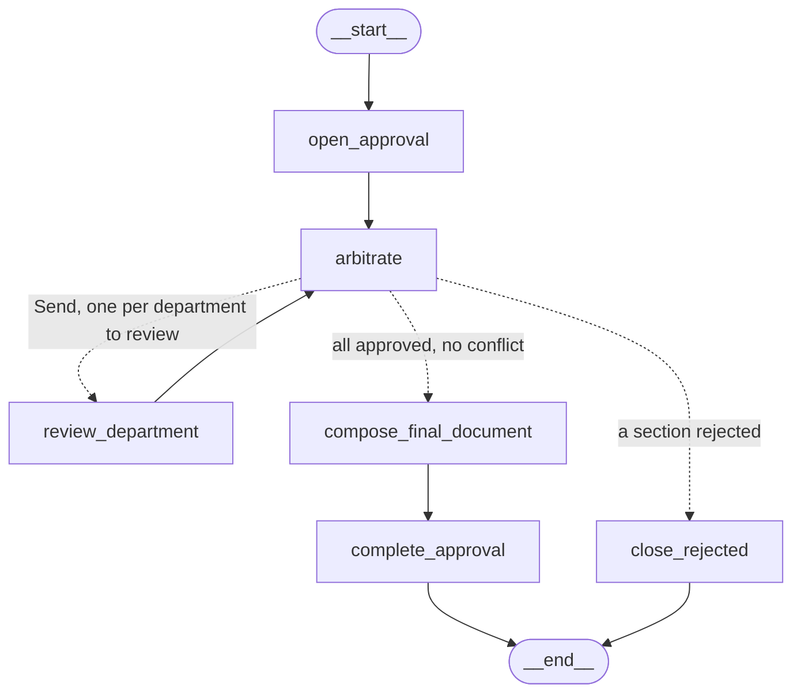
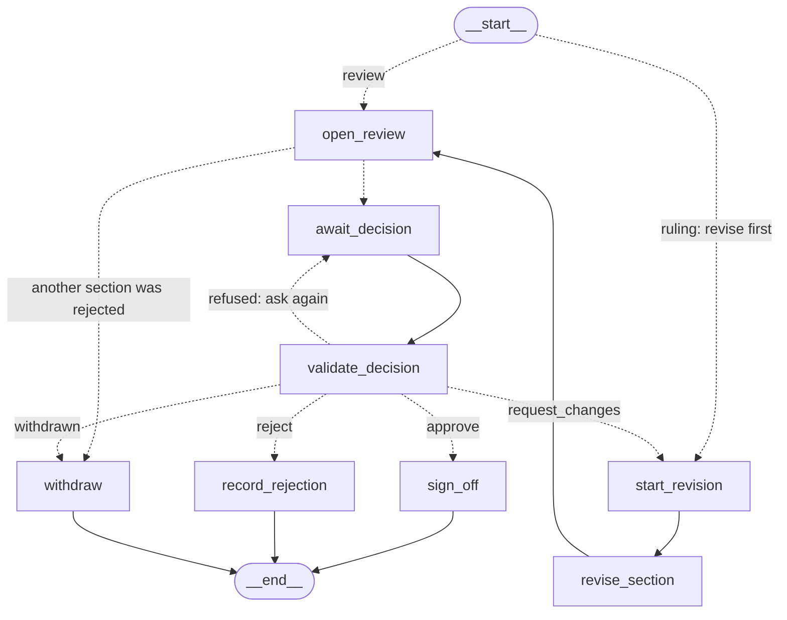

# Human approval and document completion (Milestone 9, Part 3)

Part 2 ([proposal-drafting.md](proposal-drafting.md)) drafts every department's section of the pricing proposal and checks it automatically. Part 3 is the last piece: **a person from each department signs off their own section**, and once every owner has approved, **the final document generates itself**.

- **Brief:** `lead-instr.png` (ticket "Human approval and document completion"), `stages-todo.png` (the checklist), `visual-ref.png` ("approval tickets & ultimate document synthesis").
- **Briefing:** the root `agentic-workflow-context.md` (the ticket's `company-BRIEFING.md`):
  - §2.1: owners;
  - §2.3: `FinalDocument` and statuses;
  - §6: no approval ladder;
  - §7: conflict triggers and fixed arbiters.
- **Input:** the Part 2 handoff [`rfp-proposal/1`](proposal-handoff-contract.md).

## Decisions taken with the developer (2026-11-23)

1. **The checkpointer is PostgreSQL, in the same database as the tickets.**
   - It is LangGraph's `PostgresSaver` (`langgraph-checkpoint-postgres` + `psycopg[binary]`, added with `uv add`), in its own schema (`RFP_CHECKPOINT_SCHEMA`, default `rfp_graph`), with RLS on.
   - A ticket can wait days for its owners. Its paused graph survives an API restart or a new container, and is backed up with the ticket.
   - SQLite engines (the offline tests, the smoke run) use LangGraph's `SqliteSaver`, in a file next to the database.
2. **Approvers are configured owner accounts.**
   - `RFP_APPROVERS` maps each department to its owner's account email.
   - Only that account can approve, reject or request changes on its department's section. Anyone else gets 403, admins included: TrackFlow has peer owners only, with no ladder (§6).
   - The owners' names come from the briefing (§2.1): warehouse → Ana Whitfield, lastmile → Carlos Vega, reverse → Sofía Ramos.
3. **Reject ends the proposal.**
   - The section is `rejected`, and every other open request is withdrawn (a system decision).
   - The ticket ends in a new terminal status, **`rejected`**, added to the briefing's list as `failed` was. No document is generated.
4. **Arbitration applies the briefing's rule deterministically.**
   - When a §7 conflict fires, the arbitration node applies the table's resolution rule and records the ruling under the named arbiter. The arbiter is not asked through an interrupt.
   - The owners of the revised sections approve them again.
   - A conflict still unresolved at the limit rejects the offending section, as §7 says.

## Where things live

Everything is in `data/pipelines/rfp_intake/approval/` (briefing §2.4). Nothing there imports `services/`.

| Module | Role |
|---|---|
| `graph.py` | The two graphs (below), the node wrapper that traces every node, the graph fingerprint. |
| `runner.py` | `start_pending` / `start`, `submit_decision`, `apply_decisions` (the resume entry point), `resume`, `recover`, `open_requests`, `state_trace`. |
| `decisions.py` | `ApprovalRequest` (the interrupt payload), `ApprovalDecision` (the resume value), `check_decision`: the one rule set used by the API and inside the graph. |
| `approvers.py` | Owner names (briefing) and owner accounts (`RFP_APPROVERS`). |
| `arbitration.py` | The §7 table verbatim (drift test), `detect` and `rule_on`: pure functions, no model. |
| `document.py` | `FinalDocument` and `compose`: deterministic, the approved sections word for word. |
| `checkpoint.py` | `thread_id` and the checkpointer factory (PostgreSQL or SQLite). |
| `store.py` | Part 3 persistence: runs and their lease, decisions, section approvals, the final document. |
| `detail.py` | What the API and the CLI read: per-section approval state, the run, the document summary. |
| `trace.py` | `ticket_trace`: every step of Parts 1-3, with the agent that took it. |

## The flow

### Outer graph `rfp_approval`: one checkpoint thread per ticket, `rfp-<ticket_id>`



1. **`open_approval`:**
   - takes the claimed `ProposalHandoff`. Both of Part 2's end statuses are accepted, as the contract requires;
   - moves the ticket to `waiting_for_approval`;
   - sets every active section to `approval_status: pending`.
2. **`arbitrate`** is the hub, and the briefing's arbitration node. It runs first on Part 2's sections, so no owner is asked to approve a section that is already in conflict. It runs again every time the department branches converge. It:
   - detects the §7 contradictions on the sections' structured drafts and text;
   - applies the rule;
   - routes: a review per section still to approve (with a ruling's instruction for a conflicting one), the final document, or `close_rejected`.
3. **`review_department`** runs one department's branch (below). Branches run in parallel through `Send`. **An interrupt pauses only its own branch:** another department is approved, revised or rejected meanwhile, and its result is saved at once.
4. **`compose_final_document`** is the "ultimate document synthesizer" of the visual reference. It is deterministic: the approved sections go in as approved.
5. **`complete_approval`** stores the document and sets `done` in one transaction.

### Department branch `rfp_department_review`



`npm run rfp -- graph --part 3` prints both graphs from the code.

- **`open_review`** persists the request before the pause: the section is `pending`, `ready_at` is set, and an event "asked <owner>" is written. The checkpoint after it holds everything the pause needs.
- **`await_decision`** only calls `interrupt(ApprovalRequest)`.
  - LangGraph re-runs the node that holds an interrupt every time the thread resumes, so this node has no side effect.
  - It is not wrapped in `steps.run_step`: `GraphInterrupt` is an `Exception`, and `run_step` would turn the pause into a failure.
- **`validate_decision`** checks the resumed value before it changes anything (`decisions.check_decision`):
  - department, round and draft SHA-256 must match the open request;
  - the decider must be the configured owner, or `system` for `withdrawn`;
  - a comment is required for reject and request changes;
  - request changes is refused once the revisions are used up.

  A refused value is asked for again, with the reason in the new request. The section is left unchanged.
- **`start_revision` + `revise_section`** run Part 2's own generator-evaluator loop (`rfp_proposal_section`) on this section:
  - the generator gets the draft under review and the owner's comment (as untrusted data) or the arbiter's instruction (`revision_request`);
  - the three evaluators check the result again;
  - a capped volume (§7 `volume-vs-capacity`) replaces the assignment's volume, so the existing guard accepts it;
  - the revision has its own run id, fixed before the loop, so a resumed revision reuses it;
  - a revision that breaks goes back to the owner with its last evaluated attempt, or with the old draft, plus a note. An approval never dies on a gateway stall.
- **`sign_off`** sets `approved`, `approver` (the owner's name), `approved_by` (the account) and `approved_at`.

### Running, resuming and concurrency

```text
start_pending ─► start ─► graph.invoke(input)            ─► every branch paused (interrupts)
POST …/decision ─► submit_decision ─► rfp_approval_decisions (recorded) ─► 202
                   background: apply_decisions ─► lease ─► graph.invoke(Command(resume={interrupt_id: decision}))
```

- **`apply_decisions` is the explicit resume entry point.** It:
  - matches each recorded decision to its department's open interrupt (by department, round and draft);
  - resumes them all in one call (`Command(resume={id: value, ...})`). The other branches stay paused;
  - never re-runs `open_approval`, nor Parts 1 and 2. A test counts the events.
- **One process at a time per ticket.** A lease on `rfp_approval_runs` (a conditional UPDATE, portable, expiring after `RFP_STALE_AFTER_MINUTES`) stops two concurrent resumes of one thread, which would each start from the same checkpoint and lose each other's writes.
  - A decision recorded while another worker holds the lease waits as `recorded`.
  - The holder applies it before releasing.
- **After a rejection** the runner withdraws every other open request (a `system` decision), so the run reaches `close_rejected`.
- **Failures keep everything.**
  - A technical failure leaves the ticket `waiting_for_approval` with `error_stage` / `error_message`. The run becomes `failed`.
  - `npm run rfp -- resume <id>` (or `recover` at API start-up) continues from the last checkpoint, and no decision is lost.
- **`recover`** runs at API start-up in a background thread. It resumes runs a dead process left behind and applies decisions it recorded but never applied.
- **Graph version.** The graph's fingerprint is stored on the run; a resume under a different one is logged as a warning event.

### Checkpointer identity

- **One thread per ticket**, `rfp-<ticket_id>`, stored on `rfp_approval_runs.thread_id`.
- **The departments are branches of that thread.** LangGraph gives each branch its own checkpoint namespace (`review_department:<task>`).
- **Concurrent tickets never share a checkpoint** (tested).

## The §7 arbitration (`arbitration.py`)

The table is the briefing's, verbatim; `test_arbitration.py` parses §7. Agents never resolve a conflict: the node detects it from structured state and applies the fixed rule.

| Trigger | Fires when (as implemented) | Arbiter | Rule applied |
|---|---|---|---|
| `volume-vs-capacity` | warehouse and lastmile are both active, and lastmile's `assumed_monthly_volume` is above the warehouse's `committed_capacity.monthly_orders` (or the site's rate-card capacity) | Miguel Torres (Commercial Director) | The volume is capped at the capacity: lastmile is revised with the capped volume, and the document states the cap |
| `returns-sla-breach` | any section has `returns_turnaround_hours < 48`, or its text promises returns under 48 h (the §5 returns check) | Sofía Ramos for her own section, Miguel Torres for any other | Forced request changes on every offending section; no document while it holds |
| `currency-mismatch` | a section quotes another currency than the `client_country` mapping (US→USD, Spain→EUR), so two sections differ (the §5 currency check) | Miguel Torres | The offending sections are rewritten in the country's currency. An unknown country cannot be fixed by rewriting and is rejected at once |

- **Limits:**
  - `RFP_MAX_ARBITRATION_ROUNDS` (default 2): how many times arbitration may send sections back;
  - `RFP_MAX_REVISION_ROUNDS` (default 3): revisions per section, from the owner or the arbiter.

  A conflict still there at either limit rejects the offending section in the arbiter's name ("reject if unresolved after iteration limit"), and the ticket ends `rejected`.
- **A ruling can reopen an approved section.** For example, an owner approves a revision that slipped into USD for a Spanish client. Only the offending section goes back; the others stay approved (tested).
- **Every ruling is recorded:**
  - in `rfp_approval_runs.rulings` (trigger, arbiter, rule, departments, round, evidence);
  - as an `arbiter` decision on each section;
  - in the document's notes.

## The final document (`document.py`)

`FinalDocument` has the briefing's fields, `ticket_id`, `sections`, `currency` and `generated_at`. It adds the client, the Markdown `content` and its SHA-256, and the thread id. It is composed with no model, because every owner approved a precise text. The Markdown, in order:

1. **Title:** "Pricing proposal for <client>", and the date it was prepared.
2. **Cover lines:** client and country, prices currency, services, monthly volume (noting an arbitration cap), the RFP's deadline.
3. **One numbered part per approved section**, in the briefing's order. The section is word for word as approved. Its "For approval by …" line becomes "Approved by <owner> on <date>", and its headings move one level down.
4. **"Approvals":** department, owner, date.
5. **"Notes":**
   - the rate card version, whose indicative prices Commercial must confirm before sending;
   - any arbitration that changed the proposal;
   - the questions for the client.

Sales reads it on the ticket page and downloads it as `.md`. `GET /rfp/tickets/{id}/document` returns JSON and `…/document.md` returns the file; both answer 404 until the ticket is `done`.

## Statuses

The ticket statuses, the same ticket across the three parts:

| Status | Set by |
|---|---|
| `waiting_for_approval` | `open_approval`, from `waiting_for_approval` or `needs_human_review`. It stays there while any approval is pending, revisions included: it never goes back to a Part 2 status. |
| `done` | `complete_approval`, in the transaction that stores the document. |
| `rejected` (added) | `close_rejected`, after an owner's or an arbiter's rejection. |

The end-to-end test checks the timeline `analyzing → intake_complete → drafting → under_evaluation → waiting_for_approval → done` (and the `needs_human_review` variant) from the ticket's status at every event written by any part.

Section `approval_status`: `pending → (changes_requested → pending)* → approved | rejected | withdrawn`. Every decision, append-only, is in `rfp_approval_decisions`:
- `source`: owner, arbiter or system;
- `status`: recorded, applied, stale or refused.

## Traceability

The lead asked for "which agent did what and in what order", for any run.

- **In the graph state:** `trace` holds every Part 3 node execution, with `node`, `agent`, `department`, `input`, `output`, `outcome`, `started_at` and `finished_at`.
  - Each branch's entries join the run's state when the branch finishes.
  - A paused branch keeps them in its own checkpoint namespace.
  - `runner.state_trace` reads both: `npm run rfp -- trace <id> --state`.
- **In the database:** every node also writes an `rfp_ticket_events` row, with the agent, input and output in its `detail`.
  - `trace.ticket_trace` merges the three parts in order and names the agent of each Part 1 and Part 2 node.
  - Part 2 nodes that ran inside a Part 3 revision are shown as Part 3 revision steps.
  - It is served by `npm run rfp -- trace <id>`, `GET /rfp/tickets/{id}/trace` and the backoffice "Run history".

## API and backoffice

**API.** Every route is staff-only, and the router only calls the runners (an AST test pins this).
- **`GET /rfp/tickets/{id}`** adds, per section, `approver`, `approved_by`, `approved_at`, `review_round`, `review_rounds`, `max_review_rounds`, `allowed_actions`, `awaiting_decision`, `decision_pending`, `can_decide` (the signed-in account is this department's owner) and `decisions[]`. It also adds an `approval` block (run status, thread, rulings, failure) and a `final_document` summary.
- **`POST /rfp/tickets/{id}/sections/{department}/decision`**
  - Body: `{action: approve|request_changes|reject, comment, review_round}`.
  - **202:** recorded, and the graph is resumed in the background.
  - **403:** not the owner.
  - **404:** unknown ticket or a department not in the proposal.
  - **409:** not waiting for a decision, a stale round or draft, already decided, or the revision limit.
  - **422:** a missing comment or a malformed body.
- **`GET /rfp/tickets/{id}/document`**, **`…/document.md`** and **`…/trace`**.
- **The upload chains** intake → drafting (`RFP_AUTO_DRAFT`) → opening the approvals (`RFP_AUTO_REQUEST_APPROVAL`).

**Backoffice (`/rfp/[id]`):**
- An "Approval by department" card:
  - "1 of 2 departments approved", and who it is waiting for;
  - the conflicts and who ruled on them;
  - a failure with its resume command;
  - why a rejected proposal was closed.
- The "Final document" card: the rendered document and a `.md` download.
- Each section card ends with **"Approval by <owner>"**:
  - its state for everyone;
  - for its owner only, the decision form (approve / request changes / reject, with the comment required for the last two, and the revisions left);
  - the decision history.
- A "Run history" panel: every step of Parts 1-3, with its agent.
- The page polls while a section is revised or a decision is applied (3 s), and every 15 s while owners decide, because another owner may decide meanwhile.
- The list shows which departments a ticket waits for.

**Fixed in the transitions between parts** (the ticket's end-to-end review):
- the Part 2 card said "Every section passed its automatic review" for any `waiting_for_approval` ticket, which became wrong once Part 3 takes a `needs_human_review` ticket. The text now comes from the sections;
- `waiting_for_approval` was shown green like a finished ticket. It is now amber, and only `done` is green;
- the page stopped polling once Part 2 ended;
- the card's "Approval: not reviewed yet" label is replaced by the approval block.

## Configuration

| Setting | Default | Meaning |
|---|---|---|
| `RFP_APPROVERS` | `{}` | JSON, department → owner account email. A department with no account cannot be decided (the UI says so). |
| `RFP_MAX_REVISION_ROUNDS` | 3 | Part 3 revisions per section. At the limit, the owner approves or rejects. |
| `RFP_MAX_ARBITRATION_ROUNDS` | 2 | Times arbitration may send sections back before an unresolved conflict rejects. |
| `RFP_AUTO_REQUEST_APPROVAL` | true | Open the approvals right after drafting. |
| `RFP_CHECKPOINT_SCHEMA` | `rfp_graph` | PostgreSQL schema of LangGraph's checkpoint tables. |

## Runbook

```bash
npm run rfp -- run PDF-examples/trackflow-request-2.pdf   # intake + drafting + open approvals
npm run rfp -- request-approval                           # open approvals for queued proposals
npm run rfp -- approvals <ticket_id>                      # who is asked, rounds, rulings, decisions
npm run rfp -- decide <ticket_id> lastmile request-changes --as carlos.vega@trackflow.com \
     --comment "Add the Nevada delivery times"            # an owner's decision, applied at once
npm run rfp -- decide <ticket_id> warehouse approve --as ana.whitfield@trackflow.com
npm run rfp -- resume <ticket_id>                         # continue a run stopped by a failure
npm run rfp -- document <ticket_id> --output proposal.md  # the final document
npm run rfp -- trace <ticket_id> [--state] [--json]       # which agent did what, in order
npm run rfp -- kpi                                        # iterations, approval time, build time (§3)
npm run rfp -- graph --part 3                             # both graphs as Mermaid
npm run rfp:e2e                                           # Parts 1→3 offline, simulated owners
LLM_TIMEOUT_SECONDS=120 npm run rfp:smoke                 # Parts 1→3 live, simulated owners
```

## Tests

- **`tests/pipelines/rfp_intake/approval/`** runs offline: real graphs, scripted Parts 1-2 agents, `SqliteSaver`, and owners simulated through `submit_decision` + `apply_decisions`.
  - **`test_interrupt_resume.py`:**
    - one interrupt per department, with a checkpoint first;
    - resume as an entry point (no node of Parts 1-2 nor `open_approval` re-run);
    - a resume after a "restart";
    - a `needs_human_review` ticket accepted;
    - every refusal, both before the graph and inside it (a raw bad `Command(resume=…)` is asked again).
  - **`test_parallel_branches.py`:**
    - **department B approved while department A remains interrupted** (same interrupt, never re-asked, B's sign-off in the trace);
    - B revised while A waits;
    - two departments resumed in one call;
    - two tickets with separate checkpoints.
  - **`test_limits.py`:**
    - the revision limit;
    - a revision that exhausts Part 2's loop goes back to its owner;
    - the arbitration limit rejects;
    - an owner's rejection withdraws the other request.
  - **`test_arbitration.py`:**
    - the §7 drift test;
    - each trigger and arbiter;
    - unknown country;
    - the limits;
    - in the graph: returns breach ruled by Sofía Ramos before review, volume capped by Miguel Torres, a currency conflict after approval reopening only the offending section.
  - **`test_document.py`:** sections word for word and in order, the briefing's fields, deterministic output, `done` and the document written atomically.
  - **`test_trace.py`:** agent, input, output and times for every node, in the state and the events; Parts 1-3 in order.
  - **`test_store.py`:** the lease, a decision waiting for the lease, `recover`, and a failure resumed from the checkpoint with every decision kept.
  - **`test_end_to_end.py`** (`npm run rfp:e2e`):
    - ModaViva and Luna from the real PDFs to `done`;
    - the status timeline;
    - client, currency and departments identical in the intake handoff, the proposal handoff and the document;
    - a `needs_human_review` ticket;
    - the invalid PDF never reaching Part 3.
- **`tests/test_rfp_approval_api.py`** (also in `rfp:e2e`): the whole flow over HTTP with owner accounts, every refusal status, the document and its download, the trace, and a 503 that names nothing.
- **`tests/test_rfp_postgres.py`** (opt-in, `INVENTORY_TEST_DATABASE_URL`):
  - `PostgresSaver` in a throwaway schema with RLS, and a paused branch resumed from PostgreSQL after a "restart";
  - the `ck_rfp_status` upgrade to allow `rejected`;
  - the lease between two workers.
- **`tests/frontend/backoffice/rfp.test.ts`:** approval fields validated (malformed refused), the decision POST, decision error copy, document, download and trace calls, polling, and approval and stage labels.

## Live evidence (2026-11-23)

The live model was `gpt-6-luna` on the 4Geeks gateway. Qdrant was down, so the generators read the knowledge-base documents directly, as designed.

**`npm run rfp:smoke`: 3/3 passed** (`data/eval/rfp_intake/smoke.json`), Parts 1 → 3:
- correct-classification rate 1.0, and Part 2's 1.75 attempts per section;
- **ModaViva:** `waiting_for_approval`, then `done`, with one live change request.
  - The simulated warehouse owner asked for a contact sentence.
  - The real generator revised the section, the three evaluators passed it, and the owner approved round 2.
  - The revision took 18 s and 8,515 tokens.
  - The document's checks passed: EUR, both sections, the approved summaries word for word, and statuses only moving forward;
- **Luna:** `done`, USD;
- **RapidShip:** discarded, never reaching Part 3.

**Through the backoffice** (Chrome via playwright-core, the real API on a throwaway `postgres:17-alpine`, Sales and the three owners as manager accounts, `RFP_APPROVERS` set). 28 checks passed:
- **Start-up** created the `rfp_graph` schema with LangGraph's four checkpoint tables, RLS on.
- **Uploads:** the three PDFs went through intake, drafting and the opening of the approvals in the upload's background tasks. The list reached "Waiting for approval: Warehouse Operations, Reverse Logistics" in **98 s without a reload**.
- **Ana Whitfield** saw the form on her warehouse section only, and approved it. The page showed "Approved by Ana Whitfield", "1 of 2 departments approved" and "Waiting for Sofía Ramos (round 1)".
- **Sofía Ramos** first tried "Request changes" without a comment and was told one is required. She then asked for a change: the section showed "being revised", came back as round 2 **after 60 s without a reload**, and she approved it.
- **The ticket became `done`.** The final document rendered, downloaded as `trackflow-proposal-modaviva-sl.md`, and its Approvals table names both owners.
- **The run history** shows the classifier, the reverse generator (revision), Sofía Ramos and the final document synthesizer.
- **Carlos Vega**, who owns no ModaViva section, got a read-only view. A customer account got the staff-only message.
- **Dark mode and a 390 px phone**, on a finished ticket and on a waiting one: no horizontal overflow and no console errors.
- **PostgreSQL afterwards:**
  - ModaViva `done` / run `done`, with 3 applied owner decisions, 1 document and 32 checkpoints;
  - Luna `waiting_for_approval` / run `paused`, with its two paused branches in `rfp_graph.checkpoints`.

**Found and fixed during this run:**
- **Glued words.** Part 2's message rendered "needsa person's review": the compiler drops a leading space after an expression there. An explicit `{" "}` fixed it, and a scan of every panel on both pages found no other glued words.
- **Download file name.** The download used the generic file name because the browser hid `Content-Disposition` from the cross-origin page. The API now exposes it (CORS `expose_headers`), and an API test pins it.
- **Comment refusal.** The comment field's native `required` showed the browser's tooltip instead of the form's own announced message. The form is now `noValidate` with `aria-required`.
- **Revision wording.** "Being revised for round 2 of 4" now reads "revision 1 of 3 in progress", matching the limit the owner sees.

## Known limits

- **Owner accounts are configuration.** Moving an owner to another account means changing `RFP_APPROVERS`. A real directory or SSO group is the production answer.
- **A revision cannot bring in new figures.** An owner's comment cannot introduce a figure that is in neither the RFP, the rate card nor the knowledge base: the guard drops it, as in Part 2. A new price needs a rate-card change by Commercial.
- **Supabase's transaction pooler and `search_path`.** The checkpointer sets the `search_path` option on its connections. Check that the pooler accepts it before the first start against Supabase. If it does not, set `RFP_CHECKPOINT_SCHEMA=public` (RLS stays on).
- **One resume at a time per ticket.** While a revision runs (minutes, with the live gateway), another owner's decision on the same ticket is recorded at once but applied after it.
