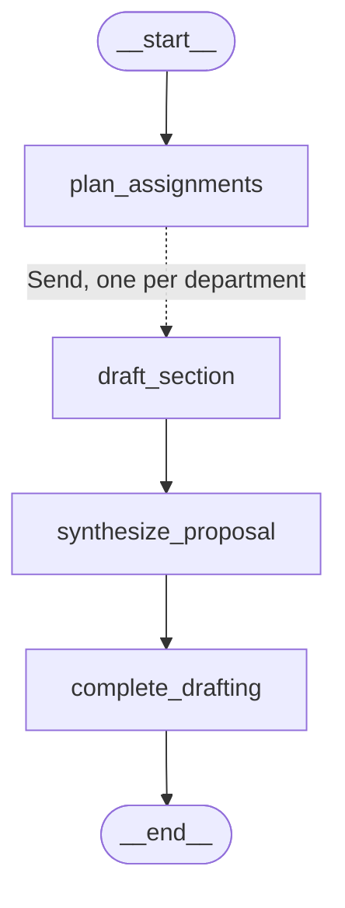
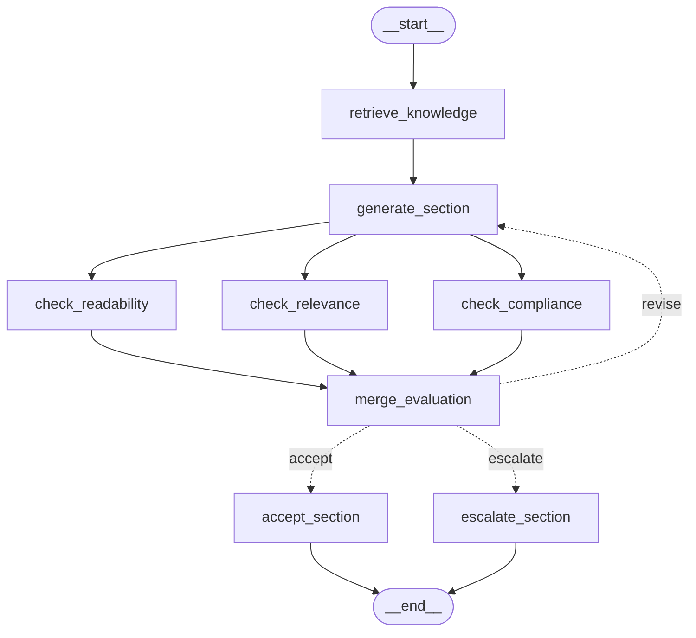

# Proposal drafting and self-evaluation (Milestone 9, Part 2)

Part 1 ([rfp-intake.md](rfp-intake.md)) turns an RFP PDF into a ticket that says what each department must provide. Part 2 turns that analysis into a **first draft of the pricing proposal**, one section per department, and **checks every section automatically before a person reads it**.

Each check is done by its own evaluator, and the three run in parallel:
- **readability** (`py-readability-metrics`);
- **relevance** (does the section answer what the RFP asks?);
- **compliance** with the company guidelines (briefing §5).

A section that fails goes back to its generator with concrete feedback, up to an iteration limit. A section that never passes ships to Part 3 as `needs_human_review`, with its last draft and evaluation. It is never dropped.

- **Brief:** `lead-instr.png` (the ticket) and `stages-todo.png` (the checklist).
- **Visual reference:** `visual-ref.png`, "departmental mapping & deliverable finalization".
- **Briefing:** the root `agentic-workflow-context.md` (the ticket's `company-BRIEFING.md`).
- **Part 3 contract:** [proposal-handoff-contract.md](proposal-handoff-contract.md).

## Decisions taken with the developer (2026-11-23)

1. **Prices come from a rate card plus the knowledge base.**
   - `proposal/rate_card.py` holds the knowledge base's real figures. Each one quotes its document verbatim, and a test checks the quotes.
   - It also holds **indicative** list prices and discount tiers for what the knowledge base does not price. Those are owned by Commercial (Miguel Torres) and must be confirmed before a proposal leaves TrackFlow. Every draft says so.
   - A deterministic guard rejects any figure that comes from none of the handoff, the knowledge base or the rate card.
2. **The SLA rule is checked on one designated section.** §5 says "every proposal must state the on-time delivery SLA (%)". That is the `lastmile` section when last mile is in scope, otherwise the first active section (warehouse, else reverse). ModaViva ships with its own carrier, so its warehouse section states the SLA.
3. **The Sales view shows the drafts** and their evaluations (`/rfp/[id]`).

Defaults (settings, see Configuration):
- **iteration limit:** 3;
- **final status:** `waiting_for_approval` when every section passed, `needs_human_review` otherwise;
- **technical errors:** `failed`, as in Part 1;
- **language:** English. The readability formulas are calibrated for English.

## Where things live

Everything is in the same pipeline package (briefing §2.4), in `data/pipelines/rfp_intake/proposal/`. Nothing there imports `services/`.

| Module | Role |
|---|---|
| `assignments.py` | The **assignment orchestrator**: one `SectionAssignment` per department, from the intake handoff only. |
| `sections.py` | The section format from briefing §2.1: required elements, the generators' output models, fixed headings, knowledge-base queries. |
| `rate_card.py` | The only prices a draft may quote (see above). |
| `guidelines.py` | The five §5 rules: verbatim text, where each applies, deterministic checks, remedies, the §7 trigger each feeds. |
| `knowledge.py` | Knowledge-base access: `rag.retrieve` in Qdrant, with a fallback to the indexed documents. |
| `agents/generators.py` | **One generator agent per department** (`write_warehouse_section`, `write_lastmile_section`, `write_returns_section`) and the deterministic guard. |
| `agents/relevance.py` | The relevance evaluator: §2.1 required elements, plus a model judge with verbatim evidence. |
| `agents/compliance.py` | The compliance evaluator: the deterministic rules, plus an optional model reviewer that can only add violations. |
| `evaluation.py` | The readability evaluator, the `EvaluationResult` merge, `feedback_for_generator` and the loop decision. |
| `results.py` | The `EvaluationResult` models. |
| `render.py` | The structured draft as the Markdown handed to approval. |
| `graph.py` | The two graphs (below). |
| `store.py` | Part 2 persistence. |
| `handoff.py` | The Part 3 contract `rfp-proposal/1`. |
| `runner.py` | `run_pending`, `draft_ticket`, `redraft`. |

Part 1 gained `steps.py` (the shared `run_step` / `StageFailed` / `MODEL_RETRY`, moved out of `graph.py`), a targeted `handoff.claim`, and status guards generalised to Part 2's statuses.

## The flow

### Outer graph `rfp_proposal`



1. **`plan_assignments`** is the assignment orchestrator.
   - It reads the claimed `IntakeHandoff` and resets each section's Part 2 state.
   - It chooses the SLA section and builds one assignment per department. An assignment holds:
     - the client facts and the Part 1 summary;
     - this department's objective, ask, key aspects, needs and open questions;
     - its required elements and applicable rules;
     - the rate card in the client's currency only;
     - its knowledge-base queries.
   - It is deterministic: Part 1 already chose the departments. **The PDF and its Markdown are never read again.**
2. **`draft_section`** runs one department's loop (the subgraph below). Departments run in parallel through `Send`. A technical failure inside it becomes an outcome, not an exception, so the other sections still finish:
   - if an evaluated draft exists, that draft ships as `needs_human_review` with a `review_note`;
   - if none exists, the section is `failed`.
3. **`synthesize_proposal`** is the final deliverable synthesis. It reads the stored sections back and builds the department "for approval" tickets (a `ProposalHandoff`):
   - the owner, `approval_status: pending`;
   - a one-line `assignment_summary`;
   - the Markdown, the `EvaluationResult` and the structured facts.

   It also computes `average_iterations_per_section` (§3 KPI).
4. **`complete_drafting`** writes `rfp_proposal_handoffs` and the ticket's final status in one transaction.

### Section subgraph `rfp_proposal_section` (the generator-evaluator loop)



`npm run rfp -- graph --part 2` prints both graphs from the code.

- **`retrieve_knowledge`** runs once per department and records which source it used: `qdrant`, `local` or `none`.
- **`generate_section`** calls the department's generator. From the second attempt on, it passes the previous draft and the evaluators' `feedback_for_generator`. It renders the Markdown and saves the attempt.
- **The three evaluators** run in parallel over the same draft. Each writes only its own state key.
- **`merge_evaluation`** builds the `EvaluationResult`, stores it, and decides:
  - **`accept`:** every check passed;
  - **`escalate`:** the attempt reached `RFP_MAX_DRAFT_ITERATIONS`, or there is a violation no rewrite can fix (the client's country is unknown, so no currency can be set). That section can never pass, so no further attempt is spent;
  - **`revise`:** otherwise, back to the generator.
- **`accept_section`** sets the section to `passed`. **`escalate_section`** sets it to `needs_human_review` and records a `warning` event. Both set `approval_status: pending`.

Every node runs inside `steps.run_step`, as in Part 1:
- it moves `current_stage`, for example `generate_section:reverse#2` (stage, department, attempt);
- it writes an `rfp_ticket_events` row with timing and tokens;
- it turns failures into a safe `StageFailed`.

`MODEL_RETRY` gives a reply that breaks its schema one more attempt, on `generate_section` and `check_relevance`. The wrapper node has no retry policy: a retry would re-run the whole loop.

### Statuses

| Ticket status | Set by |
|---|---|
| `drafting` | `handoff.claim_next` / `claim` (the queue), or `redraft`. |
| `under_evaluation` | The first saved draft. It never goes back to `drafting`: sections run in parallel, so the ticket shows the furthest stage reached, and each section's `draft_status` gives the detail. |
| `waiting_for_approval` | `complete_drafting`, when every section passed. |
| `needs_human_review` | `complete_drafting`, when at least one section exhausted the limit. That section is still in the handoff. |
| `failed` | A section failed before any evaluated draft, or the stale sweep, which now also covers `drafting` and `under_evaluation`. |

Section `draft_status`: `pending → drafting → under_evaluation → (drafting → under_evaluation)* → passed | needs_human_review | failed`.

## The generators (one per department)

Each generator is one forced tool call with its own output model (`sections.DRAFT_MODELS`). The shared fields:
- `summary`, `narrative`;
- `price_lines` (`item_id`, `amount`, `currency`);
- `discount_tiers`, `on_time_sla_pct`;
- `assumptions`, `open_questions`.

Each department adds what §2.1 says it contributes. These are also the structured state Part 3's conflict triggers (§7) read:

| Department | Extra fields |
|---|---|
| `warehouse` | `storage_site`, `committed_capacity` (pallet positions, orders a month), `onboarding_business_days` |
| `lastmile` | `delivery_options`, `carriers_by_destination`, `assumed_monthly_volume` |
| `reverse` | `returns_turnaround_hours`, `return_window_days`, `return_shipping_paid_by`, `international_returns` |

**The prompt.**
- **System message:** the department, its owner and the required elements; the five §5 rules with their ids, saying whether this section carries the SLA; "never invent a figure"; English, short sentences, 150 to 300 words of prose.
- **User message:**
  - the client facts (a missing volume is stated as unknown);
  - the Part 1 analysis inside an `<<untrusted>>` envelope, because its quotes are RFP text;
  - the rate card in the client's currency;
  - the knowledge-base passages;
  - on a retry, the previous draft and the feedback.

**The guard (`generators.check`, deterministic).** It drops and notes, and never corrects. Its notes go back to the generator inside the feedback.

| What | Rule |
|---|---|
| Price | Must be a rate card item of this department, at the card's amount (as a `Decimal`) in the currency the line states. The currency is left as written, so a wrong currency is failed by compliance, not hidden. |
| Discount tiers | Must be exactly the department's card tiers, or the table is dropped. |
| Facts | The SLA must be 90 (and only in the SLA section); capacity and onboarding must be the card's; the return window must be 30 days; the carriers must be the knowledge base's for the country; the assumed volume must be the client's. A returns turnaround under 48 hours is kept for compliance to fail; any other value must be the card's. |
| Prose | A sentence with a figure that is in none of the handoff, the rate card or the knowledge base is dropped. This is Part 1's `unsupported_figures`. |

**Rendering (`render.py`).** The same headings for every department:
- title, "For approval by <owner>", currency, rate-card version (indicative);
- summary;
- Scope and approach;
- Pricing (table);
- Volume discount tiers (table);
- Service commitments;
- Carriers by destination (last mile only);
- Assumptions;
- Pending information. This always includes the handoff's open questions.

The renderer writes the knowledge base's fixed facts itself, so every proposal words them the same way:
- the SLA sentence with its 5% compensation and peak-date caveat;
- the storage grace period and long-term fee;
- "a preferential storage rate is negotiated only by Miguel Torres".

## The evaluators and `EvaluationResult`

```
EvaluationResult:
  section_id, department_id, iteration
  readability: { pass, score, details }
  relevance:   { pass, missing_aspects[], covered_aspects[], not_applicable[] }
  compliance:  { pass, rule_ids[], violations[{rule_id, message, quote, source}], checked_rule_ids[], reviewer }
  overall_pass: bool
  feedback_for_generator: string
  evaluated_at
```

`pass` is served under the ticket's name: the Python field is `passed`, with `pass` as its alias. `compliance.rule_ids` are the violated rules.

- **Readability.** `readability.measure` scores the section's own prose (summary, narrative, assumptions), without tables or fixed sentences.
  - It passes with Flesch reading ease ≥ `RFP_READABILITY_MIN_EASE` (30) and Flesch-Kincaid grade ≤ `RFP_READABILITY_MAX_GRADE` (14).
  - Under 100 words it fails, with "write at least 150 words".
  - Missing NLTK data passes with `scored: false`, so an environment problem never traps a draft.
- **Relevance.**
  - The §2.1 required elements are checked on the structured draft. A drift test keeps them equal to the briefing.
  - A model judge (`judge_section_relevance`) then gives a verdict on each of the department's key aspects (A1…) and needs (N1…) from the handoff.
  - `covered` counts only when the quoted evidence really is in the section: word for word, ignoring table pipes and list markers, and sentence by sentence when the judge joins passages.
  - A requirement the judge leaves out is asked for once more. If it is still left out, it counts as missing.
  - `not_applicable` needs a reason.
- **Compliance.** The deterministic rules are the authority. A drift test parses briefing §5.

| `rule_id` | Applies to | Check | §7 trigger |
|---|---|---|---|
| `currency-by-country` | every section | every price line in the `client_country` currency; no sentence uses the other currency | `currency-mismatch` |
| `on-time-sla-stated` | the SLA section | `on_time_sla_pct` set and stated in the section | |
| `returns-min-48h` | every section | turnaround under 48 h, or a returns sentence promising less (ranges count at their minimum, days ×24, "same-day" and "next-day" count) | `returns-sla-breach` |
| `volume-discount-table` | every section | at least two card tiers, rendered as a table | |
| `no-carrier-rates` | every section | a carrier never next to an amount, a %-discount or "negotiated" (naming carriers by destination is fine) | |

The optional model reviewer (`report_guideline_violations`, `RFP_COMPLIANCE_REVIEWER`) can only **add** violations:
- with a rule id that applies to the section;
- with a verbatim quote of the section;
- that the checks have not already found.

When it is unavailable, the result records `reviewer: unavailable` and stands.

**`feedback_for_generator`** is deterministic, numbered and empty on a pass. It lists, in order:
1. each violation, with the passage to rewrite and the remedy (for example, "use the rate card's turnaround of 72 hours");
2. each missing aspect;
3. readability figures against their targets, plus the longest sentence;
4. the guard's notes.

## Knowledge base

The generators get the Milestone 7 knowledge base: `rag.retrieve` over `trackflow_knowledge`, with one query per subject the department needs. The SLA section also gets the SLA query.

If Qdrant or the embeddings model is unavailable, or nothing scores above the threshold, the generators read the same documents from `docs/company-knowledge-base/` (about 150 words each). So a draft is never blocked on the vector database. The source is recorded per section (`knowledge_source`).

## Persistence (PostgreSQL)

| Table | Part 2 content |
|---|---|
| `rfp_department_sections` | Columns that already existed: `draft_content` (the latest Markdown), `evaluation_results` (its `EvaluationResult`) and `approval_status` (`pending`). New columns: `draft_status`, `draft_iterations`, `draft_data` (the structured draft and how it was made), `draft_run_id` and `ready_at`. |
| `rfp_section_drafts` (new) | **Every attempt** and its evaluation, unique per (section, run, attempt). It is the audit trail and the source of the §3 KPI (`npm run rfp -- kpi`). |
| `rfp_proposal_handoffs` (new) | The Part 3 queue: `rfp-proposal/1`, `next_stage = approval`. See the contract. |

`store.initialize_schema` creates the seven tables. Because `create_all` never alters a table, it adds the new section columns to a Part 1 database with `ALTER TABLE … ADD COLUMN IF NOT EXISTS`, typed by the dialect, plus the `draft_status` check on PostgreSQL. This is the same approach as inventory's `products.client_id`. RLS is on, with no policies.

## Triggering (no new API process)

- **`POST /rfp/tickets`** schedules two background tasks, which run in order: `runner.run_intake`, then, with `RFP_AUTO_DRAFT` on (the default), `proposal.runner.run_pending`. The second drains the drafting queue, so drafting follows the intake automatically.
- **The queue** uses `FOR UPDATE SKIP LOCKED`, so several workers can drain it.
- **Handoffs left pending** by a restart, or queued while auto-draft was off, are drafted by the next upload or by `npm run rfp -- draft`.

## API and backoffice

- **`GET /rfp/tickets/{id}`** now also returns:
  - per section: `draft_status`, `draft_iterations`, `max_iterations`, `is_sla_section`, `needs_human_review`, `draft_content`, `draft`, `guard_notes`, `knowledge_source`, `review_note`, `evaluation`, `approval_status`, `ready_at`;
  - a `proposal` block: status, SLA department, currency, rate card, average attempts.
- **`/rfp/[id]`** has a "Proposal draft" area above the Sales brief:
  - the outcome in one sentence;
  - average attempts against the target of fewer than 2;
  - the rate card, marked indicative;
  - one card per department (`ProposalSectionCard`). Each card shows "For approval by <owner>", its status and attempt count, a callout with what is still wrong when it needs human review, the three checks, the draft as it goes to approval (rendered from the fixed Markdown subset as React elements, never HTML) and the removed items.
- **Polling:** the page polls while `drafting` / `under_evaluation`, and every 10 s while the handoff waits in the queue. The list polls through drafting too. A Part 2 failure shows the `redraft` command.

## Configuration

| Setting | Default | Meaning |
|---|---|---|
| `RFP_MAX_DRAFT_ITERATIONS` | 3 | Drafts per section before it ships as `needs_human_review`. |
| `RFP_AUTO_DRAFT` | true | Draft right after a successful intake. |
| `RFP_DRAFT_BATCH_SIZE` | 5 | Most tickets one drain takes. |
| `RFP_READABILITY_MIN_EASE` | 30 | Flesch reading ease floor. |
| `RFP_READABILITY_MAX_GRADE` | 14 | Flesch-Kincaid grade ceiling. |
| `RFP_COMPLIANCE_REVIEWER` | true | The model reviewer that can only add violations. |
| `RFP_KNOWLEDGE_TOP_K` | 4 | Passages per knowledge-base query. |

## Runbook

```bash
npm run rfp -- run PDF-examples/trackflow-request-2.pdf      # intake + drafting (--no-draft to stop at Part 1)
npm run rfp -- draft [<ticket_id>]                           # one ticket, or drain the queue
npm run rfp -- redraft <ticket_id>                           # Part 2 again (not once Part 3 has claimed it)
npm run rfp -- show <ticket_id>                              # the drafts, their checks and what to fix
npm run rfp -- proposal <ticket_id>                          # the Part 3 payload
npm run rfp -- kpi                                           # average iterations per section (§3)
npm run rfp -- graph --part 2                                # both Part 2 graphs as Mermaid
npm run rfp -- proposal-schema --write                       # refresh the contract's JSON Schema
LLM_TIMEOUT_SECONDS=120 npm run rfp:smoke                    # intake + drafting on the three PDFs, live
```

## Tests

- **`tests/pipelines/rfp_intake/proposal/`**, offline (scripted agents or the fake model, the real guards and rules, SQLite):
  - **`test_guidelines.py`:** the §5 drift test, the SLA designation, a pass and a fail case for each rule, and false-positive guards.
    - It holds **the checklist's compliance-failure case**: one reverse draft promising "Returns are processed within 24 hours of arrival." gives `compliance.pass == false`.
  - **`test_generators.py`** (the generator agent): what it is given (never the PDF), retries with feedback, and the guard dropping invented or off-card values.
  - **`test_evaluators.py`** (the evaluator agents): readability pass and fail, relevance pass and fail (missing cost per shipment, fabricated evidence), the reviewer only adding, the `EvaluationResult` shape, the feedback order, the loop decisions.
  - **`test_graph.py`:**
    - a first-time pass;
    - a fail then pass carrying the feedback;
    - **the limit reached → `needs_human_review`, still in the handoff**;
    - no PDF access;
    - the knowledge-base fallback;
    - gateway failures before and after an evaluated draft;
    - a schema retry, a sweep mid-run, the queue order, redraft rules;
    - the graph shapes.
  - **`test_render.py`, `test_rate_card.py`, `test_store_and_handoff.py`:**
    - the Part 1 → Part 2 column upgrade;
    - the contract's schema drift;
    - Part 3 claims;
    - the detail, the sweep, the KPI.
- **`tests/test_rfp_api.py`:** auto-draft scheduling, and a whole upload ending with drafts and evaluations (passed, and needs review).
- **`tests/test_rfp_postgres.py`** (opt-in): JSONB and RLS on the new tables, the column upgrade and its check, a whole drafting, `SKIP LOCKED` on the proposal queue.
- **`tests/frontend/backoffice/rfp.test.ts`:** drafted tickets validated, malformed evaluations refused, polling, attempt labels, rule labels, the Markdown subset.

## Live evidence (2026-11-23, `gpt-6-luna` on the 4Geeks gateway, Qdrant)

- **`npm run rfp:smoke` on the final code:** 3/3 (`data/eval/rfp_intake/smoke.json`).
  - Correct-classification rate 1.0. Every §5 check passed on every section: EUR for ModaViva, USD for Luna, the SLA in warehouse (ModaViva) and in last mile (Luna), returns at 72 h.
  - **1.75 attempts per section.**
  - ModaViva → `waiting_for_approval`. Luna → `needs_human_review`: its last-mile section was escalated after 3 attempts because the RFP asks for per-carrier SLAs and a carrier recommendation, while the knowledge base says the system assigns carriers and gives SLAs per service. That one is for Carlos Vega.
- **Calibration runs before that:** 2.75 → 2.0 → 2.5 → 2.0 attempts per section.
  - Relevance drove the misses, never compliance (once the country was known).
  - The fixes were the judge's scope and rules, tolerant evidence matching, a second ask for omitted ids, and generator guidance to answer every aspect.
- **Through the backoffice** (Chrome, staff account): three PDFs uploaded. The list showed Analyzing → Drafting → Under evaluation → Waiting for approval without a reload in about 2 minutes. No console errors; light, dark and 390 px mobile checked.

## Known limits and what to confirm

- **The indicative rate card** must be confirmed by Commercial (Miguel Torres) before a proposal is sent.
- **Briefing versus knowledge base:**
  - §2.1 says "cost per pallet/SKU", but the knowledge base charges storage per cubic meter. Storage stays per m³; inbound-per-pallet and SKU-setup fees cover the briefing's wording.
  - In a proposal without last mile, the warehouse section states the 90% SLA "for the deliveries TrackFlow manages". Carlos Vega should confirm that wording.
- **Readability thresholds** should be calibrated on real drafts. Strict thresholds raise the iterations KPI.
- **Gateway stalls** (30-120 s per call; up to three calls per attempt) can make one ticket take several minutes in the API's background task. The stale sweep and `redraft` cover a restart.
- **The figure guard matches digits only,** so "2.4" and "24" collide. Price lines are compared exactly; prose is also covered by compliance.
