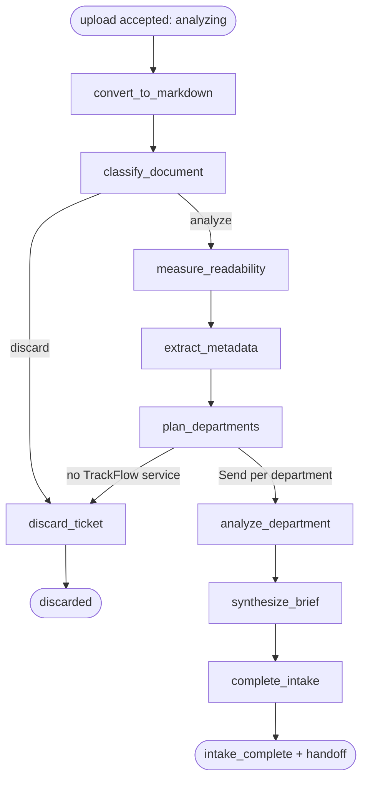

# RFP intake and routing (Milestone 9, Part 1)

Sales (Miguel Torres, Commercial Director) receives dozens of RFPs a week as PDFs. They miss deadlines because nobody can tell, at a glance, which departments to involve or what each one needs. This is the first stretch of the agentic workflow that fixes that. A PDF uploaded in the backoffice becomes a **ticket**, and the dedicated `rfp_intake` graph then does five things:

1. it converts the PDF to Markdown;
2. it decides whether the document really is a TrackFlow RFP;
3. it extracts the metadata and readability metrics;
4. it splits the analysis across the departments the requested scope needs (orchestrator → workers → synthesizer);
5. it leaves a handoff for Part 2.

**Acceptance criterion:** Sales can read a processed ticket and know, without opening the PDF, what is needed from each department and who to ask.

Sources:
- the ticket and checklist: `lead-instr.png`, `stages-todo.png`;
- the briefing: the root `agentic-workflow-context.md` (the ticket's `company-BRIEFING.md`);
- the sample PDFs: `PDF-examples/`.

## Where things live

| Layer | Path | Role |
|---|---|---|
| UI | `uis/backoffice/app/(protected)/rfp/`, `components/rfp/`, `lib/rfp.ts` | Upload, ticket list, Sales view. Polls while a ticket is `analyzing`. |
| HTTP | `services/rfp/router.py`, `models.py`, `lifecycle.py` | Staff-only routes on the existing API. It only triggers and queries. |
| Graph and agents | `data/pipelines/rfp_intake/` | The `rfp_intake` LangGraph graph, the five agents, persistence, the handoff. |
| CLI | `scripts/rfp_intake.py` (`npm run rfp`) | Run, reprocess, show, list, handoff, the live smoke run. |
| Data | PostgreSQL (Supabase): five `rfp_*` tables | The source of truth. The PDF itself is stored in `data/raw/rfp/<ticket_id>.pdf` (git-ignored). |

Nothing in `data/` imports `services/`; `tests/test_reporting_api.py` checks this. The API passes its own engine (`services/inventory/database.get_engine`). The model endpoint is the RAG settings' `GENERATION_MODEL` on the 4Geeks gateway.

## The flow



`npm run rfp -- graph` prints the compiled graph.

1. **Upload.** `POST /rfp/tickets`:
   - **Validates the file.** It must be called `.pdf` or declared `application/pdf`, carry the `%PDF-` signature in its first KiB, be non-empty, and stay within `RFP_MAX_UPLOAD_MB`.
   - **Stores it** atomically as `data/raw/rfp/<ticket_id>.pdf` and creates the ticket (`analyzing`).
   - **Answers 202 at once.** The graph then runs as a FastAPI background task in the same API process.
2. **`convert_to_markdown`.** MarkItDown's `PdfConverter` (pdfminer), called directly. `MarkItDown.convert` would fall back to plain text on a corrupt PDF and hand its raw bytes on as "Markdown".
   - `text.clean_markdown` turns unmapped bullet glyphs (`(cid:127)`) into `- `.
   - A PDF with no text layer is refused: there is no OCR.
   - A document longer than `RFP_MAX_DOCUMENT_CHARS` is truncated with a visible notice and flagged.
   - The Markdown is stored on the ticket, so no later step re-parses the PDF.
3. **`classify_document`**, the classifier agent. See below. Its decision routes to `discard_ticket` or onwards.
4. **`measure_readability`**: counts, an estimated token count and readability scores (see below).
5. **`extract_metadata`**, the metadata agent. The metadata and the metrics are stored together in `rfp_metadata`.
6. **`plan_departments`**, the orchestrator. It reads the whole document once and writes one subtask per department: an objective plus the verbatim extracts that department needs.
7. **`analyze_department`**, one worker per department, in parallel through `Send`. A worker receives a `WorkerTask`: the shared metadata plus its own extracts. It never receives the document or another department's extracts.
8. **`synthesize_brief`**, the synthesizer. It reads the metadata and the sections, never the document, and writes the Sales brief.
9. **`complete_intake`**, in **one transaction**: the department sections (`key_aspects` per department), the Sales brief, the `rfp_handoffs` row and the status `intake_complete`.

### Statuses

They are the briefing's (§2.3), plus two: `failed` here, and `rejected` in Part 3.

| Status | Set by |
|---|---|
| `analyzing` | The upload; `reprocess` |
| `discarded` | `discard_ticket`: the classifier said the document is not an RFP, or no TrackFlow service is requested |
| `intake_complete` | `complete_intake` |
| `failed` | Any stage failing, or the stale sweep. **Not in the briefing:** a technical failure is not a classification, and calling it `discarded` would distort the "correct classification rate" KPI (§3). |
| `drafting` … `needs_human_review` | Part 2. `handoff.claim_next` sets `drafting`; see [proposal-drafting.md](proposal-drafting.md). |
| `waiting_for_approval`, `done`, `rejected` | Part 3: each department owner's approval and the final document; see [approval-completion.md](approval-completion.md). **`rejected` is not in the briefing either:** an owner, or an unresolved §7 conflict, rejected a section, so the proposal does not go out. |

**"Don't fail silently."**
- Every node runs inside `graph._step` (`steps.run_step`, shared with Part 2), which:
  - moves `current_stage` (the UI shows it live);
  - appends an `rfp_ticket_events` row with the duration and the model tokens;
  - turns a failure into `StageFailed`. The runner records it as `failed` with `error_stage` and a safe message: our own text, or `unexpected <Class>`, never a driver or library message.
- `runner.run_intake` never raises.
- Status changes are conditional updates. A step that finds its ticket no longer `analyzing` stops instead of overwriting.
- A run dies with its process if the API restarts mid-run. Its ticket is closed as `failed` / `abandoned` by `store.sweep_abandoned` after `RFP_STALE_AFTER_MINUTES` without progress. The sweep runs at API start-up and on every list request.
- `npm run rfp -- reprocess <id>` re-runs a `failed` or `discarded` ticket from its stored PDF.

## The agents and their guards

Each agent is one forced tool call (`llm.call_tool`): `tool_choice="required"`, temperature 0, the same pattern as the knowledge agent's planner.
- **Retries:**
  - The OpenAI client retries a gateway error once (`MAX_RETRIES`), with `RFP_LLM_TIMEOUT_SECONDS` (default 120) per call.
  - The graph gives a reply that did not match its schema (`InvalidModelReply`) one more attempt (`MODEL_RETRY`).
- **Untrusted input:** the RFP is text from outside TrackFlow. It is always sent inside an `<<untrusted kind=...>>` envelope, with envelope markers inside it defused, and every prompt says instructions inside it are data.
- **Deterministic checks after the model:** what a manipulated or wrong reply could change is limited by checks that need no model. They are listed per agent below.

The checks share `text.py`:
- `appears_in` checks that a quote is in the source. It tolerates wrapped lines, curly quotes, dashes, `...` elisions and a copied list marker: the live orchestrator writes "2. …" because its extracts were numbered.
- `unsupported_figures` finds figures absent from the sources. "15.000" (Spain) and "15,000" (US) count as the same figure. Single digits are not checked.

### Classifier (`agents/classifier.py`)

The criteria are the briefing's (§1, §2.2, §4):
- **An RFP** is a prospective client, an e-commerce brand, asking TrackFlow (or providers in general) for a proposal or pricing for warehousing, last mile and/or returns, in the US and/or Spain.
- **Formal and informal** requests are both RFPs. An email asking for a proposal is one.
- **A carrier or vendor selling to TrackFlow is not an RFP,** even when it talks about shipping, volumes and prices. That is the RapidShip sample.

The model returns a label:
- `document_kind`: `formal_rfp`, `informal_rfp`, `carrier_or_vendor_offer` or `other`;
- `is_rfp`, `confidence`, `language`, `sender`;
- `reasons` and `evidence_quotes`.

`decide()` turns the label into the routing decision. It is **recall-first**: a missed RFP costs a deal, and a false alarm costs one analysis that is shown flagged.
- **Discard** only on a consistent and confident "not an RFP" (confidence of at least 0.7).
- **Accept, flagged** `low_confidence` or `inconsistent_verdict`, on a hesitant or contradictory verdict. The Sales view then shows "a person should confirm".
- **Evidence quotes** not found verbatim are dropped (`unverified_evidence`).

### Metadata (`agents/metadata.py`)

Briefing §2.3 fields:
- **From the model:** `client_name`, `client_country` (US or ES), `services_requested`, `monthly_volume`, `deadline` and `deadline_text`, `budget_range`. Each value comes with a quote.
- **Derived, never from the model:** `currency` (US → USD, ES → EUR) and `departments_needed` (from the services).

Nothing is guessed:
- **A value whose quote is not in the document** is dropped.
- **`monthly_volume`** must appear in its own quote, and that quote must talk about orders, shipments or packages per month (EN/ES). ModaViva's "15.000 SKUs" is a catalogue size, not a volume: it stays `null` and becomes an open question.
- **`deadline`** is a date only when the document gives the day and the year. Luna's "around August 24th" keeps its words and gets no date.
- **Every missing field** becomes a question for the client.

### Orchestrator (`agents/orchestrator.py`)

Two agents read the scope, and they must agree:
- **A department the client did not request** is dropped. "Not every RFP needs all three departments": ModaViva keeps its own carrier, so there is no `lastmile`.
- **A requested department the orchestrator forgot** is added, with the briefing's description.
- **Extracts not found verbatim** are dropped.
- **Requirements no department covers**, for example ModaViva's ERP integration, go to `unassigned_requirements`, so the proposal does not drop them.
- **No requested service at all** discards the ticket, after the plan.

### Workers (`agents/workers.py`)

One prompt per department, built from §2.1 (name, owner, what it contributes). A worker returns:
- `key_aspects`: aspect, detail and a verbatim `source_quote`;
- `needed_from_department`;
- `open_questions`.

The checks:
- **An aspect whose quote is not in its sources is dropped,** and so is any aspect, need or question carrying a figure the RFP does not state. "Never invent pallet/SKU/order volumes", §2.3. The reasons are kept in `validation_notes`.
- **When the monthly volume is missing,** `warehouse` and `lastmile`, whose cost depends on it, always get the open question.
- **The owner comes from the briefing,** never from the model.

### Synthesizer (`agents/synthesizer.py`)

It writes:
- a summary;
- one ask per department owner, matched by id, name or owner;
- the questions for the client, with those the metadata already raised passed in as "ALREADY ASKED" so they are not repeated;
- the risks.

The checks:
- **Owners and the currency are filled in deterministically.**
- **Every active department gets an ask,** even if the model skips one: it is then built from that department's needs.
- **Text with an unsupported figure is dropped.** A summary with one is replaced by a plain summary built from the metadata.

## Readability and processing cost

`readability.measure`:
- **Always computed:** characters, words, sentences, `estimated_tokens` (characters / 4; no tokenizer dependency) and a `processing_cost` tier: low under 2,000 tokens, medium under 8,000, high above.
- **From `py-readability-metrics`:** Flesch reading ease, Flesch-Kincaid grade and Gunning Fog.
  - The library needs at least 100 words (the RapidShip pitch has 60) and NLTK's `punkt` / `punkt_tab` data (`npm run rfp:setup`; the Dockerfile downloads it).
  - Without either, the scores are empty with a `note`, and the ticket does not fail.
  - The formulas are calibrated for English: on ModaViva's bilingual RFP they are indicative, and the note says so.
- **Measured cost:** the tokens actually spent per ticket are summed from every model call (`llm_tokens_used`, about 7,000 per sample RFP).

## Persistence (PostgreSQL)

The SQLModel tables are in `models.py`. JSON is JSONB on PostgreSQL and JSON on SQLite, for the tests. Every check is a portable `IN (...)`.

| Table | Holds |
|---|---|
| `rfp_tickets` | The briefing's Ticket fields, plus: `current_stage`, the file facts (`original_filename`, `pdf_sha256`, `pdf_bytes`), `uploaded_by`, the `markdown`, the `classification` (JSON), `discard_reason`, `error_stage` / `error_message`, the `sales_brief` (JSON) and `llm_tokens_used`. |
| `rfp_metadata` | The briefing's RFP metadata, plus `currency`, `deadline_text`, `evidence` (quotes, missing fields, questions, notes) and the readability metrics. |
| `rfp_department_sections` | DepartmentSection: `department_id`, `owner`, `objective`, `extracts`, `key_aspects`, `needed_from_department`, `open_questions`, `validation_notes`. It also has the **Part 2/3 columns, created now and nullable** (`draft_content`, `evaluation_results`, `approval_status`, `approver`, `approved_at`), because `create_all` never alters a table. Unique per ticket and department. |
| `rfp_handoffs` | The routing record for Part 2. See `handoff-contract.md`. |
| `rfp_ticket_events` | One row per node completed or failed: the run's trace. |

`store.initialize_schema` runs at API start-up:
- it creates these five tables plus Part 2's two (`rfp_section_drafts`, `rfp_proposal_handoffs`), and adds Part 2's section columns to an existing table (initialization, not migration; see [proposal-drafting.md](proposal-drafting.md));
- it turns RLS on with no policies, like inventory.

**Before the first start against Supabase,** check the live schema for existing `rfp_*` tables: the dashboard is also edited by hand.

## Routing to Part 2

On `intake_complete`, the `rfp_handoffs` row holds:
- `ticket_id`;
- `next_stage = "drafting"`, `status = "pending"`;
- an `IntakeHandoff` payload (`contract_version = "rfp-intake/1"`): client, currency, scope, and per department the owner, ask, key aspects, needs and open questions.

Part 2 takes work with `handoff.claim_next`, which uses `FOR UPDATE SKIP LOCKED` and moves the ticket to `drafting`. There is no second API. The contract and its JSON Schema are in [`handoff-contract.md`](handoff-contract.md).

Since Part 2 (2026-11-23), the upload also schedules the drafting queue right after the intake (`RFP_AUTO_DRAFT`). Drafting and evaluation are described in [proposal-drafting.md](proposal-drafting.md).

## HTTP API

All routes need a staff account: `admin` or `manager`. A self-registered `user` account gets 403 "This area is available to TrackFlow staff only". The dependency is `services/auth/dependencies.py::StaffUser`.

| Route | Answer |
|---|---|
| `POST /rfp/tickets` (multipart `file`) | **202** `{ticket_id, rfp_id, status, original_filename}`.<br>**415** not a PDF, **413** too large, **422** empty, **503** storage failure (the stored PDF is removed). |
| `GET /rfp/tickets` | The 50 newest tickets, with the client and departments when known. It runs the stale sweep first. |
| `GET /rfp/tickets/{id}` | Everything the Sales view shows: classification, metadata with readability, sections, Sales brief, handoff status and events. No Markdown. **404** unknown, **422** malformed id. |

## Backoffice

The protected route `/rfp` ("RFP intake" in the nav):
- **Upload:** a drop zone or file picker, several PDFs at once, one ticket each, with a result line per file.
- **Ticket list:** status badges, plus the live stage while a ticket is analysing.
- **Polling:** every 3 s while any ticket is `analyzing`, without a reload.

`/rfp/[id]`, the Sales view:
- **The Sales brief:** the summary, "Ask the client", the risks, and what no department covers.
- **"Who to ask":** one card per department, headed "Ask <owner>", with the ask, what they must provide, the open questions and the RFP's own words (collapsed).
- **"The request":** client, country and currency, services, volume, deadline and budget. A missing value is said plainly and highlighted.
- **"Processing cost"** and the classification details.
- **Progress or outcome:** the stage-by-stage progress while analysing, the reason for a discarded ticket, or the failed stage.

`lib/rfp.ts` validates every reply before rendering it, and maps 403/404/413/415 to its own copy. It follows the backoffice tokens and dark mode.

## Configuration

These settings are in `.env.example`. The model settings are the RAG ones: `GENERATION_MODEL`, `LLM_BASE_URL`, `LLM_API_KEY`.

| Setting | Default | Meaning |
|---|---|---|
| `RFP_UPLOAD_DIR` | `data/raw/rfp` | Where uploaded PDFs are stored (relative to the repo, or absolute). |
| `RFP_MAX_UPLOAD_MB` | 20 | Upload limit. |
| `RFP_LLM_TIMEOUT_SECONDS` | 120 | Per model call. The gateway stalls for 30-120 s at times. |
| `RFP_STALE_AFTER_MINUTES` | 30 | Minutes without progress before an `analyzing` ticket counts as abandoned. |
| `RFP_MAX_DOCUMENT_CHARS` | 60000 | Longer documents are truncated before the agents read them. |

## Runbook

```bash
npm run rfp:setup                                   # NLTK tokenizer data, once per machine
npm run api                                         # creates the rfp_* tables at start-up
npm run dev:backoffice                              # http://localhost:3001/rfp (staff account)
npm run rfp -- run PDF-examples/trackflow-request-1.pdf   # intake, then drafting (Part 2)
npm run rfp -- show <ticket_id> [--json]
npm run rfp -- reprocess <ticket_id>                # failed or discarded tickets only
npm run rfp -- handoff <ticket_id>                  # the Part 2 payload
LLM_TIMEOUT_SECONDS=120 npm run rfp:smoke           # the three samples, live, on a temporary SQLite
```

## Tests and evidence

- **`tests/pipelines/rfp_intake/`**, offline: a fake model or scripted agents, SQLite, and the real sample PDFs.
  - The classifier: the three samples, recall-first decisions, envelope injection, invalid and unreachable model.
  - The workers: they receive only metadata and their own extracts, invented figures are dropped, a missing volume becomes a question.
  - The metadata, orchestrator and synthesizer guards.
  - Conversion of the sample PDFs and of corrupt or empty files; readability.
  - The whole graph: completion, discard, failure at each kind of stage, retry, truncation, a sweep mid-run, reprocess.
  - Persistence, `claim_next`, and the handoff schema kept in sync with its document.
  - A drift test against the briefing's tables.
- **`tests/test_rfp_api.py`:** staff-only access, upload validation, the background run, reads, 503s, and the router's imports.
- **`tests/test_rfp_postgres.py`**, opt-in with `INVENTORY_TEST_DATABASE_URL`: JSONB, RLS, server-side constraints, a whole run, `SKIP LOCKED` between two connections.
- **`tests/frontend/backoffice/rfp.test.ts`:** the multipart upload, reply validation, error copy, stage labels and progress.
- **`npm run rfp:smoke`** writes `data/eval/rfp_intake/smoke.json`: expected against actual for the three briefing PDFs, and the correct-classification rate.

## Known limits

- **Tables in PDFs** come out column by column: labels first, then values. ModaViva's weights and dates are readable but not paired.
- **No OCR:** a scanned PDF fails at conversion with a clear message.
- **The background run lives in the API process.** A restart mid-run leaves the ticket to the stale sweep, and then to a reprocess. A queue worker (the existing Celery setup) would be the next step if volume grows.
- **Readability scores are English formulas.**
- **No duplicate detection:** the PDF's SHA-256 is stored, but the same file uploaded twice makes two tickets.
