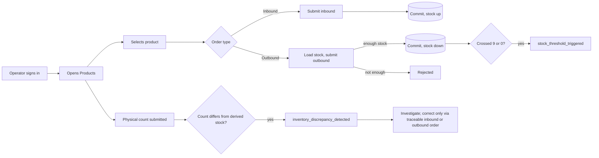

# TrackFlow Telemetry Plan

- Status: draft for the Friday review
- Date: 2026-10-14
- Companion file: [event-schemas.json](event-schemas.json) (JSON Schema draft-07, schema version 1.0.0)
- Scope: design only. No instrumentation code is written by this document.

## 0. Summary

The inventory system works but nobody can see inside it. This plan answers the management RFI: yes, the system can produce actionable information, not only about inventory but about every part of the application that a user or a process touches.

| Item | Count |
|---|---|
| Events in the catalogue | 44 |
| Mandatory events | 12 |
| Identified opportunities | 32 |
| Categories | 7 (inventory, authentication, navigation, performance, errors, operations, pipeline) |
| Stream / batch | 13 / 30 |

### 0.1 Where the mandatory metrics come from (needs confirmation on Friday)

The brief says the mandatory metrics are listed in `CONTEXT`. The repository has no root `CONTEXT.md` (only `contexts/context.md`, mirrored in `memory-bank/context.md`), and neither contains an explicit list titled "mandatory metrics". The plan therefore derives the mandatory floor from the three sources that do exist, and marks every derived item so it can be corrected:

| Source | What it fixes |
|---|---|
| Tech lead message (`lead-instr-1.png`) | Outbound orders per day, validation errors per product, rejected direct stock edits, minimum-stock alerts, failed logins per day, most-visited sections, abandoned flows. |
| `contexts/context.md`, Technology and Warehouse Operations | "Centralised telemetry and logging", "real-time monitoring with automatic alerts" (API latency and errors) and "low-stock alerts". |
| `contexts/coding-fundamentals.md` and `memory-bank/techContext.md` | Entities (Product, InventoryMovement as inbound/outbound orders), the minimum-stock concept, and the business constraint. |

If a different list exists, replace the mandatory set before Friday. The identifiers below follow the code and the contexts verbatim.

## 1. Phase 1: Exhaustive catalogue of data opportunities

### 1.1 Mandatory metrics, entities and constraints

**Entities** (as implemented in `services/inventory/models.py`)

| Entity | Identifier | Notes |
|---|---|---|
| Product | `product_id` (UUID), unique `(sku, warehouse)` | Warehouses are `Monterrey` and `Zaragoza`. Stock is never stored. |
| Inbound order | `order_id` (UUID) | Adds stock. Carries `user_uuid`. |
| Outbound order | `order_id` (UUID) | Removes stock. Carries `user_uuid`. |
| User | `userId` (TinyDB UUID4) | Also the envelope `userId`. |

**Business constraint (non-negotiable)**: stock cannot be modified directly; it changes only through inbound and outbound orders traceable to a user. Current stock = inbound total minus outbound total. The stock rule is enforced under a `SELECT FOR UPDATE` lock in `record_order`.

**Minimum-stock rule**: the SQL schema has no per-product minimum. The documented display bands are 0 (out of stock), 1-9 (low) and 10+ (healthy), and the plan reuses them for `stock_threshold_triggered`. If a per-product `minStockThreshold` (present in `contexts/coding-fundamentals.md`) is added later, `threshold_max_units` takes that value without changing the event name.

**Mandatory metrics, each mapped to its event**

| Mandatory metric | Event | Source |
|---|---|---|
| Product registered | `product_created` | Product entity |
| Inbound orders per day | `inbound_order_created` | InventoryMovement |
| Outbound orders per day | `outbound_order_created` | Lead message |
| Validation errors per product | `order_validation_failed` | Lead message |
| Physical-count stock discrepancies | `inventory_discrepancy_detected` | CTO feedback; Warehouse Operations reports discrepancies are frequent and detected late |
| Direct stock modification attempts | `direct_stock_edit_rejected` | Business constraint |
| Minimum-stock alerts and when they fire | `stock_threshold_triggered` | Warehouse Operations "low-stock alerts" |
| Failed login attempts per day | `login_failed` | Lead message |
| Sections operators visit most | `section_viewed` | Lead message |
| Flows abandoned halfway | `flow_abandoned` | Lead message |
| API response time | `api_latency_recorded` | Technology "real-time monitoring" |
| Error rate and unhandled errors | `api_error_recorded` | Technology "telemetry and logging" |

### 1.2 Inventory flow map and instrumentation points

| # | Point in the flow | Event(s) | Code location |
|---|---|---|---|
| 1 | Product registered or refused as duplicate | `product_created`, `product_creation_rejected` | `service.create_product`, `ProductAlreadyExists` handler |
| 2 | Stock lookup before an outbound order | `stock_availability_checked` | `GET /inventory/products/{id}`, backoffice outbound form |
| 3 | Inbound order committed | `inbound_order_created` | `service.record_order`, after `flush()` |
| 4 | Outbound order committed | `outbound_order_created` | `service.record_order`, after `flush()` |
| 5 | Validation failure (insufficient stock, unknown product, bad quantity) | `order_validation_failed` | `ValidationFailed` and `ProductNotFound` raise sites plus the 422 handler for the order schemas |
| 6 | Direct stock modification attempt | `direct_stock_edit_rejected` | See note below |
| 7 | Band crossing after an outbound order | `stock_threshold_triggered` | `service.record_order`, comparing `stock_before` and `stock_after` |
| 8 | Concurrent contention | `inventory_lock_wait_recorded` | Around the `with_for_update()` query |
| 9 | Daily stock history | `stock_snapshot_recorded` | Scheduled job reading `list_products` |
| 10 | Browsing products and history | `section_viewed`, `list_filter_applied` | Frontend routes under `/backoffice/inventory/...` |
| 11 | Abandoned inbound/outbound forms | `flow_started`, `flow_completed`, `flow_abandoned` | `uis/backoffice` shared order form |
| 12 | Physical count or warehouse-system count is reconciled against derived inventory | `inventory_discrepancy_detected` | Future reconciliation action/endpoint or WMS connector, after the count is submitted and compared with inbound-minus-outbound stock |

**Discrepancy capture boundary.** No physical-count or reconciliation endpoint exists today. Add the event when a count is submitted through a future reconciliation workflow (or imported from the Monterrey/Zaragoza WMS) and the counted quantity differs from the transaction-derived quantity. Emit one event per product per reconciliation, including zero-count discrepancies; do not emit for a matching count. This event records evidence only: it must not update stock. Any correction remains a separately authenticated inbound or outbound order, attributed to its user, preserving the existing non-negotiable stock constraint.

**Note on direct stock edits.** There is no endpoint that writes stock, which is the point of the constraint. A direct edit attempt therefore shows up as: (a) `POST /inventory/products` or an order payload with a stock-like field, which the `extra="forbid"` schemas already reject with 422, or (b) a `PUT`, `PATCH` or `DELETE` against `/inventory/products/{id}`, which returns 405 (or 404). The event is emitted from the exception handler and a small middleware hook that sees these statuses on `/inventory` routes. Only field names from an allow-list are recorded, never values.

### 1.3 Other sections of the application

| Area | What is touched | Events |
|---|---|---|
| Authentication | Login, token, expired sessions, rejected tokens, registration, password recovery and change | `login_succeeded`, `login_failed`, `session_expired`, `token_rejected`, `user_registered`, `password_reset_requested`, `password_reset_completed`, `password_reset_rejected`, `password_changed`, `password_change_rejected` |
| Navigation | Section views, time in section, flows, filters, form errors | `section_viewed`, `section_left`, `flow_started`, `flow_completed`, `flow_abandoned`, `list_filter_applied`, `form_validation_failed` |
| Errors | What users actually see | `api_error_recorded`, `ui_error_displayed` |
| Performance | Backend latency, Core Web Vitals, dependencies, email, restarts | `api_latency_recorded`, `page_load_measured`, `service_lifecycle_recorded`, `dependency_health_sampled`, `email_delivery_recorded` |
| Operations | Incidents, suppliers, profiles | `incident_created`, `incident_status_changed`, `supplier_created`, `supplier_rated`, `supplier_status_changed`, `supplier_deleted`, `profile_updated` |
| Pipeline | Telemetry's own health and data jobs | `telemetry_dropped`, `seed_run_completed`, `stock_snapshot_recorded` |

### 1.4 Catalogue with hypothesis and decision

Every entry completes the sentence: "We capture [event_type] because we need to know [hypothesis], which allows us to make the decision [decision]." Points that could not complete it were discarded; see section 3.3.

#### Mandatory events

1. [inventory] We capture `product_created` because we need to know how fast the catalogue grows per warehouse and who is onboarding SKUs, which allows us to plan catalogue-maintenance capacity and spot warehouses that lag in onboarding.
2. [inventory] We capture `inbound_order_created` because we need to know how much stock enters each warehouse per day and who records it, which allows us to size receiving staff per warehouse and detect days with no receipts.
3. [inventory] We capture `outbound_order_created` because we need to know how many outbound orders are registered per day, per warehouse and per user, which allows us to plan picking capacity and replenishment.
4. [inventory] We capture `order_validation_failed` because we need to know which products and fields accumulate the most validation errors, and how large the stock shortfall is, which allows us to fix confusing forms, correct stock records, or reorder products that operators keep over-requesting.
5. [inventory] We capture `inventory_discrepancy_detected` because we need to know which products and warehouses have physical counts that disagree with transaction-derived stock, which allows us to investigate process or integration failures before they cause missed picks, overselling or inaccurate reports.
6. [inventory] We capture `direct_stock_edit_rejected` because we need to know whether users or integrations try to bypass the inbound/outbound rule, and who, which allows us to decide on user training, tighter access, or a clearer UI when the attempts concentrate on one user or client.
7. [inventory] We capture `stock_threshold_triggered` because we need to know when and where the minimum-stock alerts fire most, which allows us to set reorder points and trigger replenishment before a warehouse stocks out.
8. [authentication] We capture `login_failed` because we need to know how many failed login attempts happen per day and whether they concentrate on one identifier, which allows us to tune rate limiting, add lockout or investigate credential-stuffing.
9. [navigation] We capture `section_viewed` because we need to know which sections operators visit most and in which order, which allows us to prioritise the roadmap and decide what to promote or retire in the navigation.
10. [navigation] We capture `flow_abandoned` because we need to know which flows get abandoned halfway through and at which step, which allows us to fix the step that loses operators, or remove a flow nobody finishes.
11. [performance] We capture `api_latency_recorded` because we need to know which endpoints are slow and how latency changes over time, which allows us to decide on indexing, caching and capacity before operators feel it.
12. [errors] We capture `api_error_recorded` because we need to know the error rate per endpoint and which errors are domain rules versus defects, which allows us to page an engineer for 5xx and prioritise bug fixes versus UX fixes.

#### Identified opportunities

1. [inventory] We capture `product_creation_rejected` because we need to know whether operators keep trying to register duplicates or malformed products, which allows us to decide whether the creation form needs duplicate detection or clearer guidance.
2. [inventory] We capture `stock_availability_checked` because we need to know how often operators work against stale stock and how slow the check feels, which allows us to decide whether to poll, cache or push stock to the form.
3. [inventory] We capture `inventory_lock_wait_recorded` because we need to know whether concurrent operators contend on the same product, which allows us to decide if hot products need a different concurrency strategy.
4. [inventory] We capture `stock_snapshot_recorded` because we need to know how stock evolves over time, because stock is derived and has no history, which allows us to forecast demand, slow movers and seasonal replenishment.
5. [authentication] We capture `login_succeeded` because we need to know daily active users and which client apps are used, which allows us to prioritise the backoffice or website and size support.
6. [authentication] We capture `session_expired` because we need to know how often operators lose a session mid-task, which allows us to adjust `ACCESS_TOKEN_EXPIRE_MINUTES` or add silent renewal.
7. [authentication] We capture `token_rejected` because we need to know whether stale, forged or orphaned tokens are in circulation, which allows us to investigate tampering or revisit deactivation behaviour.
8. [authentication] We capture `user_registered` because we need to know how fast the user base grows and through which client, which allows us to decide onboarding effort and which app to invest in.
9. [authentication] We capture `password_reset_requested` because we need to know how often users get locked out of their account, which allows us to invest in clearer sign-in UX or SSO.
10. [authentication] We capture `password_reset_completed` because we need to know how long users take to use the emailed link, which allows us to tune `PASSWORD_RESET_TOKEN_EXPIRE_MINUTES`.
11. [authentication] We capture `password_reset_rejected` because we need to know whether links expire before use or are replayed, which allows us to extend expiry or investigate replay attempts.
12. [authentication] We capture `password_changed` because we need to know how many accounts rotate credentials, which allows us to judge whether a password-rotation reminder is needed.
13. [authentication] We capture `password_change_rejected` because we need to know whether sessions are used by someone who does not know the current password, which allows us to flag possible hijacked sessions.
14. [navigation] We capture `section_left` because we need to know which sections hold attention and which are bounced from, which allows us to redesign or merge low-value sections.
15. [navigation] We capture `flow_started` because we need to know how many people begin each flow, which allows us to build the denominator for abandonment analysis.
16. [navigation] We capture `flow_completed` because we need to know how long flows take and how many submit attempts they need, which allows us to simplify the flows that need several attempts.
17. [navigation] We capture `list_filter_applied` because we need to know which filters operators rely on, which allows us to promote the filters people use as defaults or saved views.
18. [navigation] We capture `form_validation_failed` because we need to know which fields confuse operators, which allows us to rewrite labels, hints and defaults.
19. [errors] We capture `ui_error_displayed` because we need to know how often users see failures and which kind, which allows us to prioritise fixes by user impact.
20. [performance] We capture `page_load_measured` because we need to know whether real users match the lab scores recorded in `AUDIT.md`, which allows us to decide on frontend optimisation work with field data.
21. [performance] We capture `service_lifecycle_recorded` because we need to know how often and why the service restarts, which allows us to fix recurring startup failures such as a database or settings fault.
22. [performance] We capture `dependency_health_sampled` because we need to know whether TinyDB, Supabase and the email provider are healthy, which allows us to trigger automatic alerts and decide when to scale or fail over.
23. [performance] We capture `email_delivery_recorded` because we need to know whether reset emails actually leave the system, which allows us to move off the console backend or verify the sender domain.
24. [pipeline] We capture `telemetry_dropped` because we need to know whether the telemetry itself is losing data, which allows us to resize buffers or fix a failing transport.
25. [operations] We capture `incident_created` because we need to know how many incidents are raised and where, which allows us to staff incident handling per branch and category.
26. [operations] We capture `incident_status_changed` because we need to know how long incidents wait before being worked, which allows us to set resolution-time targets and escalation rules.
27. [operations] We capture `supplier_created` because we need to know how fast the supplier directory grows, which allows us to plan supplier onboarding.
28. [operations] We capture `supplier_rated` because we need to know how supplier quality perception moves, which allows us to review contracts with falling ratings.
29. [operations] We capture `supplier_status_changed` because we need to know how many suppliers are deactivated and when, which allows us to audit supplier churn.
30. [operations] We capture `supplier_deleted` because we need to know whether deletions are frequent or unusual, which allows us to decide if soft-delete or confirmation is needed.
31. [operations] We capture `profile_updated` because we need to know which profile fields people maintain, which allows us to drop or simplify unused profile fields.
32. [pipeline] We capture `seed_run_completed` because we need to know whether data jobs finish and stay idempotent, which allows us to catch broken data loads before dashboards go stale.

## 2. Phase 2: Event envelope design

### 2.1 Standard envelope

Every event carries these fields and nothing else at the top level.

| Field | Type | Rule |
|---|---|---|
| `eventId` | UUID | Unique per event. Consumers deduplicate on it. |
| `timestamp` | ISO 8601 UTC string | When the event occurred at the emitter, for example `2026-10-14T10:00:00Z`. |
| `sessionId` | UUID | Generated by the browser per tab session and sent as `X-Session-Id`. The API is stateless JWT with no server session, so this id is client-owned. Scripts use one id per run. |
| `userId` | UUID or null | TinyDB user UUID from the validated token. Null for anonymous views and unknown accounts. |
| `event_type` | string | `entity_action` name, lower snake case. |
| `schemaVersion` | semver string | Version of that event's schema. |
| `requestId` | UUID | One per HTTP request, from `X-Request-Id` or generated by the API when absent. Correlates the event with the `api.timing` log line and any error. |
| `properties` | object | Event-specific allow-listed payload. |

Naming and evolution rules:

- Taxonomy is `entity_action` in the past tense (`inbound_order_created`, `session_expired`). Technical measurements use `_recorded`, `_measured` or `_sampled`.
- Adding an optional property is a minor version bump; removing, renaming or changing a type is a major bump and creates a new schema entry.
- Property keys are lower snake case. Properties not in an event's allow-list are rejected by validation (`additionalProperties: false`), which prevents accidental leakage.
- Frontend calls add two headers, `X-Session-Id` and `X-Client-App`. CORS already allows all headers.

### 2.2 Privacy rules applied to all events

- Never emitted: passwords, tokens, reset links, raw email addresses, IP addresses, free-text search terms, incident descriptions, supplier contact and price data, customer fields.
- Failed logins carry `identifier_hash`: a keyed HMAC-SHA-256 of the submitted email truncated to 16 hex characters, with the key held outside the event store. It allows grouping repeated attempts without storing the address.
- `userId` is a pseudonymous UUID. It is still personal data under GDPR (Zaragoza operations), so it follows the retention and access rules in section 3.3.
- Forms are measured by field names and counts, never by values.

### 2.3 Event reference

Property tables list the permitted keys. Full constraints (enum values, ranges, patterns) are in [event-schemas.json](event-schemas.json).

#### `product_created`

- Class: mandatory; category: inventory; emitted by: backend.
- Description: Each product registered in a warehouse.
- Sensitive data / PII: None beyond the pseudonymous `userId` in the envelope.

| Property | Type | Required | Description |
|---|---|---|---|
| `product_id` | string (uuid) | yes | New product UUID. |
| `sku` | string | yes | Product SKU (business identifier, not personal data). |
| `warehouse` | enum: `Monterrey`, `Zaragoza` | yes | Warehouse of the product. |
| `initial_stock` | integer (>= 0) | yes | Always 0; stock is derived, never stored. |

#### `product_creation_rejected`

- Class: identified opportunity; category: inventory; emitted by: backend.
- Description: Each rejected product creation.
- Sensitive data / PII: None beyond the pseudonymous `userId` in the envelope.

| Property | Type | Required | Description |
|---|---|---|---|
| `reason` | enum: `duplicate_sku_warehouse`, `validation_failed` | yes | Why it was refused. |
| `sku` | string, nullable | yes | Product SKU (business identifier, not personal data). |
| `warehouse` | enum: `Monterrey`, `Zaragoza`, nullable | yes | Warehouse of the product. |
| `rejected_fields` | array<string> | no | Names of fields that failed validation. |

#### `inbound_order_created`

- Class: mandatory; category: inventory; emitted by: backend.
- Description: Each committed inbound order.
- Sensitive data / PII: `userId` in the envelope is the only person reference; no names or emails.

| Property | Type | Required | Description |
|---|---|---|---|
| `order_id` | string (uuid) | yes | Inbound order UUID. |
| `product_id` | string (uuid) | yes | Product UUID. |
| `sku` | string | yes | Product SKU (business identifier, not personal data). |
| `warehouse` | enum: `Monterrey`, `Zaragoza` | yes | Warehouse of the product. |
| `quantity` | integer (>= 1) | yes | Units received. |
| `stock_after` | integer (>= 0) | yes | Computed stock after the movement. |
| `transaction_ms` | number (>= 0) | yes | Lock + insert + commit duration. |
| `actor_role` | string | no | Role of the authenticated user. |

#### `outbound_order_created`

- Class: mandatory; category: inventory; emitted by: backend.
- Description: Each committed outbound order.
- Sensitive data / PII: None beyond the pseudonymous `userId` in the envelope.

| Property | Type | Required | Description |
|---|---|---|---|
| `order_id` | string (uuid) | yes | Outbound order UUID. |
| `product_id` | string (uuid) | yes | Product UUID. |
| `sku` | string | yes | Product SKU (business identifier, not personal data). |
| `warehouse` | enum: `Monterrey`, `Zaragoza` | yes | Warehouse of the product. |
| `quantity` | integer (>= 1) | yes | Units dispatched. |
| `stock_before` | integer (>= 0) | yes | Stock before the movement. |
| `stock_after` | integer (>= 0) | yes | Stock after the movement. |
| `drained_to_zero` | boolean | yes | True when this order emptied the product. |
| `transaction_ms` | number (>= 0) | yes | Lock + validate + insert + commit duration. |
| `actor_role` | string | no | Role of the authenticated user. |

#### `order_validation_failed`

- Class: mandatory; category: inventory; emitted by: backend.
- Description: Each inbound/outbound order refused by validation.
- Sensitive data / PII: None beyond the pseudonymous `userId` in the envelope.

| Property | Type | Required | Description |
|---|---|---|---|
| `order_direction` | enum: `inbound`, `outbound` | yes | Order type attempted. |
| `rejection_reason` | enum: `insufficient_stock`, `product_not_found`, `invalid_quantity`, `malformed_payload` | yes | Rule that refused the order. |
| `field` | enum: `quantity`, `product_id`, `other` | yes | Offending field. |
| `product_id` | string (uuid), nullable | yes | Product UUID if it was a valid UUID. |
| `sku` | string, nullable | yes | Product SKU (business identifier, not personal data). |
| `warehouse` | enum: `Monterrey`, `Zaragoza`, nullable | yes | Warehouse of the product. |
| `requested_quantity` | integer, nullable | yes | Quantity requested, null if not an integer. |
| `available_stock` | integer (>= 0), nullable | yes | Stock at refusal time, null if the product was not found. |
| `shortfall` | integer (>= 1), nullable | yes | requested - available when insufficient_stock, else null. |

#### `inventory_discrepancy_detected`

- Class: mandatory; category: inventory; emitted by: backend reconciliation workflow or WMS connector (future capture point; not implemented today).
- Description: One physical or imported count disagrees with transaction-derived stock for a product.
- Sensitive data / PII: `userId` in the envelope identifies the authenticated counter where available; no names, free text or customer data. `source_system` is a fixed enum.

| Property | Type | Required | Description |
|---|---|---|---|
| `reconciliation_id` | string (uuid) | yes | Stable identifier for the count/reconciliation run. |
| `product_id` | string (uuid) | yes | Product UUID. |
| `sku` | string | yes | Product SKU (business identifier, not personal data). |
| `warehouse` | enum: `Monterrey`, `Zaragoza` | yes | Warehouse where the count was performed. |
| `expected_stock` | integer (>= 0) | yes | Stock computed from committed inbound minus outbound orders at reconciliation time. |
| `counted_stock` | integer (>= 0) | yes | Physical or imported quantity observed. |
| `variance_units` | non-zero integer | yes | `counted_stock - expected_stock`; negative means fewer units were found. |
| `count_method` | enum: `cycle_count`, `full_count`, `inbound_receipt_check`, `outbound_pick_check`, `manual_investigation` | yes | How the observed quantity was obtained. |
| `source_system` | enum: `backoffice`, `monterrey_wms`, `zaragoza_wms`, `manual`, `other` | yes | System that supplied the observation. |

Emit only when `variance_units` is non-zero, once per product per reconciliation. Detection is a stream because warehouse operations should investigate the discrepancy during the current shift. The event reports a mismatch; it never changes stock or substitutes for a traceable inbound/outbound correction.

#### `direct_stock_edit_rejected`

- Class: mandatory; category: inventory; emitted by: backend.
- Description: Each attempt to modify stock directly.
- Sensitive data / PII: None beyond the pseudonymous `userId` in the envelope.

| Property | Type | Required | Description |
|---|---|---|---|
| `attempt_kind` | enum: `stock_field_in_payload`, `unsupported_method_on_stock_resource` | yes | How the bypass was attempted. |
| `http_method` | enum: `GET`, `POST`, `PUT`, `PATCH`, `DELETE` | yes | HTTP method used. |
| `route_template` | string | yes | Route pattern such as `/inventory/products/{id}`, never the raw path. |
| `rejected_fields` | array<enum> | yes | Allow-listed stock-like field names found in the payload (names only, never values). |
| `product_id` | string (uuid), nullable | yes | Target product when present in the path. |
| `response_status` | enum: `404`, `405`, `422` | yes | Status returned (422, 404 or 405). |
| `client_app` | enum: `website`, `backoffice`, `api_docs`, `script`, `unknown` | yes | Which client made the call, from the `X-Client-App` header. |

#### `stock_threshold_triggered`

- Class: mandatory; category: inventory; emitted by: backend.
- Description: Each time a product crosses into a low or out-of-stock band.
- Sensitive data / PII: None beyond the pseudonymous `userId` in the envelope.

| Property | Type | Required | Description |
|---|---|---|---|
| `product_id` | string (uuid) | yes | Product UUID. |
| `sku` | string | yes | Product SKU (business identifier, not personal data). |
| `warehouse` | enum: `Monterrey`, `Zaragoza` | yes | Warehouse of the product. |
| `stock_level_after` | integer (>= 0) | yes | Stock after the crossing movement. |
| `threshold_band` | enum: `out_of_stock`, `low` | yes | Band entered. |
| `threshold_max_units` | integer (>= 0) | yes | Upper bound of the band (0 or 9, the documented display thresholds). |
| `previous_band` | enum: `healthy`, `low` | yes | Band before the movement. |
| `triggering_order_id` | string (uuid) | yes | Outbound order that caused the crossing. |

#### `stock_availability_checked`

- Class: identified opportunity; category: inventory; emitted by: frontend.
- Description: Each stock lookup made while preparing an outbound order.
- Sensitive data / PII: None beyond the pseudonymous `userId` in the envelope.

| Property | Type | Required | Description |
|---|---|---|---|
| `product_id` | string (uuid) | yes | Product UUID. |
| `warehouse` | enum: `Monterrey`, `Zaragoza` | yes | Warehouse of the product. |
| `context` | enum: `outbound_form`, `product_list` | yes | Where the lookup happened. |
| `outcome` | enum: `ok`, `error` | yes | Result of the lookup. |
| `stock_returned` | integer (>= 0), nullable | yes | Stock returned, null on error. |
| `latency_ms` | number (>= 0) | yes | Round-trip time. |

#### `inventory_lock_wait_recorded`

- Class: identified opportunity; category: inventory; emitted by: backend.
- Description: Row-lock waits on `SELECT FOR UPDATE` during movements.
- Sensitive data / PII: None beyond the pseudonymous `userId` in the envelope.

| Property | Type | Required | Description |
|---|---|---|---|
| `order_direction` | enum: `inbound`, `outbound` | yes | Movement type. |
| `warehouse` | enum: `Monterrey`, `Zaragoza` | yes | Warehouse of the product. |
| `wait_ms` | number (>= 0) | yes | Time waiting for the lock. |
| `outcome` | enum: `committed`, `rolled_back` | yes | Transaction result. |

#### `stock_snapshot_recorded`

- Class: identified opportunity; category: inventory; emitted by: script.
- Description: A daily stock snapshot per product.
- Sensitive data / PII: None beyond the pseudonymous `userId` in the envelope.

| Property | Type | Required | Description |
|---|---|---|---|
| `snapshot_date` | string (date) | yes | UTC date of the snapshot. |
| `product_id` | string (uuid) | yes | Product UUID. |
| `sku` | string | yes | Product SKU (business identifier, not personal data). |
| `warehouse` | enum: `Monterrey`, `Zaragoza` | yes | Warehouse of the product. |
| `stock_level` | integer (>= 0) | yes | Computed stock. |
| `inbound_total` | integer (>= 0) | yes | Lifetime inbound units. |
| `outbound_total` | integer (>= 0) | yes | Lifetime outbound units. |
| `band` | enum: `out_of_stock`, `low`, `healthy` | yes | Display band at snapshot time. |

#### `login_succeeded`

- Class: identified opportunity; category: authentication; emitted by: backend.
- Description: Each successful sign-in.
- Sensitive data / PII: None beyond the pseudonymous `userId` in the envelope.

| Property | Type | Required | Description |
|---|---|---|---|
| `login_route` | enum: `/auth/login`, `/auth/token` | yes | Endpoint used. |
| `client_app` | enum: `website`, `backoffice`, `api_docs`, `script`, `unknown` | yes | Which client made the call, from the `X-Client-App` header. |
| `actor_role` | string | no | Role of the user. |

#### `login_failed`

- Class: mandatory; category: authentication; emitted by: backend.
- Description: Each failed sign-in.
- Sensitive data / PII: The raw email and password are never emitted. `identifier_hash` uses a secret key kept out of the data store and rotated quarterly; `userId` is null for unknown accounts.

| Property | Type | Required | Description |
|---|---|---|---|
| `reason` | enum: `unknown_account`, `wrong_password`, `inactive_account`, `malformed_credentials` | yes | Failure class (internal only, never shown to the client). |
| `identifier_hash` | string | yes | Keyed HMAC-SHA-256 of the submitted email, truncated to 16 hex chars. |
| `login_route` | enum: `/auth/login`, `/auth/token` | yes | Endpoint used. |
| `client_app` | enum: `website`, `backoffice`, `api_docs`, `script`, `unknown` | yes | Which client made the call, from the `X-Client-App` header. |

#### `session_expired`

- Class: identified opportunity; category: authentication; emitted by: frontend.
- Description: Each forced sign-out caused by an expired or rejected token.
- Sensitive data / PII: None beyond the pseudonymous `userId` in the envelope.

| Property | Type | Required | Description |
|---|---|---|---|
| `trigger` | enum: `api_401`, `client_exp_check` | yes | How expiry was detected. |
| `session_age_seconds` | integer (>= 0), nullable | yes | Seconds since login, null if unknown. |
| `route_template` | string | yes | Route pattern such as `/inventory/products/{id}`, never the raw path. |

#### `token_rejected`

- Class: identified opportunity; category: authentication; emitted by: backend.
- Description: Each bearer token refused by the auth gate.
- Sensitive data / PII: None beyond the pseudonymous `userId` in the envelope.

| Property | Type | Required | Description |
|---|---|---|---|
| `reason` | enum: `invalid_or_expired`, `missing_user_id`, `user_no_longer_exists`, `inactive_user` | yes | Failure class. |
| `route_template` | string | yes | Route pattern such as `/inventory/products/{id}`, never the raw path. |

#### `user_registered`

- Class: identified opportunity; category: authentication; emitted by: backend.
- Description: Each new account.
- Sensitive data / PII: None beyond the pseudonymous `userId` in the envelope.

| Property | Type | Required | Description |
|---|---|---|---|
| `client_app` | enum: `website`, `backoffice`, `api_docs`, `script`, `unknown` | yes | Which client made the call, from the `X-Client-App` header. |
| `actor_role` | string | no | Initial role. |

#### `password_reset_requested`

- Class: identified opportunity; category: authentication; emitted by: backend.
- Description: Each password-reset request.
- Sensitive data / PII: Deliberately omits whether the address matched an account, so telemetry cannot become an enumeration oracle.

| Property | Type | Required | Description |
|---|---|---|---|
| `client_app` | enum: `website`, `backoffice`, `api_docs`, `script`, `unknown` | yes | Which client made the call, from the `X-Client-App` header. |

#### `password_reset_completed`

- Class: identified opportunity; category: authentication; emitted by: backend.
- Description: Each completed reset.
- Sensitive data / PII: None beyond the pseudonymous `userId` in the envelope.

| Property | Type | Required | Description |
|---|---|---|---|
| `link_age_seconds` | integer (>= 0) | yes | Seconds between issuing and using the link. |

#### `password_reset_rejected`

- Class: identified opportunity; category: authentication; emitted by: backend.
- Description: Each refused reset token.
- Sensitive data / PII: None beyond the pseudonymous `userId` in the envelope.

| Property | Type | Required | Description |
|---|---|---|---|
| `reason` | enum: `forged`, `expired`, `unknown`, `spent` | yes | Internal reason (never shown to the client). |

#### `password_changed`

- Class: identified opportunity; category: authentication; emitted by: backend.
- Description: Each successful password change.
- Sensitive data / PII: None beyond the pseudonymous `userId` in the envelope.

| Property | Type | Required | Description |
|---|---|---|---|
| `route` | enum: `/auth/change-password`, `/users/{user_id}` | yes | Endpoint that changed it. |
| `client_app` | enum: `website`, `backoffice`, `api_docs`, `script`, `unknown` | yes | Which client made the call, from the `X-Client-App` header. |

#### `password_change_rejected`

- Class: identified opportunity; category: authentication; emitted by: backend.
- Description: Each refused password change.
- Sensitive data / PII: None beyond the pseudonymous `userId` in the envelope.

| Property | Type | Required | Description |
|---|---|---|---|
| `reason` | enum: `incorrect_current_password`, `validation_failed` | yes | Why it failed. |

#### `section_viewed`

- Class: mandatory; category: navigation; emitted by: frontend.
- Description: Each backoffice or website section view.
- Sensitive data / PII: None beyond the pseudonymous `userId` in the envelope.

| Property | Type | Required | Description |
|---|---|---|---|
| `section` | enum (see JSON) | yes | Logical section. |
| `route_template` | string | yes | Route pattern such as `/inventory/products/{id}`, never the raw path. |
| `referrer_section` | enum (see JSON), nullable | yes | Previous section, null if none. |
| `entry_type` | enum: `initial_load`, `navigation`, `reload`, `back_forward` | yes | How the view started. |
| `viewport` | enum: `mobile`, `tablet`, `desktop` | yes | Width class. |

#### `section_left`

- Class: identified opportunity; category: navigation; emitted by: frontend.
- Description: The time spent in each section.
- Sensitive data / PII: None beyond the pseudonymous `userId` in the envelope.

| Property | Type | Required | Description |
|---|---|---|---|
| `section` | enum (see JSON) | yes | Logical section. |
| `dwell_ms` | integer (>= 0) | yes | Visible time in the section. |
| `interacted` | boolean | yes | Any click, input or submit happened. |

#### `flow_started`

- Class: identified opportunity; category: navigation; emitted by: frontend.
- Description: The first interaction in a multi-step flow.
- Sensitive data / PII: None beyond the pseudonymous `userId` in the envelope.

| Property | Type | Required | Description |
|---|---|---|---|
| `flow` | enum (see JSON) | yes | Flow name. |
| `entry_section` | enum (see JSON) | yes | Section where it began. |

#### `flow_completed`

- Class: identified opportunity; category: navigation; emitted by: frontend.
- Description: The successful end of a flow.
- Sensitive data / PII: None beyond the pseudonymous `userId` in the envelope.

| Property | Type | Required | Description |
|---|---|---|---|
| `flow` | enum (see JSON) | yes | Flow name. |
| `duration_ms` | integer (>= 0) | yes | Start to completion. |
| `attempts` | integer (>= 1) | yes | Submit attempts, including failures. |

#### `flow_abandoned`

- Class: mandatory; category: navigation; emitted by: frontend.
- Description: Each flow left before completion.
- Sensitive data / PII: None beyond the pseudonymous `userId` in the envelope.

| Property | Type | Required | Description |
|---|---|---|---|
| `flow` | enum (see JSON) | yes | Flow name. |
| `last_step` | enum: `opened`, `field_edited`, `submit_failed`, `submitted_awaiting_response` | yes | Furthest point reached. |
| `fields_touched` | integer (>= 0) | yes | Number of fields edited (count only, never values). |
| `duration_ms` | integer (>= 0) | yes | Time from start to exit. |
| `exit_reason` | enum: `navigated_away`, `tab_closed`, `session_expired`, `idle_timeout` | yes | How the user left. |

#### `list_filter_applied`

- Class: identified opportunity; category: navigation; emitted by: frontend.
- Description: Each filter combination applied to a list.
- Sensitive data / PII: None beyond the pseudonymous `userId` in the envelope.

| Property | Type | Required | Description |
|---|---|---|---|
| `view` | enum: `inventory_products`, `inventory_orders`, `suppliers_list`, `incidents_list` | yes | List view. |
| `filter_keys` | array<enum> | yes | Names of filters used (never their values). |
| `result_count` | integer (>= 0) | yes | Rows returned. |

#### `form_validation_failed`

- Class: identified opportunity; category: navigation; emitted by: frontend.
- Description: Each client-side validation failure.
- Sensitive data / PII: None beyond the pseudonymous `userId` in the envelope.

| Property | Type | Required | Description |
|---|---|---|---|
| `flow` | enum (see JSON) | yes | Flow name. |
| `field` | string | yes | Field name from a fixed form schema. |
| `error_code` | enum (see JSON) | yes | Error class. |

#### `ui_error_displayed`

- Class: identified opportunity; category: errors; emitted by: frontend.
- Description: Each error message or crash screen shown to a user.
- Sensitive data / PII: None beyond the pseudonymous `userId` in the envelope.

| Property | Type | Required | Description |
|---|---|---|---|
| `error_class` | enum: `network`, `client_error_4xx`, `server_error_5xx`, `unreadable_response`, `render_crash` | yes | Kind of failure shown. |
| `route_template` | string | yes | Route pattern such as `/inventory/products/{id}`, never the raw path. |
| `http_status` | integer (>= 100), nullable | yes | Status if any. |
| `fingerprint` | string | yes | Stable hash of error class + route; never the message text. |

#### `api_latency_recorded`

- Class: mandatory; category: performance; emitted by: backend.
- Description: The latency of every API request.
- Sensitive data / PII: None beyond the pseudonymous `userId` in the envelope.

| Property | Type | Required | Description |
|---|---|---|---|
| `route_template` | string | yes | Route pattern such as `/inventory/products/{id}`, never the raw path. |
| `method` | enum: `GET`, `POST`, `PUT`, `PATCH`, `DELETE` | yes | HTTP method. |
| `status_class` | enum: `2xx`, `3xx`, `4xx`, `5xx` | yes | Response class. |
| `duration_ms` | number (>= 0) | yes | Total handler time (matches the existing timing middleware). |
| `db_ms` | number (>= 0), nullable | no | Database time, null if unmeasured. |
| `sample_rate` | number (>= 0.01) | yes | Probability this event was kept; consumers divide by it. |

#### `api_error_recorded`

- Class: mandatory; category: errors; emitted by: backend.
- Description: Each 4xx and 5xx response.
- Sensitive data / PII: None beyond the pseudonymous `userId` in the envelope.

| Property | Type | Required | Description |
|---|---|---|---|
| `route_template` | string | yes | Route pattern such as `/inventory/products/{id}`, never the raw path. |
| `method` | enum: `GET`, `POST`, `PUT`, `PATCH`, `DELETE` | yes | HTTP method. |
| `status_code` | integer (>= 400) | yes | HTTP status. |
| `error_class` | enum (see JSON) | yes | Classification. |
| `exception_type` | string, nullable | no | Exception class name only, never the message or traceback. |

#### `page_load_measured`

- Class: identified opportunity; category: performance; emitted by: frontend.
- Description: Core Web Vitals per section.
- Sensitive data / PII: None beyond the pseudonymous `userId` in the envelope.

| Property | Type | Required | Description |
|---|---|---|---|
| `section` | enum (see JSON) | yes | Logical section. |
| `metric` | enum: `LCP`, `INP`, `CLS`, `FCP`, `TTFB` | yes | Web Vital. |
| `value` | number (>= 0) | yes | Final metric value. |
| `rating` | enum: `good`, `needs_improvement`, `poor` | yes | Standard rating. |
| `connection` | string, nullable | no | Effective connection type, null if unavailable. |

#### `service_lifecycle_recorded`

- Class: identified opportunity; category: performance; emitted by: backend.
- Description: API startup, failed startup and shutdown.
- Sensitive data / PII: None beyond the pseudonymous `userId` in the envelope.

| Property | Type | Required | Description |
|---|---|---|---|
| `phase` | enum: `startup_succeeded`, `startup_failed`, `shutdown` | yes | Lifecycle phase. |
| `failed_check` | enum: `settings`, `identity_db`, `sql_connection`, `schema_init`, nullable | no | Failing startup step. |
| `duration_ms` | number (>= 0) | yes | Time spent in the phase. |
| `app_version` | string | yes | FastAPI app version. |

#### `dependency_health_sampled`

- Class: identified opportunity; category: performance; emitted by: backend.
- Description: A health sample of each dependency every 60 s.
- Sensitive data / PII: None beyond the pseudonymous `userId` in the envelope.

| Property | Type | Required | Description |
|---|---|---|---|
| `dependency` | enum: `tinydb`, `supabase_postgres`, `resend` | yes | Dependency sampled. |
| `status` | enum: `ok`, `degraded`, `down` | yes | Health result. |
| `latency_ms` | number (>= 0), nullable | yes | Probe time, null when down. |

#### `email_delivery_recorded`

- Class: identified opportunity; category: performance; emitted by: backend.
- Description: Each transactional email attempt.
- Sensitive data / PII: The recipient address and message body are never emitted.

| Property | Type | Required | Description |
|---|---|---|---|
| `template` | enum: `password_reset` | yes | Email template. |
| `provider` | enum: `resend`, `console` | yes | Backend used. |
| `outcome` | enum: `accepted`, `failed` | yes | Result. |
| `latency_ms` | number (>= 0) | yes | Provider call time. |

#### `telemetry_dropped`

- Class: identified opportunity; category: pipeline; emitted by: backend.
- Description: Events the emitter had to discard.
- Sensitive data / PII: None beyond the pseudonymous `userId` in the envelope.

| Property | Type | Required | Description |
|---|---|---|---|
| `emitter` | enum: `backend`, `frontend`, `script` | yes | Which emitter dropped. |
| `reason` | enum: `buffer_full`, `serialization_error`, `schema_rejected`, `transport_failed`, `deduplicated` | yes | Why events were dropped. |
| `dropped_count` | integer (>= 1) | yes | Events dropped in the window. |
| `window_seconds` | integer (>= 1) | yes | Window length. |

#### `incident_created`

- Class: identified opportunity; category: operations; emitted by: backend.
- Description: Each incident reported.
- Sensitive data / PII: Incident description and customer fields are never emitted.

| Property | Type | Required | Description |
|---|---|---|---|
| `incident_id` | string (uuid) | yes | Incident UUID. |
| `category` | string | yes | Incident category (enumerated). |
| `origin` | string | yes | Incident origin (enumerated). |
| `branch` | string | yes | Branch (enumerated). |

#### `incident_status_changed`

- Class: identified opportunity; category: operations; emitted by: backend.
- Description: Each incident status transition.
- Sensitive data / PII: None beyond the pseudonymous `userId` in the envelope.

| Property | Type | Required | Description |
|---|---|---|---|
| `incident_id` | string (uuid) | yes | Incident UUID. |
| `from_status` | string | yes | Previous status. |
| `to_status` | string | yes | New status. |
| `age_hours` | number (>= 0) | yes | Hours since creation. |

#### `supplier_created`

- Class: identified opportunity; category: operations; emitted by: backend.
- Description: Each supplier registered.
- Sensitive data / PII: Supplier names, contacts and prices are commercially sensitive and are never emitted.

| Property | Type | Required | Description |
|---|---|---|---|
| `supplier_id` | integer (>= 1) | yes | TinyDB document id. |

#### `supplier_rated`

- Class: identified opportunity; category: operations; emitted by: backend.
- Description: Each supplier rating change.
- Sensitive data / PII: None beyond the pseudonymous `userId` in the envelope.

| Property | Type | Required | Description |
|---|---|---|---|
| `supplier_id` | integer (>= 1) | yes | TinyDB document id. |
| `from_rating` | number, nullable | yes | Previous rating, null if none. |
| `to_rating` | number | yes | New rating. |

#### `supplier_status_changed`

- Class: identified opportunity; category: operations; emitted by: backend.
- Description: Each supplier status change.
- Sensitive data / PII: None beyond the pseudonymous `userId` in the envelope.

| Property | Type | Required | Description |
|---|---|---|---|
| `supplier_id` | integer (>= 1) | yes | TinyDB document id. |
| `from_status` | string | yes | Previous status. |
| `to_status` | string | yes | New status. |

#### `supplier_deleted`

- Class: identified opportunity; category: operations; emitted by: backend.
- Description: Each supplier deletion.
- Sensitive data / PII: None beyond the pseudonymous `userId` in the envelope.

| Property | Type | Required | Description |
|---|---|---|---|
| `supplier_id` | integer (>= 1) | yes | TinyDB document id. |

#### `profile_updated`

- Class: identified opportunity; category: operations; emitted by: backend.
- Description: Each profile edit.
- Sensitive data / PII: None beyond the pseudonymous `userId` in the envelope.

| Property | Type | Required | Description |
|---|---|---|---|
| `fields_changed` | array<string> | yes | Names of changed fields (never values). |

#### `seed_run_completed`

- Class: identified opportunity; category: pipeline; emitted by: script.
- Description: Each seed or data-maintenance script run.
- Sensitive data / PII: None beyond the pseudonymous `userId` in the envelope.

| Property | Type | Required | Description |
|---|---|---|---|
| `script` | enum: `seed_incidents`, `seed_inventory`, `seed_performance_data` | yes | Script name. |
| `outcome` | enum: `succeeded`, `failed`, `refused_conflict` | yes | Result. |
| `inserted_count` | integer (>= 0) | yes | Rows inserted. |
| `skipped_count` | integer (>= 0) | yes | Rows skipped. |
| `duration_ms` | integer (>= 0) | yes | Run time. |

### 2.4 Export

`event-schemas.json` uses JSON Schema draft-07. The root `oneOf` selects the schema by `event_type`; each schema combines the shared `envelope` definition with the event's own `properties` allow-list. Each event also carries an `x-trackflow` block with classification, category, emitter, delivery mode and PII handling. The file was checked against the draft-07 meta-schema, and each event validated with a sample payload. An extra property in either `properties` or the envelope was rejected for every event.

## 3. Phase 3: Delivery strategy

### 3.1 Stream versus batch

The rule: an event is **stream** only if someone must act within the hour or the signal protects data integrity, security or availability. Everything else is **batch**, because the decision it feeds is a daily or weekly review.

| Event | Mode | Justification | Throttle / debounce |
|---|---|---|---|
| `product_created` | batch | Catalogue growth is a weekly planning input; nobody acts within minutes. | None. |
| `product_creation_rejected` | batch | Usability signal reviewed in aggregate. | None. |
| `inbound_order_created` | stream | Feeds the live stock and receiving dashboards; warehouse managers act within the shift. | None. |
| `outbound_order_created` | stream | Outbound volume and stock depletion drive same-day replenishment decisions. | None. |
| `order_validation_failed` | stream | A burst of shortfalls signals a stock-record error or a broken form and is worth catching the same day. | None. |
| `direct_stock_edit_rejected` | stream | A security- and integrity-relevant behaviour; the business rule is non-negotiable, so detection must be near real time. | No throttle. Alert rule: 3 or more per user in 10 minutes. |
| `inventory_discrepancy_detected` | stream | A physical-count mismatch can cause missed picks, overselling or inaccurate reports; operations should investigate during the current shift. | Emit once per product per reconciliation, only when variance is non-zero. |
| `stock_threshold_triggered` | stream | Low stock is the one inventory signal that must reach procurement before the next order, not tomorrow. | Emitted on band crossing only, not on every order inside the band. |
| `stock_availability_checked` | batch | Usability and latency tuning, reviewed weekly. | Debounce 500 ms per product. |
| `inventory_lock_wait_recorded` | batch | Capacity tuning; no operator action is needed immediately. | Emit only when wait_ms >= 50 or the transaction rolled back. |
| `stock_snapshot_recorded` | batch | A scheduled daily job by definition; trend analysis needs no latency. | None. |
| `login_succeeded` | batch | Usage reporting; no real-time decision. | None. |
| `login_failed` | stream | Brute-force and credential-stuffing must be noticed within minutes. | No throttle. Alert rule: 10 or more per identifier_hash in 10 minutes. |
| `session_expired` | batch | Session-length tuning is a product decision taken weekly. | Once per token. |
| `token_rejected` | batch | Security trend; spikes show on the daily review. | Aggregate to one event per reason and route per minute. |
| `user_registered` | batch | Growth reporting. | None. |
| `password_reset_requested` | batch | Trend only. | None. |
| `password_reset_completed` | batch | Trend only. | None. |
| `password_reset_rejected` | batch | Trend only; the client already sees a single generic message. | None. |
| `password_changed` | batch | Trend only. | None. |
| `password_change_rejected` | stream | A wrong current password inside a live session can mean a hijacked session; worth an alert. | Alert rule: 3 or more per user in 15 minutes. |
| `section_viewed` | batch | Usage analytics; no decision depends on seconds. | Dedupe identical section within 1 s and on tab refocus. |
| `section_left` | batch | Engagement analysis. | Count visible time only; ignore dwell under 500 ms. |
| `flow_started` | batch | Funnel analysis. | None. |
| `flow_completed` | batch | Funnel analysis. | None. |
| `flow_abandoned` | batch | Funnel analysis needs whole-day volumes, not instant reaction. | Idle timeout 15 min; delivered with `navigator.sendBeacon` on page hide. |
| `list_filter_applied` | batch | Usability analysis. | Debounce 800 ms; free-text search values are excluded because they can hold personal data. |
| `form_validation_failed` | batch | UX tuning. | One event per field per submit attempt. |
| `ui_error_displayed` | stream | A render crash or a 5xx spike during working hours needs same-hour attention. | Dedupe by fingerprint for 60 s, with the repeat count dropped (see `telemetry_dropped`). |
| `api_latency_recorded` | batch | Percentile trends are computed over windows; individual requests need no immediate reaction (errors have their own stream event). | Keep 100% of 4xx, 5xx and requests over 500 ms; sample 10% of the rest. |
| `api_error_recorded` | stream | 5xx must reach on-call within minutes; the team today learns about failures through WhatsApp. | No throttle on 5xx; 4xx are aggregated per route, status and minute. |
| `page_load_measured` | batch | Judged at p75 over days; no single value triggers action. | Report final values once per page load. |
| `service_lifecycle_recorded` | stream | A failed startup is an outage. | None. |
| `dependency_health_sampled` | stream | Outage detection is time-critical. | Fixed 60 s cadence; send a transition event immediately when status changes. |
| `email_delivery_recorded` | stream | A failed reset email leaves a user locked out right now. | None. |
| `telemetry_dropped` | batch | Pipeline self-monitoring reviewed daily. | None. |
| `incident_created` | batch | Operational reporting. | None. |
| `incident_status_changed` | batch | Resolution-time trends. | None. |
| `supplier_created` | batch | Reporting only. | None. |
| `supplier_rated` | batch | Reporting only. | None. |
| `supplier_status_changed` | batch | Reporting only. | None. |
| `supplier_deleted` | stream | Deletion is irreversible; an unexpected one should be seen quickly. | None. |
| `profile_updated` | batch | Product analytics. | None. |
| `seed_run_completed` | batch | Scheduled job; the result is read after it ends. | None. |

Proposed paths (to be confirmed by the team):

- Backend events pass through one emitter module that builds the envelope, validates against the schema in non-production environments, and writes structured JSON to a dedicated `trackflow.telemetry` logger. Stream events are flushed immediately; batch events are buffered and flushed every 30 seconds or at 100 events.
- Frontend events are buffered in memory and sent to a validated ingest endpoint every 15 seconds, or on page hide using `navigator.sendBeacon`. Stream events flush immediately. The endpoint accepts anonymous pre-login events with a payload size limit and per-session rate limit.
- Alert rules that depend on stream events are listed in the throttle column (failed logins, direct stock edits, password-change failures) and in the 5xx and dependency events.

### 3.2 Throttle and debounce

| Concern | Strategy |
|---|---|
| High frequency: API latency | Keep every 4xx, 5xx and request over 500 ms; sample 10% of the rest and record `sample_rate` so consumers can reweigh. |
| High frequency: 4xx errors and rejected tokens | Aggregate per route, status or reason and minute. |
| UI noise | Dedupe `section_viewed` within 1 s and on tab refocus; debounce filters 800 ms and stock checks 500 ms; one `form_validation_failed` per field per submit attempt; dedupe `ui_error_displayed` by fingerprint for 60 s. |
| Browser lifecycle | `flow_abandoned` after a 15-minute idle timeout, sent with `sendBeacon` on page hide. |
| Lock waits | Emit only at 50 ms or more, or on rollback. |
| Threshold alerts | Emit only when a product crosses a band, not on every order inside it. |
| Never throttled | `login_failed`, `direct_stock_edit_rejected`, all 5xx. |
| Self-monitoring | Every discarded event increments `telemetry_dropped`, so sampling and loss are visible. |

### 3.3 Risks and exclusions

**Events considered and discarded**

| Candidate | Why it was dropped |
|---|---|
| Keystroke or mouse-movement tracking | Heavy, invasive, and no decision depends on it. Field-level counts in `flow_abandoned` give the useful part. |
| Whether a password-reset email matched an account | It would turn the telemetry store into an account-enumeration oracle; the API deliberately gives one answer. |
| Raw search text and filter values | Can contain personal or commercial data; `filter_keys` gives the usage pattern. |
| Full request and response bodies | Leakage risk and no clear question they answer. |
| Per-product page views | Cannot complete the hypothesis sentence beyond `section_viewed` plus `list_filter_applied`. |
| Mouse-level heatmaps and session replay | Cost and privacy exceed value at this stage. |
| `GET` read counts per inventory endpoint as separate events | Already covered by `api_latency_recorded`. |

**Data not captured for privacy or cost**

- IP address, user agent string and geolocation: not needed for any listed decision.
- Names, emails, supplier contacts and prices, incident text, customer data.
- The identity of users on failed login for unknown accounts: `userId` stays null.
- Full-fidelity latency for healthy requests: sampled to control volume.

**Risks**

| Risk | Mitigation |
|---|---|
| Telemetry becomes a second source of truth for stock | Stock stays derived from orders; `stock_snapshot_recorded` is analytical only. |
| Events lost on a crash before flush | Accept for batch events; stream events flush immediately; losses are counted by `telemetry_dropped`. |
| Telemetry endpoint abused (spam or injection) | Schema validation with `additionalProperties: false`, size limit, rate limit, no echoing of payload. |
| Telemetry slows requests | Emission is non-blocking with a bounded buffer; failure never fails the request. |
| Anonymous frontend events can be forged | Treat client events as untrusted analytics; business truth comes from backend events. |
| Minimum-stock rule is not in the schema | Display bands are used now; the open question below decides the real rule. |
| TinyDB is a single JSON file | `dependency_health_sampled` tracks it; the volume of telemetry must not be written to it. |
| Retention | Proposed 90 days for raw events, 25 months for aggregates. To be confirmed by the team. |

## 4. Open questions for Friday

1. Confirm the mandatory metrics list (section 0.1).
2. Is a per-product minimum stock threshold going to be added, and does it replace the 0 / 1-9 bands?
3. Which sink stores events (log shipping, a database table, or a managed service)? It decides how `batch` is implemented.
4. Is retention of 90 days raw acceptable, and who may read `userId`-level data?
5. Is `userId` as a pseudonymous identifier acceptable to the Zaragoza data-protection contact?

## 5. Suggested implementation order

1. Envelope, emitter module and request/session headers.
2. The 11 mandatory events and the `telemetry_dropped` self-monitoring event.
3. Alert rules on the stream events (5xx, failed logins, direct stock edits, dependency down).
4. Frontend navigation events and the ingest endpoint.
5. The remaining identified opportunities, ordered by the decisions they unlock.
